# Aba Bíblia — especificação (turno 39)

Estas telas **substituem** as versões espalhadas em turnos anteriores: 5f e 28a (raiz), 18a e 28b (livros), 18b, 28c e 32a (grade), 32b (leitura livre). Se existir implementação dessas telas antigas, ela é trocada por esta.

Sistema visual idêntico aos pacotes 35 e 36–37: fundo `#EDE8E2` · tinta `#1A1714` · ação `#F0662B` · areia `#E6DACB` · realce de marcação `#FFE3C9` · cartão `#fff` · divisor `#F2EEE9` · secundário `#6E655C` · terciário `#A29A91` · marrom da areia `#7A4A1E` / `#6B5A45` / `#3A2A18`. Manrope 500/700/800. Raios 12 / 14-18 / 20-26 / 28 / 34.

Contraste: rótulos informativos nunca abaixo de `#6E655C` sobre branco e `#6B5A45` sobre areia; nada de texto informativo abaixo de 10px.

**A regra que organiza a aba:** aqui a leitura é **livre e não mexe no plano**. Quem quer a sessão do dia entra por Meu Plano. Cada tela repete isso discretamente.

---

## 39a — Raiz da aba

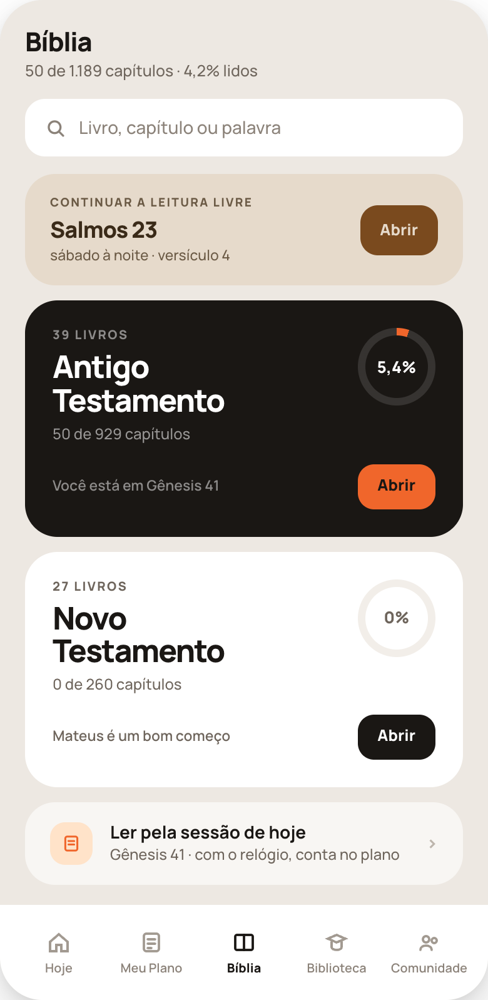

Ordem da rolagem:

1. **Cabeçalho** — "Bíblia" (21px/800) + a linha de progresso total (`50 de 1.189 capítulos · 4,2% lidos`).
2. **Busca** — campo branco de 46px, raio 16, com lupa e o placeholder "Livro, capítulo ou palavra". Abre 39k.
3. **Continuar a leitura livre** (areia) — rótulo, o capítulo em 18px/800, a linha "sábado à noite · versículo 4" e o botão marrom **Abrir** → 39d exatamente onde parou. Some se a pessoa nunca leu livremente.
4. **Antigo Testamento** (bloco escuro) — "39 livros", o nome em duas linhas 25px/800, "50 de 929 capítulos" e o **anel de progresso** (conic-gradient laranja sobre `rgba(255,255,255,.12)`, furo de 50px com a porcentagem). Rodapé do cartão: "Você está em Gênesis 41" + botão laranja **Abrir** → 39b.
5. **Novo Testamento** (cartão branco) — mesma estrutura, anel em `#F2EEE9`, a linha vira uma sugestão ("Mateus é um bom começo") e o botão é preto.
6. **Ler pela sessão de hoje** (translúcido) — ícone em `#FFE3C9`, o trecho do dia e "com o relógio, conta no plano" → 35f. **É a última coisa da tela de propósito:** é a única porta desta aba que mexe no plano.
7. **Barra de abas** fixa no rodapé, com Bíblia ativa.

**O escuro é só onde a pessoa está.** Os dois testamentos têm o mesmo peso hierárquico; se ela estiver no Novo, os cartões trocam de cor.

---

## 39b — Lista de livros do testamento

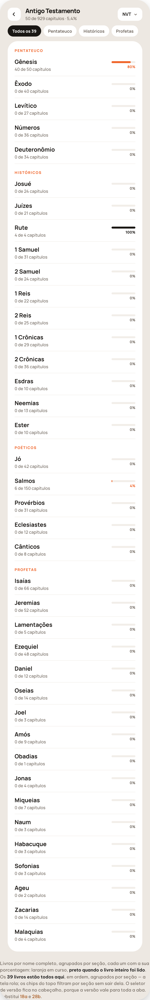

- **Cabeçalho** — voltar, "Antigo Testamento" + a contagem, e o **seletor de versão** ("NVT" com chevron): a versão vale para toda a aba, por isso mora no cabeçalho.
- **Chips de seção** — Pentateuco, Históricos, Poéticos, Profetas maiores, Profetas menores. Filtram **sem sair da tela** (rolam até a seção); o ativo é preto.
- **Seções** com o rótulo em maiúsculas e, dentro, uma linha por livro: **nome completo** (15px/700), "N de M capítulos" e, à direita, uma **barra de 62px** + a porcentagem.
  - livro em curso → barra laranja `#F0662B`
  - **livro inteiro lido** → barra preta `#1A1714`
  - não começado → trilha `#F2EEE9` e porcentagem `#6E655C`
- **Os 39 livros estão todos na tela**, em ordem canônica. A tela rola; nada de paginação nem de "ver mais".
- Toque num livro → 39c.

---

## 39c — O livro: grade de capítulos e marcação livre

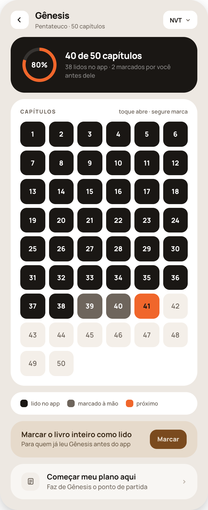

1. **Cabeçalho** — voltar, o livro (17px/800) + "Pentateuco · 50 capítulos", e o seletor de versão.
2. **Bloco escuro de progresso** — anel de 64px com a porcentagem, "40 de 50 capítulos" e a linha que **separa as duas origens**: "38 lidos no app · 2 marcados por você antes dele".
3. **A grade** (cartão branco) — rótulo "Capítulos" e, à direita, a instrução em uma linha: **"toque abre · segure marca"**. Grade de **6 colunas**, células `aspect-ratio:1`, raio 12, gap 7. Estados:
   - **lido no app** — fundo `#1A1714`, número branco 13px/800
   - **marcado à mão** — fundo `#6E655C`, número branco 13px/800
   - **próximo do plano** — fundo `#F0662B`, número `#1A1714`
   - **não lido** — fundo `#F4EFE9`, número `#6E655C` 13px/600
4. **Legenda** (cartão branco baixo) — três quadradinhos de 14px com os rótulos "lido no app", "marcado à mão", "próximo". Sem legenda a grade é adivinhação; ela não é opcional.
5. **Marcar o livro inteiro como lido** (areia) — "Para quem já leu Gênesis antes do app" + botão marrom **Marcar**. Marca todos os capítulos como marcados à mão (cinza escuro), não como lidos no app.
6. **Começar meu plano aqui** (translúcido) — "Faz de Gênesis o ponto de partida" → 35i.

### Comportamento da marcação

- **Toque** abre o capítulo (39d). **Segurar** (~450ms, com haptic) marca/desmarca como lido, sem abrir e sem diálogo.
- Marcado à mão e lido no app são **duas origens distintas** no banco: contam igual na porcentagem, mas aparecem separadas no bloco de progresso e com cores diferentes na grade.
- Segurar de novo desmarca. Nenhuma marcação exige confirmação; nenhuma é definitiva.
- Marcação manual **não mexe no plano** nem consome sessão. O capítulo "próximo do plano" continua sendo definido por Meu Plano.

---

## 39d — Leitura livre do capítulo

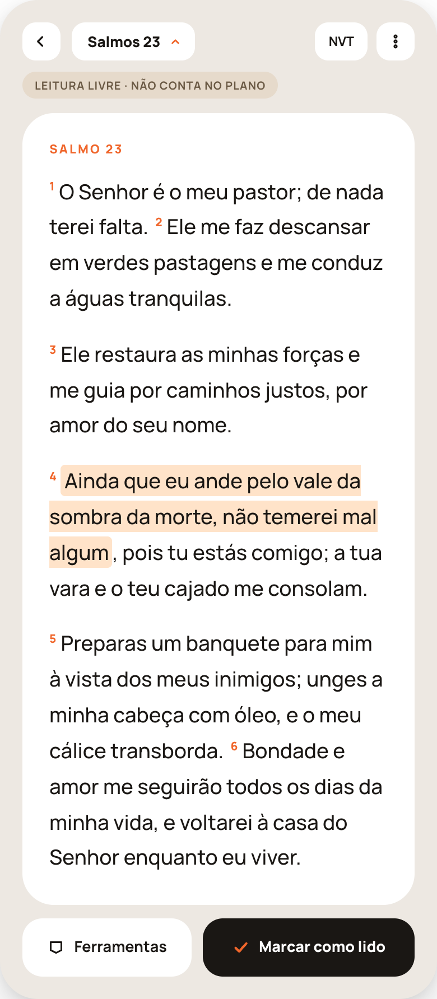

Mesma tipografia da leitura do plano (35f) — corpo 18,5px/1.72, números de versículo em 10,5px/800 laranja sobrescritos — com três diferenças que definem a tela:

- **Sem cronômetro** e **sem "Concluir"**: aqui não há sessão para fechar.
- **Tarja areia** logo abaixo do cabeçalho: "Leitura livre · não conta no plano" (pílula, 10px/700 uppercase, `#6B5A45` sobre `#E6DACB`).
- **Rodapé com duas ações:** "Ferramentas" (branco) e **"Marcar como lido"** (preto, com check laranja) — o capítulo entra no mapa, não no plano.

Cabeçalho: voltar · **seletor de capítulo** (o nome do capítulo com chevron laranja, para saltar sem voltar à grade) · seletor de versão · menu de três pontos.

Marcação de texto existente aparece com fundo `#FFE3C9` e raio 4. **Segurar um versículo** abre 39e.

---

## 39e — Versículo selecionado

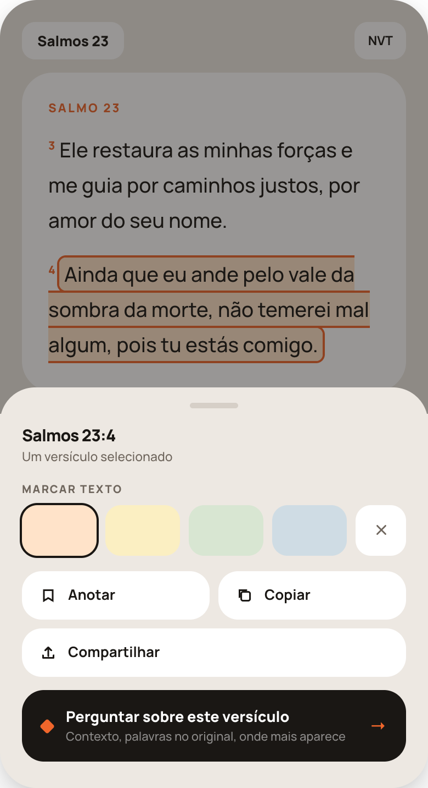

**Folha** sobre a leitura: o capítulo continua visível em cima, escurecido por `rgba(26,23,20,.45)`, e o versículo em foco fica com o realce `#FFE3C9` mais um contorno laranja de 2px. A folha tem raio 32 no topo, alça de 44×5px `#D6CFC7`, e cobre a metade de baixo.

1. **Título** — a referência (15px/800) e "Um versículo selecionado". Com mais de um versículo, vira "Três versículos selecionados".
2. **Marcar texto** — rótulo em maiúsculas e **quatro retângulos de cor, sem rótulo nenhum**: `#FFE3C9`, `#FBEFC2`, `#D8E6D2`, `#CFDCE4` (46px de altura, raio 14, largura em `flex:1`). A cor escolhida ganha **contorno preto de 2px**. No fim da fileira, um quadrado branco de 46px com um "x" `#6E655C` que **remove** a marcação. As cores não têm nome, não têm significado atribuído pelo app, e nunca ganham legenda: quem marca sabe por quê.
3. **Ações** — grade de duas colunas: **Anotar** e **Copiar**; **Compartilhar** ocupa a linha inteira abaixo. Cartões brancos de raio 18 com ícone + rótulo 13px/700.
4. **Perguntar sobre este versículo** — bloco escuro, com losango laranja, a linha "Contexto, palavras no original, onde mais aparece" e a seta laranja. **É o único item colorido da folha.**

Vale igual na leitura do plano (35f) e na livre (39d).

---

## 39f — Anotar

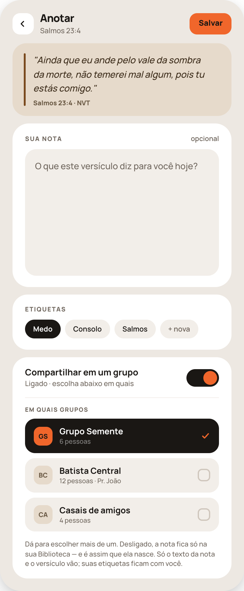

1. **Cabeçalho** — voltar, "Anotar" + a referência, e o botão laranja **Salvar**.
2. **O versículo** (areia, filete `#7A4A1E` à esquerda) — texto em itálico + "Salmos 23:4 · NVT". A pessoa não precisa lembrar do que estava lendo.
3. **Sua nota** (cartão branco) — rótulo com **"opcional"** à direita e um campo de `min-height:170px` (fundo `#F2EEE9`, raio 18) com o placeholder "O que este versículo diz para você hoje?". **Nota vazia também salva** — a marcação já é uma nota em si.
4. **Etiquetas** — chips; a ativa em preto, as demais em `#F2EEE9`, e um chip "+ nova". Servem para a Biblioteca agrupar depois.
5. **Compartilhar em um grupo** — interruptor, **desligado por padrão** (é assim que a nota nasce). Ligado, aparece a lista **"Em quais grupos"**: uma linha por grupo de que a pessoa participa, com avatar de iniciais, nome, "N pessoas" e caixa de seleção — **seleção múltipla**, o escolhido fica preto com check laranja. A linha final avisa: "Desligado, a nota fica só na sua Biblioteca… Só o texto da nota e o versículo vão; suas etiquetas ficam com você."

---

## 39g — Copiar

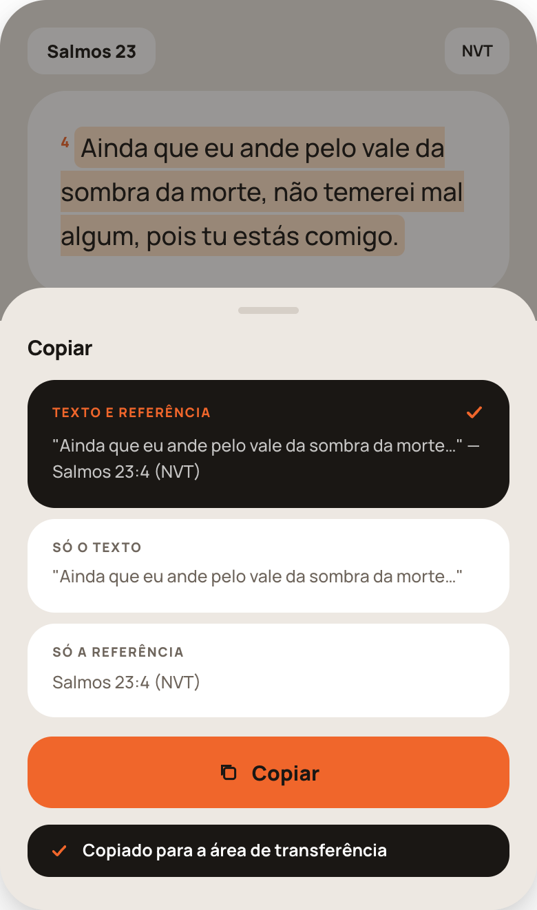

Folha sobre a leitura, como 39e. Copiar não é um toque cego: a folha mostra **exatamente o que vai ser colado**.

- **Três formatos**, cada um com o rótulo e uma **pré-visualização real do texto**:
  - **Texto e referência** (selecionado; bloco escuro com check laranja) — `"Ainda que eu ande…" — Salmos 23:4 (NVT)`
  - **Só o texto** — sem referência
  - **Só a referência** — `Salmos 23:4 (NVT)`
- **A versão vai sempre junto** quando a referência entra.
- Botão laranja **Copiar** e, embaixo, a **confirmação** em tarja preta com check: "Copiado para a área de transferência" — some sozinha em ~3 segundos.
- O último formato usado fica selecionado na próxima vez.

---

## 39i — Compartilhar como imagem

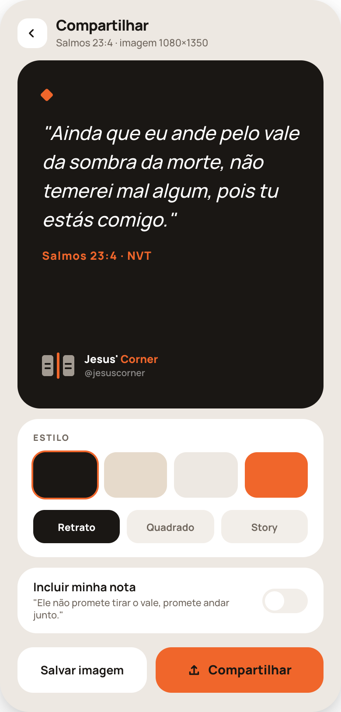

Mesma lógica do resumo do dia (37c/37d): **o que se vê é a imagem, em escala** — não um painel que depois vira imagem.

1. **Cabeçalho** — voltar, "Compartilhar" + "Salmos 23:4 · imagem 1080×1350".
2. **O cartão** (fundo `#1A1714`, `min-height:330px`) — losango laranja no topo, o versículo em **itálico 22px/1.5** branco, a referência em 13px/800 laranja e, no rodapé, a **assinatura**: o símbolo do app como ele é (páginas `#A29A91` com duas linhas `#1A1714`, lombada `#F0662B`), "Jesus' Corner" (Corner em laranja) e **@jesuscorner**.
3. **Estilo** — quatro amostras de 52px da paleta (`#1A1714`, `#E6DACB`, `#EDE8E2`, `#F0662B`); a ativa com anel laranja. Abaixo, três formatos: **Retrato** (1080×1350), **Quadrado** (1080×1080), **Story** (1080×1920).
4. **Incluir minha nota** — interruptor com a prévia da nota que ela escreveu no versículo. Desligado por padrão.
5. **Rodapé** — "Salvar imagem" (branco) e **Compartilhar** (laranja, com ícone).

Exportação: PNG 2x, sem nenhum elemento de interface do app. A assinatura entra em **todos** os estilos e formatos; nos formatos verticais, deixe livre de informação a faixa de ~9% na base.

---

## 39j — Perguntar sobre o versículo

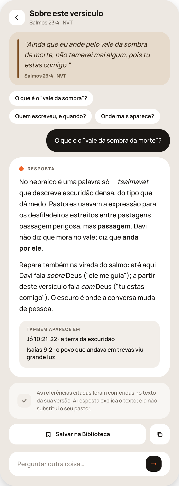

A IA mora **dentro da leitura**, nunca numa aba própria.

1. **Cabeçalho** — voltar, "Sobre este versículo" + a referência e a versão.
2. **O versículo** em areia, igual a 39f.
3. **Três perguntas prontas** em chips brancos — para quem não sabe o que perguntar ("O que é o 'vale da sombra'?", "Quem escreveu, e quando?", "Onde mais aparece?"). São geradas a partir do versículo.
4. **A pergunta da pessoa** — bloco escuro alinhado à direita, `max-width:300px`.
5. **A resposta** (cartão branco) — rótulo "Resposta" com losango, dois ou três parágrafos em 14,5px/1.65, e as **referências cruzadas num bloco separado** `#F2EEE9` ("Também aparece em"), uma por linha com o livro, o capítulo e uma frase curta. Separar as referências do corpo é o que torna a resposta consultável.
6. **Linha de conferência** — "As referências citadas foram conferidas no texto da sua versão. A resposta explica o texto; ela não substitui o seu pastor." Essa segunda frase é obrigatória e não se reescreve.
7. **Ações** — "Salvar na Biblioteca" e copiar.
8. **Rodapé fixo** — campo "Perguntar outra coisa…" com o botão preto de enviar. A conversa continua na mesma tela.

---

## 39k — Resultados da busca

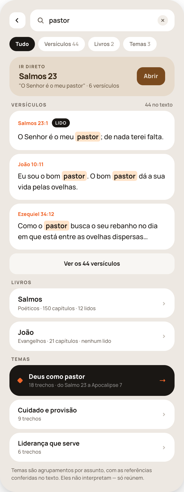

Uma tela, três tipos de resposta na mesma rolagem, na ordem em que resolvem a pergunta.

1. **Cabeçalho** — voltar + o campo com o termo digitado (600/14px, tinta cheia) e um "x" de 22px que limpa sem sair da tela.
2. **Chips de tipo** — Tudo · Versículos · Livros · Temas, cada um com **a contagem** ao lado do rótulo, na mesma tinta informativa `#6E655C`. O ativo é preto. Isolam um tipo; não navegam para outra tela.
3. **Ir direto** (areia) — aparece **só quando a busca parece uma referência** ("sl 23", "joão 3:16") ou o começo de um capítulo conhecido: o capítulo em 17px/800, a primeira linha entre aspas, a contagem de versículos e o botão marrom **Abrir** → 39d. Quando não há palpite claro, o bloco não existe.
4. **Versículos** — rótulo com "N no texto" à direita e **três cartões brancos**: a referência em 11px/800 laranja, o selo preto **LIDO** quando o capítulo já foi lido, e o versículo em 14,5px/1.6 com **o termo em `#FFE3C9` e negrito** (todas as ocorrências). Fecha com "Ver os N versículos" (translúcido), que aplica o chip Versículos.
5. **Livros** — cujos nomes batem com o termo: nome em 14,5px/700, "Seção · N capítulos · N lidos" e chevron → 39c.
6. **Temas** — o **único bloco escuro** da tela, porque é o que a busca por palavra não entrega: o tema em 13,5px/800, "18 trechos · do Salmo 23 a Apocalipse 7" e seta laranja; os temas seguintes em cartões brancos. Fecha com a linha "Temas são agrupamentos por assunto, com as referências conferidas no texto. Eles não interpretam — só reúnem."

### O que precisa ser escrito

- **Índice de busca no texto** da versão do usuário, sem acento e sem caixa, com o destaque de **todas** as ocorrências no trecho.
- **Palpite de referência** — reconhecer abreviações e formas comuns ("sl 23", "salmo 23", "jo 3.16") e alimentar "Ir direto".
- **Nome de livro** — busca por nome completo e apelidos usuais.
- **Temas** — agrupamentos por assunto com as referências **conferidas no texto** antes de aparecer. Tema é reunião de trechos, nunca comentário: não escreva interpretação nos cartões.
- **Ordenação dos versículos** — canônica; se a pessoa já leu o capítulo, ele sobe (é mais provável que ela esteja procurando o que já viu).
- **Estado vazio** — quando nada bate: o termo, uma linha explicando que a busca é no texto da versão atual, e a sugestão de tentar por tema. Não desenhei essa variante; siga a mesma casca e me mostre antes de finalizar.

## 39l — Um tema

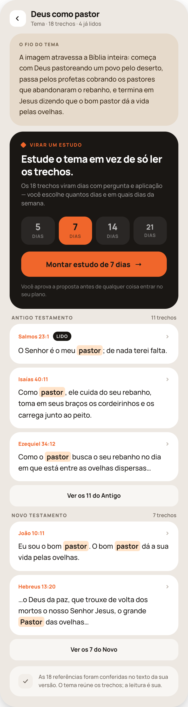

Abre de um tema em 39k. Ordem pensada para a tela não virar lista morta:

1. **Cabeçalho** — voltar, o nome do tema (17px/800) e "Tema · 18 trechos · 4 já lidos".
2. **O fio do tema** (areia) — três a quatro linhas dizendo **de onde a imagem vem e onde ela chega** na Bíblia. É o que dá sentido à lista; sem isso o tema é só um filtro.
3. **Virar um estudo** — o **único bloco escuro** da tela: rótulo com losango, a chamada em 21px/800, a linha explicando que os trechos viram dias com pergunta e aplicação, **quatro opções de duração** (5 / 7 / 14 / 21 dias, a ativa em laranja com o número em `#1A1714`), o botão laranja **"Montar estudo de N dias"** e, abaixo, a linha "Você aprova a proposta antes de qualquer coisa entrar no seu plano."
4. **Trechos, separados por testamento** — rótulo da seção com a contagem à direita; cada trecho num cartão branco com a referência em 11px/800 laranja, o selo preto **LIDO** quando o capítulo já foi lido, o chevron à direita e o versículo em 14,5px/1.6 com **o termo do tema destacado** em `#FFE3C9` e negrito. Cada seção fecha com "Ver os N do Antigo" / "Ver os N do Novo", que **expande na própria tela**.
5. **Linha de conferência** — "As N referências foram conferidas no texto da sua versão. O tema reúne os trechos; a leitura é sua."

### Comportamento

- **Tocar num trecho** abre 39d no capítulo, **rolado até o versículo** e com ele em foco (mesmo realce de 39e, sem abrir a folha).
- **"Montar estudo de N dias"** chama o mesmo gerador de 35d e leva à **proposta de 35e** — dia a dia, com trecho, pergunta e aplicação. Nada entra no plano antes de a pessoa aprovar; ao aprovar, o estudo entra como qualquer outro (35h) e o plano passa ao estado de estudo ativo (35b).
- A duração escolhida **distribui os trechos do tema** pelos dias: com menos dias, agrupa trechos próximos; com mais, abre espaço para os de contexto. Nunca corte um trecho do tema fora da proposta sem dizer.
- O tema **não interpreta**: o "fio" descreve o percurso do assunto no texto, não tira conclusão doutrinária. Referências conferidas antes de aparecer, como em toda saída de IA.

## Regras que valem para a aba inteira

1. **Leitura livre não mexe no plano.** Nenhuma ação desta aba consome sessão, adianta ou atrasa o plano — exceto "Ler pela sessão de hoje", em 39a, que sai da aba.
2. **Marcar sem abrir é requisito.** Segurar o número marca; "Marcar o livro inteiro" marca de uma vez. As duas origens (lido no app / marcado à mão) são registradas separadamente e mostradas com cores diferentes.
3. **A versão é global da aba** e se troca pelo cabeçalho de 39b/39c/39d. (Hoje o app tem uma versão só; o seletor já existe na interface, e comparar versões volta como tela quando houver a segunda.)
4. **Marcação de texto tem quatro cores, sem nome.** O app não atribui significado a cor nenhuma, nem exibe legenda.
5. **Nada é publicado sem toque explícito.** Notas nascem privadas; a publicação em grupo é escolha por grupo.
6. **Toda referência gerada por IA é conferida** contra o texto da versão do usuário antes de aparecer. Trecho que não bate não entra.

## Checklist de revisão

- [ ] 39a: os dois testamentos com o mesmo peso, escuro só onde a pessoa está
- [ ] 39a: "Ler pela sessão de hoje" é o último bloco e a única porta que conta no plano
- [ ] 39a: barra de abas fixa; nas outras telas, não
- [ ] 39b: os 39 livros na tela, por nome completo, agrupados por seção; chips filtram sem sair
- [ ] 39b: barra preta quando o livro inteiro foi lido
- [ ] 39c: grade de 6 colunas com os quatro estados e a legenda embaixo
- [ ] 39c: segurar marca sem abrir; segurar de novo desmarca; sem diálogo
- [ ] 39c: bloco de progresso separando "lidos no app" de "marcados por você"
- [ ] 39c: "Marcar o livro inteiro" marca como manual, não como lido no app
- [ ] 39d: sem cronômetro, sem "Concluir", com a tarja "não conta no plano"
- [ ] 39d: seletor de capítulo no cabeçalho
- [ ] 39e: quatro cores sem rótulo, contorno preto na escolhida, "x" remove
- [ ] 39e: "Perguntar" é o único item colorido da folha
- [ ] 39f: nota vazia salva; interruptor de grupo desligado por padrão e com seleção múltipla
- [ ] 39g: os três formatos com pré-visualização do texto real e a versão junto da referência
- [ ] 39i: assinatura com o símbolo do app em todos os estilos e formatos
- [ ] 39j: referências cruzadas em bloco separado + linha de conferência com a frase do pastor
- [ ] 39k: os três tipos na mesma rolagem, chips com contagem, "Ir direto" só quando há palpite
- [ ] 39k: todas as ocorrências do termo destacadas; temas no único bloco escuro
- [ ] 39l: fio do tema antes da lista; "virar estudo" no único bloco escuro; trechos por testamento
- [ ] 39l: trecho abre 39d rolado até o versículo; estudo passa por 35e antes de entrar no plano
