# Aba Bíblia — pacote de implementação (turno 39)

A aba **Bíblia** inteira: raiz, lista de livros, grade de capítulos com marcação livre, leitura livre do capítulo e tudo o que se faz com um versículo selecionado.

```
handoff-biblia-39/
├── README.md                      ← você está aqui
├── PROMPT-CODE.md                 ← cole isto no Claude Code
├── HANDOFF-39-biblia.md           ← especificação tela por tela + regras
├── 39a-biblia-raiz.png            ← raiz da aba
├── 39b-livros.png                 ← lista de livros do testamento
├── 39c-grade-capitulos.png        ← o livro: grade de capítulos e marcação livre
├── 39d-leitura-livre.png          ← leitura livre do capítulo (sem relógio)
├── 39e-versiculo-acoes.png        ← versículo selecionado: marcar texto e ações
├── 39f-anotar.png                 ← anotar o versículo
├── 39g-copiar.png                 ← copiar (três formatos)
├── 39i-compartilhar.png           ← compartilhar como imagem
├── 39j-perguntar.png              ← perguntar sobre o versículo
├── 39k-busca.png                  ← resultados da busca
└── 39l-tema.png                   ← um tema: trechos e estudo
```

Não existe `39h`: era a tela de comparar versões, retirada porque o app tem uma versão só por enquanto. Os ids seguem a numeração do design — não renumere.

## A regra número 1

**Os quadros são a verdade.** Cada PNG é uma tela real em 390px de largura: mesma ordem de blocos, mesmos raios, mesmas cores, mesmos pesos e tamanhos de fonte, mesmo texto de interface. Não é referência de estilo — é o layout a construir.

**Os valores não são a verdade.** "Gênesis", "Salmos 23:4", "50 de 1.189 capítulos", "4,2% lidos", "80%", "38 lidos no app · 2 marcados por você", os nomes de grupos e as notas escritas são exemplos de uma conta. Cada usuário terá os seus. O que precisa ser fiel é o quadro, o layout, os estados e os links entre as telas.

**Falta código.** Marcação manual de capítulo e de livro inteiro, marcação de texto em quatro cores, notas com etiquetas e publicação em grupos escolhidos, copiar em três formatos, exportar imagem em três proporções, a IA por versículo com checagem de referências e o índice de busca com os agrupamentos por tema — nada disso existe pronto. O HANDOFF descreve o comportamento esperado; escreva o que falta, não simule.

## Telas altas = uma tela com rolagem

Todos os quadros são mais altos que um celular — **nenhum deles são duas telas**. O cabeçalho rola com o conteúdo, o botão primário do rodapé é fixo, e a barra de abas é fixa apenas em **39a** (a raiz; as outras são telas empilhadas dentro dela).

**39b tem 2.599px** de altura em 390 de largura: é a lista com os 39 livros do Antigo Testamento, toda de uma vez. É uma tela só, rolando.

**39e** e **39g** não são telas cheias: são **folhas** que sobem sobre a leitura, com o capítulo escurecido atrás e visível na parte de cima.

## As telas, em ordem de fluxo

### 39a — Raiz da aba
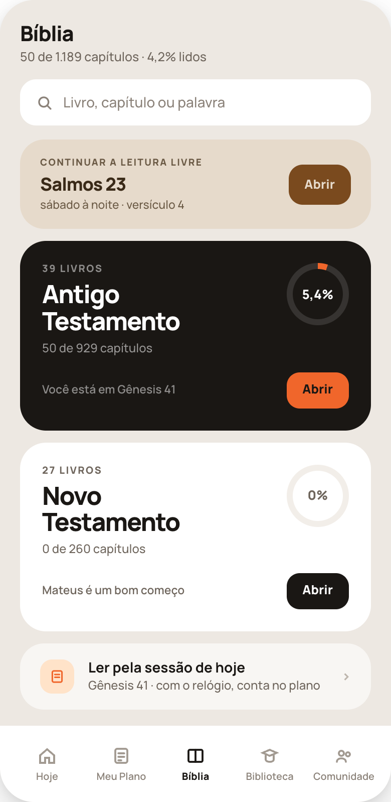

### 39b — Lista de livros do testamento
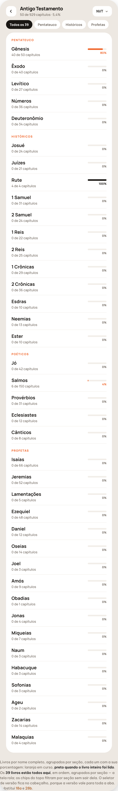

### 39c — O livro: grade de capítulos e marcação livre
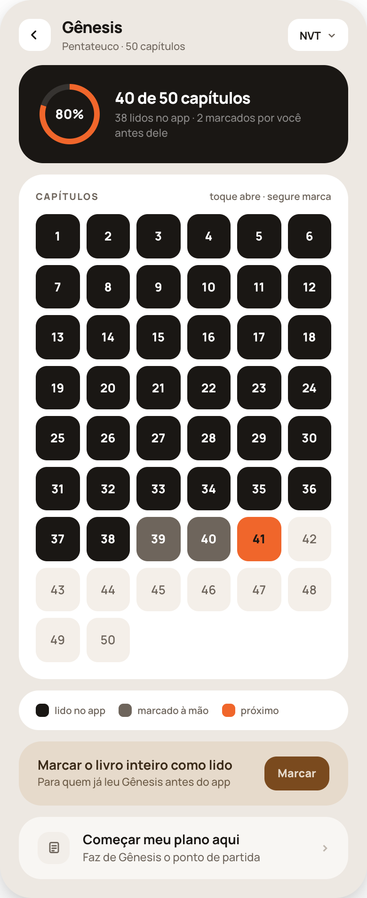

### 39d — Leitura livre do capítulo (sem relógio)
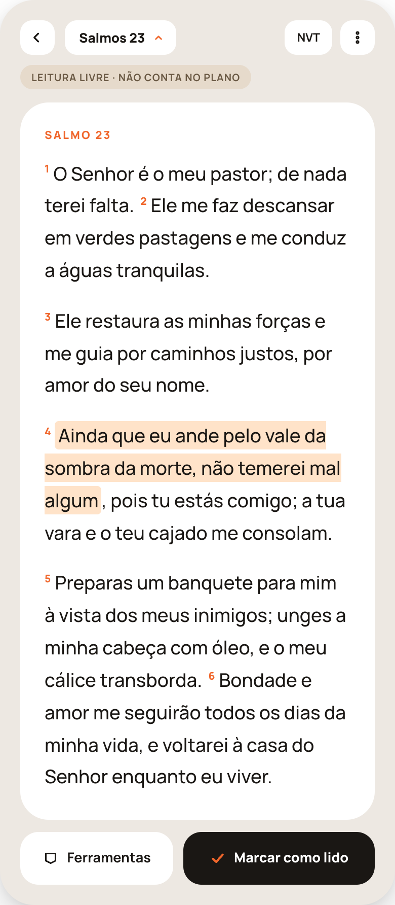

### 39e — Versículo selecionado: marcar texto e ações
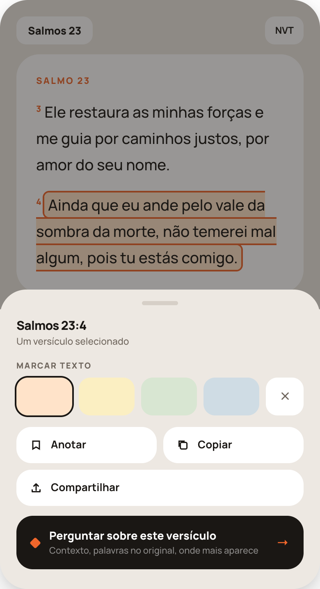

### 39f — Anotar
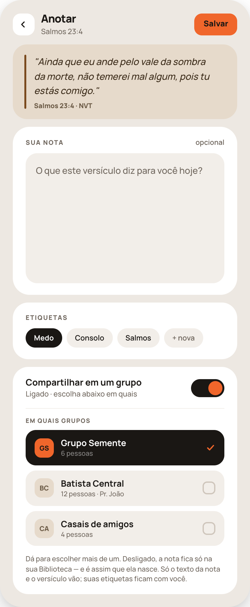

### 39g — Copiar
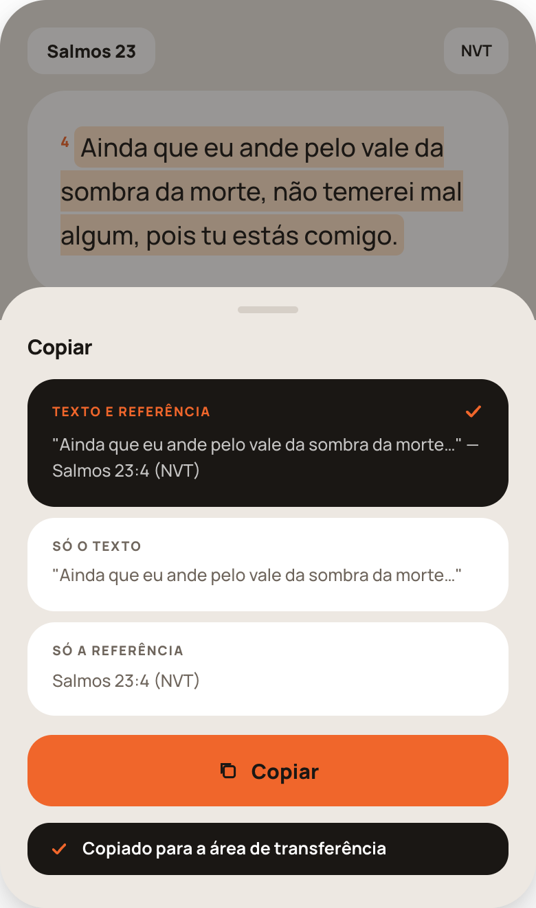

### 39i — Compartilhar como imagem
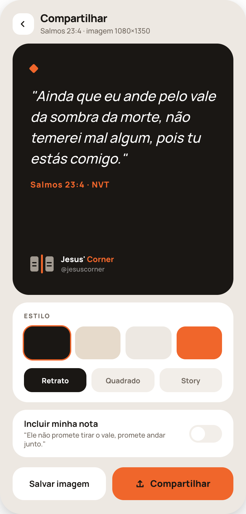

### 39j — Perguntar sobre o versículo
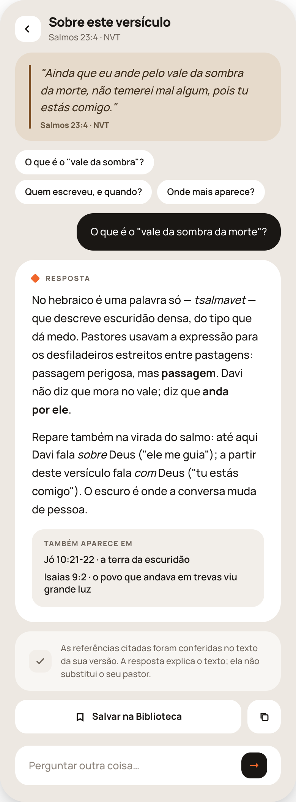

### 39k — Resultados da busca
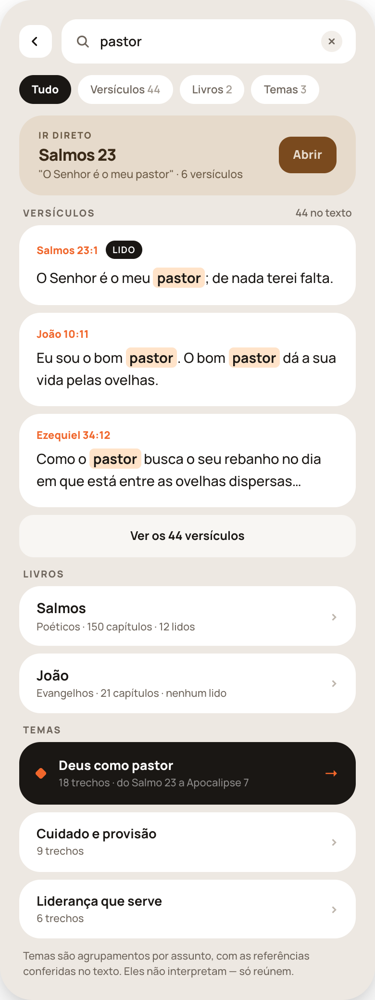

### 39l — Um tema: os trechos e o estudo que sai deles
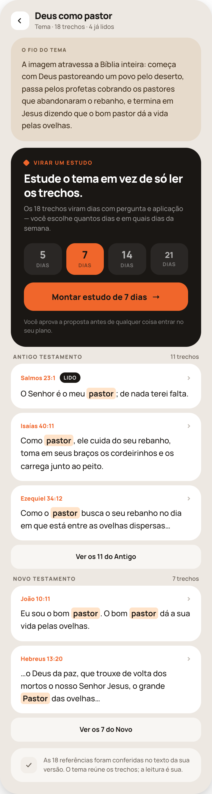

## Mapa de navegação

```
39a  Bíblia (raiz · barra de abas fixa)
│
├── busca ─────────────────────────────► 39k (resultados)
├── "Continuar a leitura livre" ───────► 39d no capítulo e versículo onde parou
├── Antigo Testamento → "Abrir" ───────► 39b (39 livros)
├── Novo Testamento → "Abrir" ─────────► 39b (27 livros)
└── "Ler pela sessão de hoje" ─────────► 35f (leitura do plano, com relógio)
      única porta desta aba que conta no plano

39b  Lista de livros
├── chips de seção filtram sem sair da tela
├── seletor de versão no cabeçalho (vale para toda a aba)
└── toque num livro ───────────────────► 39c

39c  O livro
├── toque num capítulo ────────────────► 39d
├── SEGURAR um capítulo ───────────────► marca como lido sem abrir (fica cinza escuro)
├── "Marcar o livro inteiro como lido" → marca todos os capítulos à mão
└── "Começar meu plano aqui" ──────────► 35i (organizar a leitura, já com este livro)

39d  Leitura livre (sem relógio, sem "Concluir")
├── seletor de capítulo no cabeçalho
├── SEGURAR um versículo ──────────────► 39e
├── "Ferramentas" ─────────────────────► folha de ferramentas do capítulo
└── "Marcar como lido" ────────────────► entra no mapa, não no plano · volta a 39c

39e  Versículo selecionado (folha)
├── quatro cores de marcação · "x" remove
├── "Anotar" ──────────────────────────► 39f
├── "Copiar" ──────────────────────────► 39g
├── "Compartilhar" ────────────────────► 39i
└── "Perguntar sobre este versículo" ──► 39j

39f  Anotar → "Salvar" volta à leitura (nota vazia também salva)
39g  Copiar → escolhe o formato → confirma e fecha
39i  Compartilhar → "Salvar imagem" ou "Compartilhar" (exporta PNG)
39j  Perguntar → "Salvar na Biblioteca" · campo para perguntar outra coisa

39k  Resultados da busca
├── chips Tudo / Versículos / Livros / Temas isolam um tipo
├── "Ir direto" ───────────────────────► 39d no capítulo
├── um versículo ──────────────────────► 39d no capítulo, rolado até ele
├── "Ver os N versículos" ─────────────► a mesma tela filtrada em Versículos
├── um livro ──────────────────────────► 39c
└── um tema ───────────────────────────► 39l

39l  Um tema
├── "Montar estudo de N dias" ─────────► 35e (proposta) → aprovada, entra no plano
├── um trecho ─────────────────────────► 39d no capítulo, rolado até ele
└── "Ver os N do Antigo/Novo" ─────────► expande a seção na própria tela
```

## Ordem sugerida de implementação

1. **39a / 39b / 39c** — a navegação e o mapa de leitura, incluindo a marcação manual (é onde estão os dados novos).
2. **39d** — a leitura livre (a casca já existe em 35f; aqui é a variante sem relógio).
3. **39e** — a folha do versículo, com as quatro cores de marcação.
4. **39f / 39g** — anotar e copiar.
5. **39i / 39j** — compartilhar como imagem e a IA por versículo.
6. **39k / 39l** — a busca e a tela do tema (dependem do índice do texto e dos agrupamentos por tema; 39l também depende do gerador de estudos que já existe em 35d/35e).

## Os três pontos que mais quebram

1. **Nesta aba a leitura é livre e não mexe no plano.** O único caminho que conta no plano é "Ler pela sessão de hoje", em 39a. Cada tela repete isso discretamente — a tarja areia de 39d existe para isso.
2. **Marcar sem abrir é um requisito, não um atalho.** Muita gente já leu a Bíblia antes do app; o mapa precisa ser honesto. Capítulo lido no app fica preto; marcado à mão, cinza escuro `#6E655C` com número branco — e a legenda embaixo da grade explica.
3. **A IA vive dentro da leitura**, nunca numa aba própria, e toda referência que ela cita é conferida contra o texto antes de aparecer.
