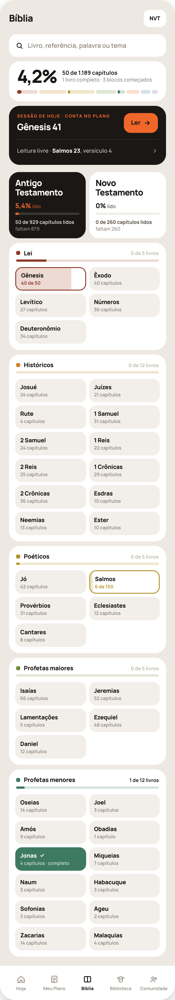
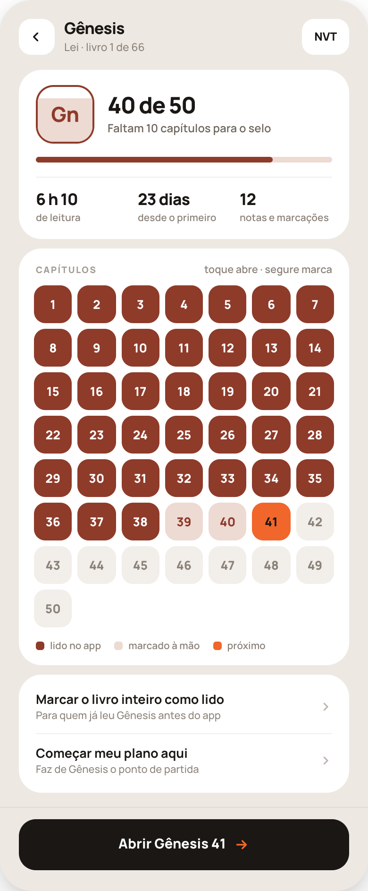
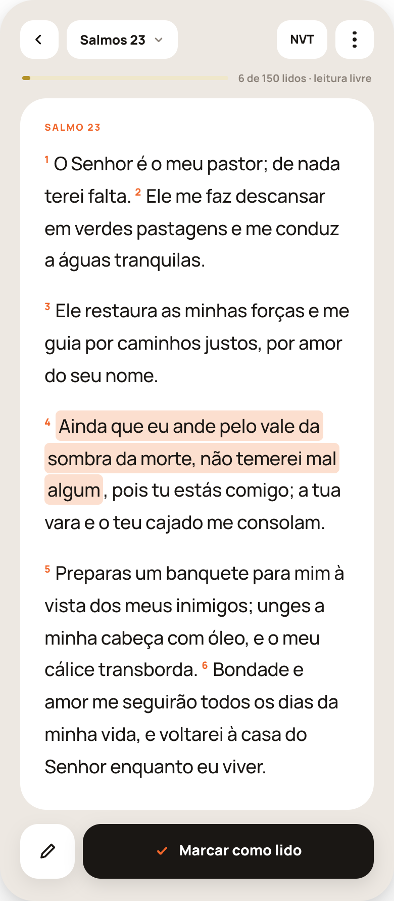
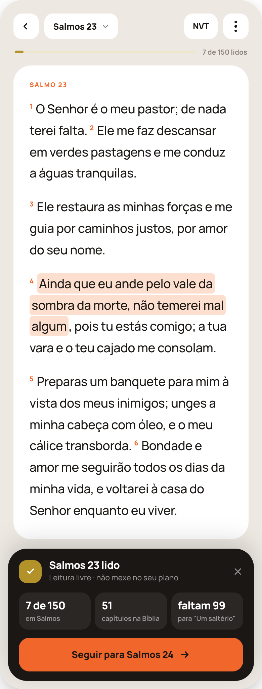
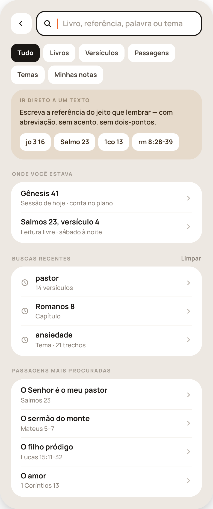
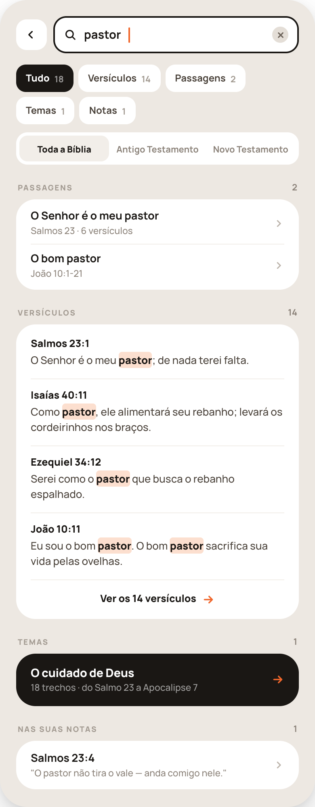
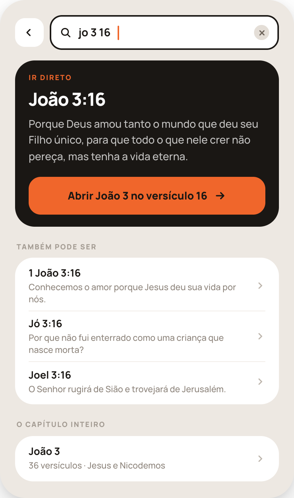

# HANDOFF — Aba Bíblia, redesenhada (B1–B7)

Substitui 39a, 39b, 39c, 39d e 39k. Onde este documento não fala, vale `handoff-biblia-39/HANDOFF-39-biblia.md`.

**Em dúvida de valor (cor, tamanho, espaçamento), vale o arquivo `referencia/Jesus Corner Redesign.dc.html`, turno 52** — as telas estão lá com todos os estilos inline. Se este documento e o arquivo discordarem, pare e pergunte.

## 0. Regras

1. **Leitura livre não mexe no plano.** O único caminho desta aba que conta no plano é "Ler", no cartão preto de B1.
2. **Cada bloco tem uma cor, e é a mesma em todo o app** — roda, estante, selo, pastilha do livro, grade de capítulos, fio de progresso.
3. **Laranja `#F0662B` é só ação e "próximo"**: o botão principal, o capítulo seguinte, o cursor da busca. Progresso usa a cor do bloco.
4. **Sem cobrança:** nenhum vermelho de erro, alerta ou "atrasado". (O marrom-avermelhado da Lei é cor de bloco, não alerta.)
5. **Parabéns de tela cheia continua só para livro completo e conquista** (G8 e G4). Capítulo marcado recebe o cartão pequeno de B4.
6. Texto sobre laranja é `#1A1714`, nunca branco.

## 1. Tokens

Os de `src/index.css`. Neutros: `#EDE8E2` fundo · `#fff` cartão · `#1A1714` preto · `#F2EEE9` areia clara · `#E6DACB` areia · `#E4DED7` · `#D6CFC7`. Texto: `#1A1714` · `#4A423A` · `#6E655C` · `#8B8279` · `#A29A91` · `#BDB5AC` · `#3A2A18`/`#9C8B76` sobre areia. Realce de busca e de marcação: `#FCDFCF`.
Blocos (cor / tom), de `data/blocos-da-biblia.json`: Lei `#8E3B2A`/`#EDDAD3` · Históricos `#D0822A`/`#F3E3CC` · Poéticos `#B3922A`/`#EFE7CB` · Profetas maiores `#6E8A3C`/`#DFE6D2` · Profetas menores `#3E7A62`/`#D2E3DB` · Evangelhos e Atos `#F0662B`/`#FCDFCF` · Cartas de Paulo `#3D6C8E`/`#D5E0E9` · Gerais e Apocalipse `#6A5A8E`/`#E0DBE9`.
Manrope em tudo. Rótulo de seção: 800 9.5px, letter-spacing .13em, maiúsculas, `#A29A91`.

---

## 2. B1 — Bíblia · raiz

Tela com rolagem; barra de abas fixa, "Bíblia" ativa.

1. **Cabeçalho** — `padding:22px 20px 0`, `gap:8px`: **Bíblia** (fixo; 800 21px, -0.7px) · pílula da versão (38px de altura, raio 13, `#fff`, 800 12px) → seletor de versão.
2. **Corpo** — `padding:16px 20px 0`, coluna com `gap:10px`.
3. **Campo de busca** — altura 50, raio 17, `#fff`, `padding:0 15px`, lupa 17px `#1A1714` + **"Livro, referência, palavra ou tema"** (fixo; 600 14px, `#8B8279`). É um botão: tocar abre B5 com o teclado.
4. **Cartão de progresso** — `#fff`, raio 24, `padding:16px 18px 17px`. → Sua Bíblia (G2).
   - Linha (`align-items:flex-end; gap:12px`, margem inferior 14): a porcentagem da Bíblia lida, uma casa e vírgula (**800 40px, line-height .85, -2px**) · ao lado, "{lidos} de 1.189 capítulos" (700 12.5px) e "{n} livro(s) completo(s) · {m} bloco(s) começado(s)" (500 11.5px, `#8B8279`).
   - **Barra dos oito blocos:** `display:flex; gap:3px`; um segmento por bloco, na ordem canônica, com **`flex` = capítulos do bloco**; altura 8, raio 99, fundo no **tom** do bloco; dentro, preenchimento na **cor** do bloco com largura = lidos ÷ capítulos do bloco (mínimo 5px quando lidos > 0).
5. **Cartão "continuar"** — `#1A1714`, raio 24, `padding:16px 18px 6px`. Duas partes:
   - **Sessão de hoje** (`padding-bottom:14px`): rótulo **SESSÃO DE HOJE · CONTA NO PLANO** (fixo; laranja) · "{Livro} {capítulo}" (800 20px, -0.6px, `#fff`, 8px abaixo) · à direita o botão **Ler** (fixo): altura 44, `padding:0 16px`, raio 15, `#F0662B`, texto 800 13.5px `#1A1714` + seta.
   - **Leitura livre**: fio `rgba(255,255,255,.1)`, linha de 50px: "Leitura livre · **{Livro} {capítulo}**, versículo {n}" (600 12.5px, `rgba(255,255,255,.7)`; o trecho em 800 `#fff`) + chevron.
   - Sem sessão hoje (descanso ou plano cumprido): a parte de cima some e a leitura livre ocupa o cartão, com o rótulo **CONTINUAR A LEITURA LIVRE**. Sem leitura livre anterior: só a parte de cima. Sem nenhuma das duas: o cartão não aparece.
6. **Os dois testamentos** — `display:flex; gap:8px; margin-top:6px`. Dois cartões iguais (`flex:1`, raio 22, `padding:14px 14px 13px`). **O selecionado é preto; o outro, branco.** Tocar seleciona e troca a lista abaixo — não navega. A escolha é lembrada; no primeiro uso, vem selecionado o testamento do livro em que a pessoa está.
   - **Nome em duas linhas** — "Antigo / Testamento", "Novo / Testamento" (fixo; **800 19px/1.08, -0.6px**; `#fff` no selecionado, `#1A1714` no outro), margem inferior 12. É o elemento de maior peso do cartão.
   - **Porcentagem**, pequena: "{p}%" (800 15px; `#F0662B` no selecionado, `#1A1714` no outro) + " lido" (600 11px, 70% de opacidade). Margem inferior 8.
   - Barra de 5px, raio 99: trilho `rgba(255,255,255,.14)` (selecionado) ou `#F2EEE9`; preenchimento `#F0662B`, mínimo 6px quando lidos > 0. Margem inferior 9.
   - **"{lidos} de {total} capítulos lidos"** (700 11px; `rgba(255,255,255,.85)` ou `#4A423A`) e, na linha de baixo, **"faltam {n}"** (500 11px; `rgba(255,255,255,.55)` ou `#8B8279`). Antigo: 929 capítulos; Novo: 260. Testamento completo: "faltam {n}" vira "completo".
7. **Os blocos do testamento selecionado** — um cartão por bloco, na ordem canônica. Antigo: Lei, Históricos, Poéticos, Profetas maiores, Profetas menores. Novo: Evangelhos e Atos, Cartas de Paulo, Gerais e Apocalipse.
   - Cartão `#fff`, raio 24, `padding:15px 14px 14px`.
   - Cabeçalho (`gap:8px`, `margin:0 2px 6px`): quadrado 9px raio 3 na cor do bloco · nome (800 13.5px, -0.2px) · "{completos} de {n} livros" (700 11px; `#1A1714` se completos > 0, senão `#BDB5AC`).
   - Barra de 5px no tom do bloco, preenchida na cor (lidos ÷ capítulos do bloco; mínimo 6px), `margin:0 2px 12px`.
   - **Os livros, com o nome por extenso** — grade de **2 colunas**, `gap:7px`, ordem canônica. Cada pastilha: altura mínima 52, raio 15, `padding:9px 11px`, duas linhas com `gap:4px` — o **nome** (800 13px/1.15, -0.2px) e uma linha de apoio (10.5px). Nome nunca é cortado nem abreviado; se precisar, quebra.

| Estado | Fundo | Nome | Linha de apoio |
|---|---|---|---|
| não começado | `#F2EEE9` | `#1A1714` | "{n} capítulos" (600, `#8B8279`) — "1 capítulo" no singular |
| em andamento | `#fff`, **borda 2px na cor do bloco**, e uma faixa no **tom** do bloco da esquerda para a direita, largura = lidos ÷ capítulos | `#1A1714` | "{lidos} de {n}" (700, na cor do bloco) |
| completo | a **cor** do bloco | `#fff`, seguido de um check branco de 12px | "{n} capítulos · completo" (600, `rgba(255,255,255,.75)`) |

   Tocar numa pastilha → B2.

**Estados:** conta nova — "0%", barra só nos tons, todas as pastilhas neutras, cartão preto só com a sessão de hoje. Carregando — esqueleto `#F2EEE9` nos cartões, nunca spinner de tela cheia.

---

## 3. B2 — O livro

Push, sem barra de abas, botão fixo no rodapé.

1. **Cabeçalho** — `padding:20px 20px 0`, `gap:10px`: voltar (38×38, raio 13) · nome do livro (800 17px, -0.5px) com "{Bloco} · livro {posição} de 66" embaixo (500 11.5px, `#8B8279`) · pílula da versão.
2. **Cartão do livro** — `#fff`, raio 24, `padding:16px 18px`:
   - linha (`gap:14px`, margem inferior 14): o **selo** em 62px — o componente `SeloDeLivro` do pacote de gamificação, nos mesmos três estados (em andamento: fundo `#fff`, borda 2px na cor, tom subindo de baixo; sigla 800 22px na cor) · "{lidos} de {n}" (800 24px, -0.9px) e, embaixo, **"Faltam {k} capítulos para o selo"** (600 12px, `#6E655C`). Singular "Falta 1 capítulo para o selo". Completo: "Selo ganho em {d} de {mês}". Zero lidos: "{n} capítulos para o selo".
   - barra de 6px no tom do bloco, preenchida na cor; margem inferior 15;
   - fio `#F2EEE9` e **três números** (`gap:10px`, `padding-top:14px`), cada um com valor (800 17px, -0.5px) e legenda (600 10.5px, `#8B8279`): **tempo de leitura neste livro** ("6 h 10" / "de leitura") · **dias desde o primeiro capítulo** ("23 dias" / "desde o primeiro") · **notas e marcações neste livro** ("12" / "notas e marcações"). Livro não começado: a linha dos três números não aparece.
3. **Cartão dos capítulos** — `#fff`, raio 24, `padding:16px 16px 15px`:
   - topo: **CAPÍTULOS** · "toque abre · segure marca" (fixo; 600 11px, `#8B8279`);
   - grade de **7 colunas**, `gap:6px`; cada casa com 40px de altura, raio 12, número em 800 13px:
     - lido no app: fundo na **cor** do bloco, número `#fff`;
     - marcado à mão: fundo no **tom** do bloco, número na cor do bloco;
     - próximo (o primeiro não lido): fundo `#F0662B`, número `#1A1714`;
     - não lido: fundo `#F2EEE9`, número `#8B8279`;
   - legenda (`flex-wrap`, `gap:8px 14px`, margem superior 14): quadrado de 9px + texto (600 10.5px, `#8B8279`) — **lido no app · marcado à mão · próximo** (fixos). Só aparecem os estados que existem na grade.
   - Toque abre o capítulo (B3); **segurar (~450 ms, com haptic) marca/desmarca**, sem abrir e sem diálogo — a regra de 39c, intacta. A área de toque de cada casa precisa chegar a 44px de altura.
4. **Lista** — `#fff`, raio 24, `padding:6px 18px`, duas linhas de 56px com fio entre elas: **Marcar o livro inteiro como lido** / "Para quem já leu {Livro} antes do app" · **Começar meu plano aqui** / "Faz de {Livro} o ponto de partida". Mesmos destinos e confirmações de 39c. Livro completo: a primeira linha vira "Desmarcar o livro".
5. **Rodapé fixo** — fio superior `rgba(0,0,0,.06)`, `padding:12px 20px 22px`: botão de 54px, raio 18, `#1A1714`, **"Abrir {Livro} {próximo capítulo}"** (800 14.5px, `#fff`) + seta laranja. Livro não começado: "Começar {Livro}". Livro completo: "Ler {Livro} de novo" (abre o capítulo 1).

---

## 4. B3 — Lendo

Sem barra de abas. A tipografia e o comportamento do texto são os de 39d — **não mude fonte, tamanho, entrelinha, número de versículo nem realce**.

1. **Cabeçalho** — `padding:20px 20px 0`, `gap:8px`: voltar · pílula "{Livro} {capítulo}" com seta para baixo (38px, raio 13) → seletor de livro/capítulo · espaço · pílula da versão · botão de três pontos (38×38) → o menu de 39d.
2. **Fio de progresso do livro** — `padding:14px 22px 0`, `gap:10px`: barra de **4px**, raio 99, no tom do bloco, preenchida na cor (capítulos lidos do livro ÷ total; mínimo 6px) · à direita **"{lidos} de {n} lidos · leitura livre"** (700 10.5px, `#8B8279`). O trecho "· leitura livre" substitui a tarja de 39d e só aparece na leitura livre.
3. **O texto** — cartão `#fff`, raio 26, `padding:24px 24px 26px`, a 14px do fio: rótulo do capítulo em laranja ("SALMO 23") e os versículos como em 39d.
4. **Barra inferior fixa** — `padding:14px 20px 22px`, `gap:8px`: botão quadrado de 54px, raio 18, `#fff`, ícone de lápis (abre o que "Ferramentas" abria em 39d; `aria-label="Ferramentas"`) · botão **Marcar como lido** (fixo): `flex:1`, 54px, raio 18, `#1A1714`, check laranja + texto 800 14.5px `#fff`.
   - Capítulo já lido: o botão fica `#fff` com texto `#1A1714` e diz **"Lido · desmarcar"**.

## 5. B4 — Capítulo marcado

Ao tocar "Marcar como lido", **a barra inferior dá lugar a um cartão**; o texto continua atrás, rolável. O fio de progresso já mostra o número novo (e perde o "· leitura livre").

- Cartão: `#1A1714`, raio 28, `padding:16px 16px 14px`, a 12px das bordas laterais e do fundo, sombra `0 -10px 34px rgba(0,0,0,.16)`.
- **Topo** (`gap:11px`, margem inferior 14): quadrado de 34px, raio 12, **na cor do bloco**, com check branco · **"{Livro} {capítulo} lido"** (800 15.5px, `#fff`) e, embaixo, **"Leitura livre · não mexe no seu plano"** (fixo; 500 11.5px, `rgba(255,255,255,.55)`) · X de 16px para fechar (área de toque 44px).
- **Três números** (`gap:6px`, margem inferior 12), cada um num bloco `rgba(255,255,255,.07)`, raio 14, `padding:11px 10px 10px`, com valor (800 16px, `#fff`) e legenda (600 10px, `rgba(255,255,255,.55)`):
  1. **"{lidos} de {n}"** / "em {Livro}";
  2. **"{total lido}"** / "capítulos na Bíblia";
  3. **"faltam {k}"** / "para "{nome da conquista}"" — o próximo degrau da família **Leitura** (`conquistas.json`). Se o livro está a 3 capítulos ou menos de terminar, este terceiro vira **"faltam {k}"** / "para o selo de {Livro}".
- **Botão**: 50px, raio 16, `#F0662B`, **"Seguir para {Livro} {capítulo seguinte}"** (800 14px, `#1A1714`) + seta. No último capítulo do livro não há botão de seguir — ver abaixo.
- **Fecha** pelo X, ou sozinho quando a pessoa rola o texto para cima; ao fechar, volta a barra inferior com "Lido · desmarcar".
- **Se este capítulo completou o livro, um bloco ou subiu um degrau:** B4 **não aparece** — entra a tela de parabéns correspondente (G8 ou G4), pela regra de prioridade do pacote de gamificação.
- **Capítulo marcado por "segurar" na grade (B2):** não mostra B4; a casa só muda de cor.
- **Lendo pela sessão do plano:** esta tela não se aplica — o fecho do passo continua sendo o que já existe.

---

## 6. A busca (B5–B7)

Uma tela só, sem barra de abas, com o teclado aberto ao entrar. O que aparece depende do que está digitado.

**Cabeçalho comum** — `padding:20px 20px 0`, `gap:8px`: voltar · o campo: altura 46, raio 16, `#fff`, **contorno interno de 2px `#1A1714`**, `padding:0 13px`, lupa 16px, o texto digitado (700 14.5px), cursor laranja (2×19px) e, havendo texto, um botão redondo de 20px `#E4DED7` com X para limpar. Vazio: o cursor e o mesmo texto de apoio de B1 em `#A29A91`.
**Corpo** — `padding:14px 20px 0`, coluna com `gap:10px`. Rótulos de grupo com `margin:0 2px`, 2px extras de respiro antes de cada um, e a contagem à direita (700 11px, `#8B8279`).
**Linha de lista** (usada em todos os grupos) — dentro de um cartão `#fff` raio 24 `padding:4px 18px`: altura mínima 52, `padding:8px 0`, título (700 13.5px) + subtítulo (500 11.5px, `#8B8279`) + chevron; fio `#F2EEE9` entre linhas.

**A busca ignora acento, maiúscula e pontuação**, começa a responder a partir de 2 caracteres, com ~250 ms de espera depois da última tecla, e roda **no texto da versão do usuário**.

### 6.1 B5 — ao abrir (campo vazio)

1. **Filtros de tipo** — pastilhas (`flex-wrap`, `gap:6px`), 34px de altura, raio 12, `padding:0 12px`: **Tudo · Livros · Versículos · Passagens · Temas · Minhas notas** (fixos). Ativa: `#1A1714` com texto `#fff` 800 12px; as outras: `#fff` com texto `#4A423A` 700 12px. O filtro escolhido vale para o que for digitado em seguida.
2. **Cartão areia "IR DIRETO A UM TEXTO"** (fixo) — `#E6DACB`, raio 24, `padding:15px 16px 16px`: a frase **"Escreva a referência do jeito que lembrar — com abreviação, sem acento, sem dois-pontos."** (fixo; 600 12.5px, `#3A2A18`) e quatro exemplos em pastilhas brancas de 32px (700 12px): **jo 3 16 · Salmo 23 · 1co 13 · rm 8:28-39** (fixos). Tocar num exemplo preenche o campo.
3. **ONDE VOCÊ ESTAVA** — até duas linhas: a sessão de hoje ("{Livro} {cap}" / "Sessão de hoje · conta no plano") e a última leitura livre ("{Livro} {cap}, versículo {n}" / "Leitura livre · {quando}"). Some o que não existir; some o grupo se nada existir.
4. **BUSCAS RECENTES** — até cinco, da mais nova para a mais antiga, com ícone de relógio à esquerda; subtítulo diz o que era ("14 versículos", "Capítulo", "Tema · 21 trechos"). À direita do rótulo, **Limpar** (fixo). Guardadas só no aparelho. Sem recentes, o grupo não aparece.
5. **PASSAGENS MAIS PROCURADAS** — quatro linhas de uma lista curada de passagens conhecidas, com o nome e a referência. Ver §6.4.

### 6.2 B6 — por palavra ou expressão

1. **Filtros de tipo com contagem** — as mesmas pastilhas, agora só os tipos que têm resultado, cada um com o número ao lado (700 11px; `rgba(255,255,255,.55)` na ativa, `#A29A91` nas outras): "Tudo 18 · Versículos 14 · Passagens 2 · Temas 1 · Notas 1". "Tudo" é a soma.
2. **Filtro de testamento** — segmentado `#fff`, raio 14, `padding:4px`, três opções de 32px, raio 10: **Toda a Bíblia · Antigo Testamento · Novo Testamento** (fixos). Ativa: fundo `#F2EEE9`, 800 11px `#1A1714`; as outras 700 11px `#8B8279`. Recalcula contagens e resultados.
3. **Grupos, nesta ordem**, cada um só se tiver resultado:
   - **LIVROS** — quando o termo bate com nome de livro ("joão" → João, 1 João, 2 João, 3 João): linha com o nome e "{Bloco} · {n} capítulos · {lidos} lidos". → B2.
   - **PASSAGENS** — nome da passagem + referência. → B3 no início do trecho.
   - **VERSÍCULOS** — cartão `#fff` raio 24 `padding:4px 18px 0`; cada resultado com `padding:12px 0`: a referência (800 12.5px) e o texto do versículo (500 13px/1.5, `#4A423A`) com **todas as ocorrências do termo realçadas**: fundo `#FCDFCF`, raio 4, peso 800, `#1A1714`, **sem padding lateral** (para não abrir espaço antes da pontuação). Em "Tudo", os **quatro primeiros**, em ordem canônica; depois uma linha de 48px **"Ver os {n} versículos"** (800 12.5px + seta laranja), que troca para o filtro "Versículos" e lista todos, em páginas de 30.
   - **TEMAS** — o **único bloco escuro** da tela (como em 39k): `#1A1714`, raio 24, `padding:15px 18px`, nome do tema (800 14.5px, `#fff`), "{n} trechos · de {primeiro} a {último}" e seta laranja. → 39l. Havendo mais de um tema, os seguintes vêm em linhas brancas comuns.
   - **NAS SUAS NOTAS** — referência + o começo da nota entre aspas. → B3 no versículo, com a nota aberta. Busca no texto das notas e nas etiquetas; só as notas da própria pessoa.
4. **Nada encontrado** — no lugar dos grupos, um cartão branco: **"Nada com "{termo}" na {versão}."** e, embaixo, "A busca é no texto desta versão. Tente outra palavra, ou procure por tema." com as pastilhas dos filtros ainda visíveis. (Não há captura deste estado; use a mesma casca e me mostre.)

### 6.3 B7 — por referência

Quando o que foi digitado **pode ser lido como referência**, a primeira resposta é o texto.

1. **Cartão "IR DIRETO"** — `#1A1714`, raio 26, `padding:18px 18px 16px`: rótulo **IR DIRETO** (fixo; laranja) · a referência por extenso (800 24px, -0.9px, `#fff`) · o texto do versículo (500 14px/1.55, `rgba(255,255,255,.75)`; num intervalo, os dois primeiros versículos e "…") · botão laranja de 50px, raio 16: **"Abrir {Livro} {cap} no versículo {n}"**. Só capítulo: "Abrir {Livro} {cap}", e o texto mostra o primeiro versículo. Só livro: não há cartão — o livro aparece no grupo LIVROS.
2. **TAMBÉM PODE SER** — as outras leituras possíveis da mesma abreviação, cada uma com a referência e o começo do versículo. Só entram as que **existem** (livro tem aquele capítulo e aquele versículo).
3. **O CAPÍTULO INTEIRO** — "{Livro} {cap}" / "{n} versículos · {título do capítulo, se houver}".
4. Se o mesmo texto também bate como palavra, os grupos de B6 vêm depois.

**O interpretador de referências aceita:** nome completo ou abreviação do livro, com ou sem acento, com ou sem espaço depois do número ("1co", "1 co", "i co", "1 coríntios"); "salmo" e "salmos"; separador de capítulo e versículo com dois-pontos, ponto, vírgula ou espaço ("3:16", "3.16", "3 16"); intervalo de versículos ("8:28-39") e de capítulos ("5-7"). **Ordem das leituras de uma abreviação ambígua:** abreviação exata primeiro, depois prefixo; em empate, o livro mais buscado (tabela fixa: "jo" → João, depois 1 João, Jó, Joel, Jonas — a ordem da captura B7). Referência que não existe ("jo 3 99") não gera cartão.

### 6.4 O que precisa existir para a busca

- **Índice do texto** por versão, normalizado (sem acento, sem caixa), com destaque de todas as ocorrências — o mesmo que 39k já pedia.
- **Tabela de livros** com nome, abreviações aceitas, bloco, capítulos e versículos por capítulo — para o interpretador.
- **Lista de passagens com nome** ("O filho pródigo" → Lucas 15:11-32): conteúdo novo, curado, guardado como dado (nome, palavras alternativas, início e fim). **Se o app não tem essa lista, me avise antes de inventar uma** — eu forneço.
- **Temas**: os agrupamentos que 39k/39l já usam.
- **Notas da pessoa**: busca local/na conta, só as dela.

## 7. O que apagar

Aprovadas B1–B7: a tela 39b inteira; de 39a, os dois cartões grandes de testamento com anel e o cartão "Ler pela sessão de hoje"; de 39c, o bloco preto com anel, o cartão de legenda e o cartão areia "Marcar o livro inteiro"; de 39d, a tarja "LEITURA LIVRE · NÃO CONTA NO PLANO" e o botão largo "Ferramentas"; a tela de resultados 39k. Antes de apagar um componente, confirme que nenhuma outra tela o usa.

## 8. Checklist

- [ ] B1: campo de busca sempre visível; um cartão preto com sessão de hoje + leitura livre.
- [ ] B1: dois testamentos lado a lado, **nome grande em duas linhas, porcentagem pequena**, "N de M capítulos lidos" e "faltam K"; o selecionado é preto e troca a lista sem navegar.
- [ ] B1: livros com **nome por extenso**, 2 colunas, três estados conforme a tabela; nenhuma sigla.
- [ ] 39b não existe mais; nenhum caminho leva a ela.
- [ ] B2: selo do pacote de gamificação; grade de 7 colunas na cor do bloco; toque abre, segurar marca.
- [ ] B3: tipografia do texto idêntica à de 39d; fio de progresso na cor do bloco.
- [ ] B4: aparece só ao marcar pela barra inferior; não aparece quando há tela de parabéns; fecha ao rolar.
- [ ] Busca: ignora acento/caixa/pontuação; referência direta com alternativas; grupos na ordem; filtros de tipo e de testamento com contagens.
- [ ] A mesma cor para o mesmo bloco em todas as telas; laranja só em ação e "próximo".
- [ ] 39e, 39f, 39g, 39i, 39j, 39l e a barra de abas **sem nenhuma mudança**.
- [ ] Nenhum número, nome, data ou texto bíblico hardcoded.
