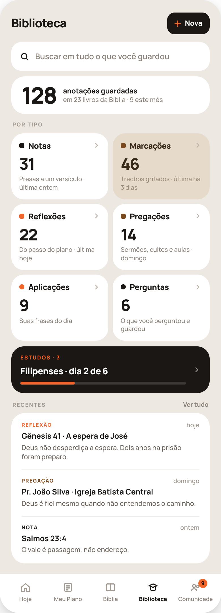
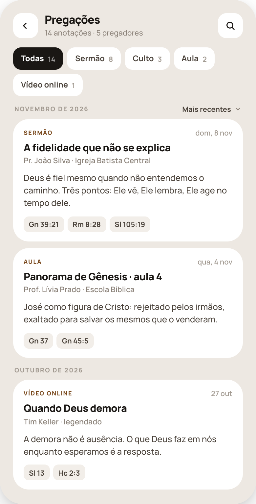
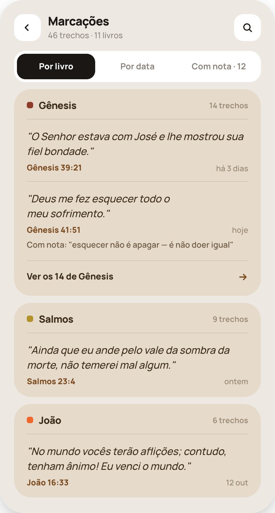
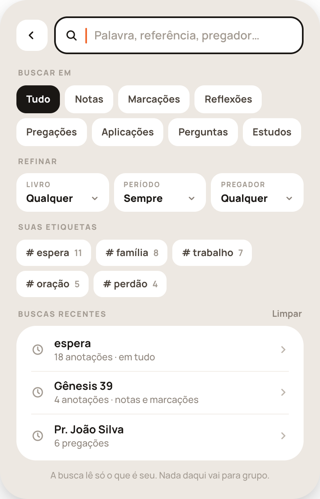
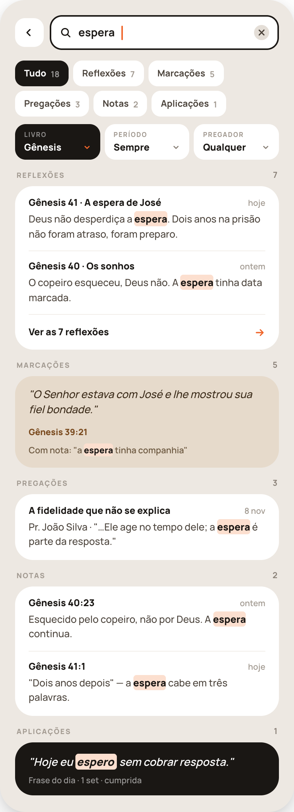
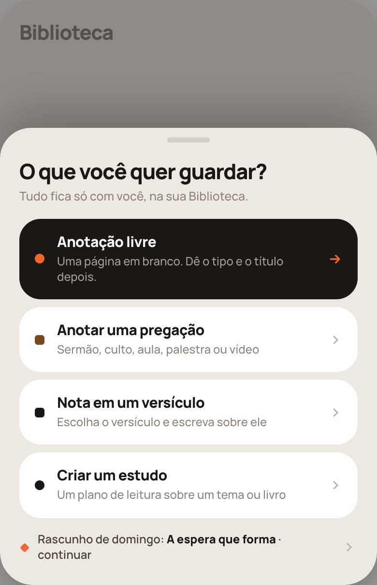
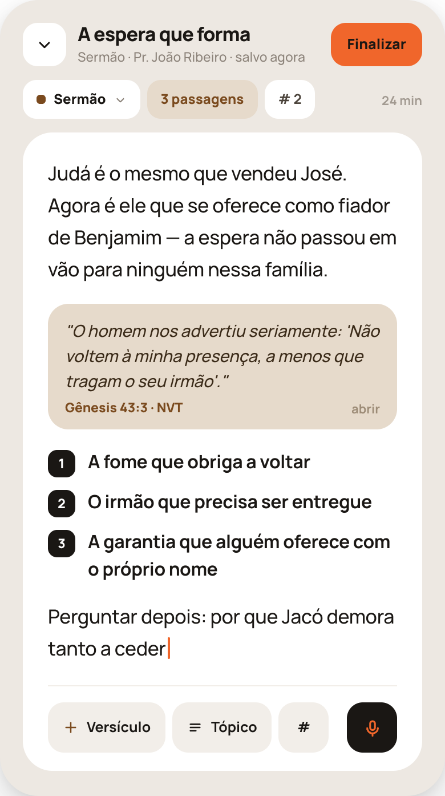
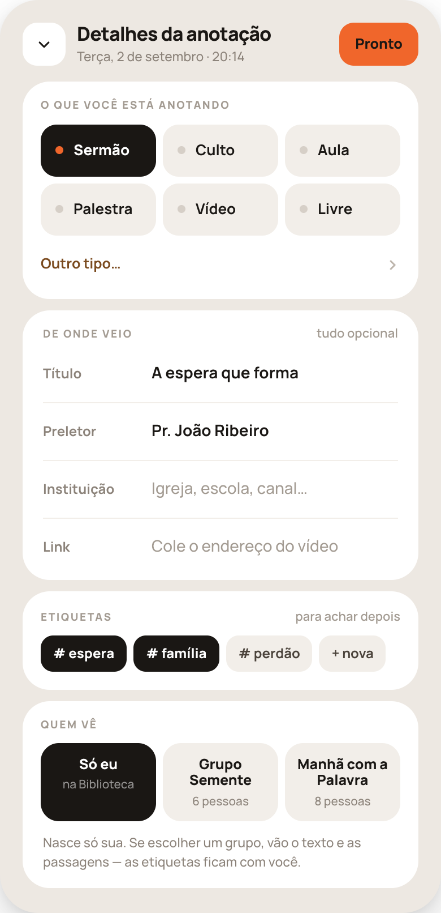
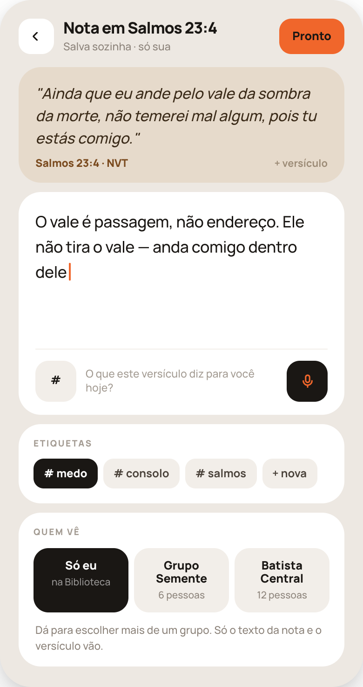
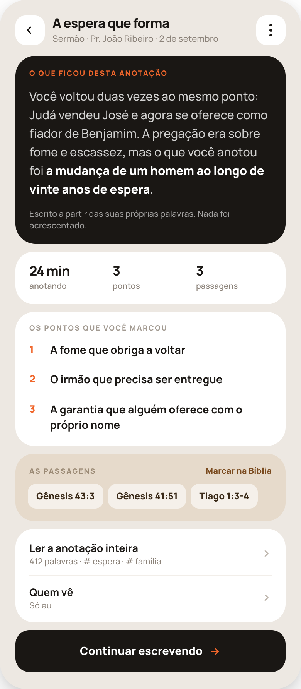

# HANDOFF — Aba Biblioteca (L1–L5) e página de anotação (N1–N5)

Substitui 4c. **Fonte de verdade para valores:** `referencia/Biblioteca 55.dc.html` (L1–L5) e `referencia/Anotar 56.dc.html` (N1–N5). Se este documento e o arquivo discordarem, pare e pergunte.

## 0. Regras

1. **As telas L1–L5 só listam, buscam e abrem.** O que muda na criação está nas telas N1–N5 (§7A) e só nelas.
2. **Só o que é da pessoa.** Nada de grupo, nada de outros usuários. **A oração nunca entra** — nem na lista, nem na contagem, nem na busca.
3. **Cada tipo tem o seu tratamento, e é o mesmo em toda a aba:** Marcações em areia `#E6DACB`; Aplicações em preto `#1A1714`; os demais em branco. Rótulo do tipo: Reflexão em `#F0662B`, Pregação em `#7A4A1E`, Nota em `#1A1714`.
4. **A cor dos blocos da Bíblia aparece só em Marcações por livro** (o quadradinho ao lado do nome do livro).
5. Laranja `#F0662B` é ação, cursor e progresso do estudo. Texto sobre laranja é `#1A1714`.
6. Sem número vaidoso além do total: nada de ranking, meta ou sequência aqui.

## 1. Peças comuns

Tokens de `src/index.css`. Manrope. Fundo `#EDE8E2`; corpo com `padding:14px 20px 0`, coluna, `gap:10px`.
- **Rótulo de grupo** — 800 9.5px, .13em, maiúsculas, `#A29A91`, `margin:4px 2px 0`; à direita, opcional, contagem ou ação (700 11px, `#8B8279`).
- **Pastilha de filtro** — 34px de altura, raio 12, `padding:0 12px`, `gap:6px`. Ativa: `#1A1714`, 800 12px `#fff`, contagem `rgba(255,255,255,.55)`. Inativa: `#fff`, 700 12px `#4A423A`, contagem `#A29A91`. Em fileira com `flex-wrap`, `gap:6px`.
- **Cabeçalho de tela de tipo** — `padding:20px 20px 0`, `gap:10px`: voltar (38×38, raio 13, `#fff`) · nome do tipo (800 17px, -0.5px) com a linha de resumo embaixo (500 11.5px, `#8B8279`) · botão da lupa (38×38).
- **Realce de busca** — fundo `#FCDFCF`, raio 4, peso 800, `#1A1714`, sem padding lateral (em itálico, `padding:1px 4px 1px 2px`).

---

## 2. L1 — Biblioteca · raiz

Com barra de abas, "Biblioteca" ativa.

1. **Cabeçalho** — `padding:22px 20px 0`: **Biblioteca** (fixo; 800 21px, -0.7px) · botão **Nova** (fixo): 38px, raio 13, `#1A1714`, "+" laranja, texto 800 12.5px `#fff`. Abre **N1** (§7A.1).
2. **Campo de busca** — 50px, raio 17, `#fff`, lupa + **"Buscar em tudo o que você guardou"** (fixo; 600 14px, `#8B8279`). É um botão → L4.
3. **Cartão do total** — `#fff`, raio 24, `padding:16px 18px`: o total (800 40px, -2px) · **"anotações guardadas"** (fixo; 700 12.5px) e **"em {n} livros da Bíblia · {m} este mês"** (500 11.5px, `#8B8279`). O total é a soma dos seis quadrados (estudos não entram). Não é tocável.
4. **POR TIPO** (fixo) — grade de 2 colunas, `gap:8px`. Cada quadrado: raio 22, `padding:14px 14px 13px`:
   - linha de cima (`gap:7px`, margem inferior 12): marcador de 9px · nome (800 14px, -0.3px) · chevron;
   - contagem (800 28px, -1.2px), margem inferior 7;
   - apoio (500 11px/1.35, `#8B8279`), até duas linhas.

| Ordem | Nome (fixo) | Fundo | Marcador | Apoio |
|---|---|---|---|---|
| 1 | **Notas** | `#fff` | quadrado `#1A1714` | "Presas a um versículo · última {quando}" |
| 2 | **Marcações** | `#E6DACB` (nome e número `#3A2A18`, apoio `#9C8B76`) | quadrado `#7A4A1E` | "Trechos grifados · última {quando}" |
| 3 | **Reflexões** | `#fff` | quadrado `#F0662B` | "Do passo do plano · última {quando}" |
| 4 | **Pregações** | `#fff` | quadrado `#7A4A1E` | "Sermões, cultos e aulas · {quando}" |
| 5 | **Aplicações** | `#fff` | círculo `#F0662B` | "Suas frases do dia" |
| 6 | **Perguntas** | `#fff` | círculo `#1A1714` | "O que você perguntou e guardou" |

   Marcador quadrado: raio 3. Tipo com zero itens: o quadrado continua, com "0" e o apoio sem o trecho "· última …"; tocar abre a tela do tipo no estado vazio.
5. **Cartão "Estudos"** — `#1A1714`, raio 22, `padding:15px 16px`: rótulo **"ESTUDOS · {n}"** (laranja) · o estudo em andamento, "{Nome} · dia {x} de {y}" (800 16px, -0.4px, `#fff`) · barra de 5px (`rgba(255,255,255,.14)` / `#F0662B`) · chevron. Sem estudo em andamento: "{n} estudos guardados" e sem barra. Sem nenhum estudo: **"Criar um estudo"**, que abre 35d.
6. **RECENTES** (fixo) · **Ver tudo** (fixo) — um cartão `#fff` raio 24, `padding:2px 18px`, com **os três itens mais recentes** de qualquer tipo (fio `#F2EEE9` entre eles, `padding:13px 0`): rótulo do tipo no singular (800 9px, .12em, na cor do tipo) · quando (600 11px, `#A29A91`) · título (700 13.5px) · uma linha do texto (500 12px, `#6E655C`).
   Título por tipo: Reflexão — "{Livro} {cap} · {título do dia}"; Pregação — "{Pregador} · {Instituição}"; Nota e Marcação — a referência; Aplicação — a frase; Pergunta — a pergunta.

**Estados:** conta nova — total "0", seis quadrados com "0", sem "Recentes"; no lugar, um cartão areia com dois exemplos do que se guarda ali (texto de 4c, estado vazio). Carregando — esqueleto `#F2EEE9`, nunca spinner de tela cheia.

---

## 3. L2 — Um tipo · Pregações

1. Cabeçalho: **Pregações** / "{n} anotações · {m} pregadores".
2. **Filtro por tipo de mensagem** — pastilhas com contagem: **Todas** e os tipos **que a pessoa já usou** (Sermão, Culto, Aula, Palestra, Vídeo online e os tipos próprios criados em 34f), na ordem do mais usado. Tipo com zero não aparece.
3. **Grupos por mês** — rótulo "{MÊS} DE {ANO}"; **só no primeiro grupo**, à direita, o seletor de ordem (700 11px `#4A423A` + seta): **Mais recentes** · Mais antigas · Por pregador (aí os grupos passam a ser os pregadores).
4. **Cartão de pregação** — `#fff`, raio 24, `padding:15px 16px 14px`:
   - tipo (800 9px, .12em, `#7A4A1E`) · data ("dom, 8 nov"; no ano corrente sem o ano);
   - **título** (800 15.5px, -0.3px) — o campo "Título" da anotação. Sem título: "{Preletor} · {Instituição}" vira o título e a segunda linha some; sem nenhum dos dois, as primeiras palavras do texto;
   - "{Pregador} · {Instituição}" (600 11.5px, `#8B8279`);
   - o começo do que foi escrito (500 13px/1.45, `#4A423A`), até três linhas;
   - **os textos citados** na anotação — pastilhas de 24px, raio 8, `#F2EEE9`, 700 11px `#4A423A`, com a referência abreviada; até quatro, depois "+{n}". **Tocar numa abre a Bíblia naquele versículo.**
   - Tocar no cartão → a anotação guardada (N5).
5. Vazio: "Nenhuma pregação anotada ainda." + botão "Anotar uma pregação".

## 4. L3 — Um tipo · Marcações

1. Cabeçalho: **Marcações** / "{n} trechos · {m} livros".
2. **Segmentado** (`#fff`, raio 16, `padding:4px`, três opções de 36px, raio 12; ativa `#1A1714`): **Por livro** · **Por data** · **Com nota · {n}** (fixos).
3. **Por livro** — um cartão areia por livro (`#E6DACB`, raio 24, `padding:15px 18px 3px`), em ordem canônica:
   - topo: quadrado de 9px **na cor do bloco do livro** · nome do livro (800 14px, `#3A2A18`) · "{n} trechos" (700 11px, `#9C8B76`);
   - **os dois trechos mais recentes** do livro, cada um com fio `rgba(58,42,24,.1)` acima e `padding:13px 0`: o trecho entre aspas, em itálico (500 14.5px/1.45, `#3A2A18`) · a referência (800 11.5px, `#7A4A1E`) e quando (600 11px, `#9C8B76`) · se houver nota, **"Com nota: "{nota}""** (600 11.5px, `#6E5A42`), 8px abaixo;
   - com mais de dois: linha de 46px **"Ver os {n} de {Livro}"** (800 12.5px + seta `#7A4A1E`), que expande o livro no lugar.
   - Tocar num trecho → Bíblia naquele versículo.
4. **Por data** — os mesmos trechos, sem cabeçalho de livro, agrupados por mês. **Com nota** — só os que têm nota, por data.
5. O texto do trecho é o **da versão em que foi marcado**.

## 5. As outras telas de tipo (sem captura — monte e me mostre)

Todas usam o cabeçalho de §1, a ordem "mais recentes primeiro" e agrupamento por mês como em L2.

- **Notas** — resumo "{n} notas · {m} livros". Segmentado **Por livro · Por data**. Por livro: cartões **brancos** por livro, no formato de L3 (quadrado na cor do bloco, nome, contagem); cada nota: a referência (800 12.5px) · quando · o texto da nota (500 13px/1.5, `#4A423A`), até três linhas. → Bíblia no versículo, com a nota aberta.
- **Reflexões** — resumo "{n} reflexões · desde {mês de ano}". Cartões brancos por mês: "{Livro} {cap} · {título do dia}" (800 14.5px) · quando · o começo da primeira resposta · e, se houver frase do dia, uma linha em itálico com ela. → a reflexão em leitura.
- **Aplicações** — resumo "{n} frases · {m} cumpridas". Filtro **Todas · Cumpridas · Em aberto**. Cada frase num cartão **preto** (raio 24, `padding:15px 18px`), como no fim de L5: a frase entre aspas, em itálico (600 14.5px, `#fff`) e "Frase do dia · {data} · cumprida" (ou "em aberto"). → a reflexão daquele dia.
- **Perguntas** — resumo "{n} perguntas guardadas". Cartões brancos: a pergunta (700 14px) · a referência de onde foi feita, em pastilha · o começo da resposta (500 12.5px, `#6E655C`), até duas linhas · quando. → a conversa guardada.
- **Estudos** — é a tela **35h**, sem mudança de conteúdo; só troque o cabeçalho pelo de §1. Se isso exigir mexer em 35h além do cabeçalho, pare e pergunte.

---

## 6. A busca (L4 / L5)

Sem barra de abas, teclado aberto ao entrar.

**Cabeçalho** — voltar · campo de 46px, raio 16, `#fff`, **contorno interno de 2px `#1A1714`**, lupa, cursor laranja; vazio: **"Palavra, referência, pregador…"** (fixo; `#A29A91`); com texto: 700 14.5px e botão redondo de 20px `#E4DED7` para limpar.

**Onde a busca procura:** o texto de cada anotação · o trecho bíblico das marcações · título, pregador, instituição e tipo das pregações · as referências bíblicas ligadas ao item · as etiquetas · o nome dos estudos. **Ignora acento, maiúscula e pontuação; encontra variações da palavra** ("espera", "espero", "esperar"); várias palavras = todas precisam aparecer; entre aspas = expressão exata. Começa com 2 caracteres, ~250 ms depois da última tecla. **Se o texto for uma referência** ("gn 39", "jo 3 16"), traz o que está ligado àquele livro, capítulo ou versículo — use o interpretador de referências da busca da Bíblia (`handoff-biblia-52/`).

### 6.1 L4 — ao abrir

1. **BUSCAR EM** (fixo) — pastilhas: **Tudo · Notas · Marcações · Reflexões · Pregações · Aplicações · Perguntas · Estudos**. Uma ativa por vez; vindo de uma tela de tipo, aquele tipo já vem ativo.
2. **REFINAR** (fixo) — três seletores lado a lado (`gap:6px`, `flex:1`): raio 14, `#fff`, `padding:10px 12px`; rótulo (800 8.5px, .12em, `#A29A91`) e o valor (800 12.5px, uma linha, com reticências) + seta. Padrões: **LIVRO** "Qualquer" · **PERÍODO** "Sempre" · **PREGADOR** "Qualquer". **Com valor escolhido, o seletor fica preto** (`#1A1714`, valor `#fff`, seta laranja). Cada um abre uma folha:
   - Livro — só os livros em que a pessoa tem algo, por bloco, com contagem;
   - Período — Sempre · Esta semana · Este mês · Este ano · De… até…;
   - Pregador — os pregadores das anotações dela, com contagem. Só aparece na tela se a pessoa tem pregações.
   Na folha, "Limpar" volta ao padrão.
3. **SUAS ETIQUETAS** (fixo) — as mais usadas (até 8): pastilhas de 32px, raio 11, `#fff`, "# {etiqueta}" + contagem. Tocar busca por ela. Sem etiquetas, o grupo não aparece.
4. **BUSCAS RECENTES** (fixo) · **Limpar** (fixo) — até cinco, num cartão branco, linhas de 52px com relógio, o termo (700 13.5px) e "{n} anotações · {onde}". Guardadas só no aparelho. Sem recentes, o grupo não aparece.
5. Linha final: **"A busca lê só o que é seu. Nada daqui vai para grupo."** (fixo; 500 11px, `#A29A91`, centralizada).

### 6.2 L5 — resultados

1. **Filtros de tipo com contagem** — "Tudo {total}" e **só os tipos que têm resultado**, do que tem mais para o que tem menos. As contagens já consideram os refinamentos.
2. **Os três seletores de refinar**, no mesmo lugar, mostrando o que está aplicado.
3. **Grupos, na ordem das pastilhas**, cada um com o rótulo do tipo e a contagem à direita, **no visual do tipo**:
   - **Reflexões, Notas, Pregações, Perguntas** — cartão branco (raio 24, `padding:2px 18px`); cada resultado com `padding:12px 0` e fio entre eles: título (800 12.5px) · quando · o trecho onde a palavra aparece (500 13px/1.5, `#4A423A`), com **todas as ocorrências realçadas**. Nas pregações, o trecho começa com o pregador.
   - **Marcações** — cartão areia: o trecho em itálico · a referência · "Com nota: …". O realce entra onde a palavra estiver (trecho ou nota).
   - **Aplicações** — cartão preto: a frase em itálico, com realce, e "Frase do dia · {data} · cumprida".
   - **Estudos** — linha com o nome do estudo e "dia {x} de {y}".
   - Em "Tudo", cada grupo mostra **os dois primeiros** resultados (mais recentes) e, havendo mais, a linha de 46px **"Ver as {n} reflexões"** / "Ver os {n} …" (800 12.5px + seta laranja), que ativa o filtro daquele tipo. Com um tipo ativo: todos, em páginas de 30.
4. **Nada encontrado** — cartão branco: **"Nada com "{termo}" no que você guardou."** e, se houver refinamento aplicado, o botão "Buscar sem os filtros".

## 7A. A página de anotação (N1–N5)

Substitui 34f, 34g, 34h e 39f. **As regras de `handoff-anotacao-34/` continuam:** não há botão "Salvar" — o rascunho é gravado ao pausar; a síntese usa só as palavras da pessoa; com menos de ~40 palavras, não há bloco de síntese; nada é publicado sem toque explícito.

**"Quem vê" é sempre "Só eu" por padrão**, em N3 e N4, toda vez que uma anotação nasce. Numa anotação já guardada, mostra o que foi escolhido.

### 7A.1 N1 — "Nova" · o que guardar

Folha inferior (fundo `#EDE8E2`, raio 32 no topo, alça 44×5), aberta pelo botão "Nova" de L1.

1. **O que você quer guardar?** (fixo; 800 22px, -0.8px) e **"Tudo fica só com você, na sua Biblioteca."** (fixo; 500 12.5px, `#8B8279`).
2. Quatro opções, `gap:8px`; cada uma raio 22, `padding:15px 16px`, `gap:13px`: marcador de 10px · título (800 15px, -0.3px) · apoio (500 12px) · chevron. Textos fixos:
   - **Anotação livre** / "Uma página em branco. Dê o tipo e o título depois." — **a única em preto** (`#1A1714`, título `#fff`, apoio `rgba(255,255,255,.6)`, seta laranja), marcador círculo `#F0662B`;
   - **Anotar uma pregação** / "Sermão, culto, aula, palestra ou vídeo" — `#fff`, quadrado `#7A4A1E`;
   - **Nota em um versículo** / "Escolha o versículo e escreva sobre ele" — `#fff`, quadrado `#1A1714`;
   - **Criar um estudo** / "Um plano de leitura sobre um tema ou livro" — `#fff`, círculo `#1A1714`.
3. **Linha do rascunho** (só se houver anotação não finalizada; a mais recente): losango laranja de 7px · "Rascunho de {quando}: **{título}** · continuar" (600 12px, `#4A423A`; o título em 800 `#1A1714`) · chevron. Sem título: as primeiras palavras do texto.

### 7A.2 N2 — Escrevendo

Tela cheia, sem barra de abas. **Uma página só para qualquer tipo** (sermão, culto, aula, palestra, vídeo, livre, tipos próprios).

1. **Cabeçalho** — `padding:20px 20px 0`, `gap:10px`: botão de fechar com seta para baixo (38×38, raio 13, `#fff`) · título (800 17px, -0.5px, uma linha) com "{Tipo} · {Preletor} · salvo agora" embaixo (500 11.5px, `#8B8279`) · botão **Finalizar** (fixo): 38px, raio 13, `#F0662B`, 800 12.5px `#1A1714`.
   - Sem título: **"Sem título"** em `#A29A91`; tocar no título abre N3 com o campo Título em foco.
   - A segunda linha mostra só o que existe; o estado é "salvando…" / "salvo agora" / "salvo há {n} min".
2. **Fileira de pastilhas** — `padding:12px 20px 0`, `gap:6px`, todas com 34px e raio 12:
   - **tipo**: `#fff`, quadrado de 8px `#7A4A1E` + nome (800 12px) + seta → N3;
   - **"{n} passagens"**: `#E6DACB`, 800 12px `#7A4A1E` → folha com a lista das passagens citadas. Com 1: "1 passagem". Com zero, não aparece;
   - **"# {n}"**: `#fff`, 700 12px `#4A423A` → N3, na seção Etiquetas. Com zero etiquetas, não aparece;
   - à direita, **o tempo anotando** ("24 min"; 700 11px, `#A29A91`, algarismos tabulares). Conta só com a página aberta.
3. **A página** — cartão `#fff`, raio 26, `padding:22px 22px 16px`, a 12px das pastilhas; cresce com o texto.
   - **Parágrafo**: 500 17px/1.65, -0.2px, `#1A1714`; 16px entre parágrafos. Página vazia: **"Comece a escrever…"** em `#A29A91`.
   - **Versículo citado**: bloco `#E6DACB`, raio 18, `padding:13px 15px`: o texto em itálico (500 14.5px/1.5, `#3A2A18`) · "{Referência} · {versão}" (800 11.5px, `#7A4A1E`) · **abrir** (fixo; 700 11px, `#9C8B76`). O bloco é uma unidade: apaga-se inteiro. **Sem a barra lateral marrom de 34g.**
   - **Tópico**: número num quadrado de 24px (raio 8, `#1A1714`, 800 11.5px `#fff`) + texto 700 16px/1.5; 9px entre tópicos. Numeração automática e contínua; Enter cria o próximo; Enter num tópico vazio volta a parágrafo.
   - Cursor laranja.
4. **Barra de ferramentas** — dentro do cartão, fio `#F2EEE9` acima, `margin-top:18px; padding-top:14px`, `gap:6px`. Botões de 44px de altura, raio 14, `#F2EEE9`, 700 12.5px:
   - **+ Versículo** (fixo; "+" em `#7A4A1E`) · **Tópico** (fixo; com ícone de linhas) · **#** (44×44; abre as etiquetas) · espaço · **voz** (44×44, `#1A1714`, microfone laranja — o ditado de 34g).
   - **Com o teclado aberto, a barra fica colada acima dele**; a página rola por trás. A largura total precisa caber em 306px — **não acrescente um quinto botão**.
5. Fechar (seta para baixo) guarda o rascunho e volta para de onde veio. **Finalizar** → N5.

### 7A.3 N3 — Detalhes da anotação

Sobe por cima de N2. Corpo `padding:14px 20px 22px`, `gap:10px`; cartões `#fff` raio 24.

1. **Cabeçalho**: seta para baixo · **Detalhes da anotação** (fixo) / a data e hora de criação · **Pronto** (fixo; laranja) → volta a N2. As mudanças valem na hora.
2. **O QUE VOCÊ ESTÁ ANOTANDO** (fixo) — grade de **3 colunas**, `gap:6px`; cada opção 46px, raio 14, `padding:0 13px`, ponto de 7px + nome. Selecionada: `#1A1714`, 800 13px `#fff`, ponto laranja. Demais: `#F2EEE9`, 700 13px, ponto `#D6CFC7`. Ordem fixa: **Sermão · Culto · Aula · Palestra · Vídeo · Livre**. ("Vídeo" é o mesmo tipo "Vídeo online" de 34f, com o rótulo curto; nas listas continua "Vídeo online".)
   - Linha **Outro tipo…** (fixo; 700 12.5px, `#7A4A1E`, 40px, chevron): abre o campo curto de 34f para criar um tipo; **os tipos já criados aparecem como opções a mais na grade**, depois de "Livre".
3. **DE ONDE VEIO** (fixo) · "tudo opcional" (fixo) — quatro linhas de 50px com fio: rótulo (84px de largura, 700 12px, `#8B8279`) + valor (700 14px) ou texto de apoio (500 14px, `#A29A91`): **Título** · **Preletor** · **Instituição** ("Igreja, escola, canal…") · **Link** ("Cole o endereço do vídeo"). Preletor e Instituição sugerem os já usados. Com o tipo **Livre**, só **Título** aparece.
4. **ETIQUETAS** (fixo) · "para achar depois" (fixo) — pastilhas de 32px, raio 11: as etiquetas da pessoa, as mais usadas primeiro. Marcada: `#1A1714`, 800 12px `#fff`. Desmarcada: `#F2EEE9`, 700 12px `#4A423A`. **+ nova** (fixo) cria uma. Mais de uma pode ficar marcada. São as mesmas etiquetas da nota de versículo.
5. **QUEM VÊ** (fixo) — três blocos lado a lado (`gap:6px`, `flex:1`), raio 16, `padding:12px 8px`, centralizados: título 800 12.5px + apoio 500 10.5px. **"Só eu" / "na Biblioteca" primeiro e selecionado**; depois os grupos da pessoa, "{n} pessoas", com o nome por extenso em até duas linhas. Selecionado: `#1A1714`. Não selecionado: `#F2EEE9`. **Mais de um grupo pode ser escolhido**; escolher "Só eu" desmarca os grupos. Com mais de dois grupos, a fileira rola na horizontal.
   - Linha fixa: **"Nasce só sua. Se escolher um grupo, vão o texto e as passagens — as etiquetas ficam com você."**
   - Escolher um grupo **não publica na hora**: a anotação vai ao grupo quando for finalizada (N5), e a pessoa vê isso escrito lá.

### 7A.4 N4 — Nota em um versículo

Substitui 39f. Abre pelas ações do versículo (39e), por N1 e ao tocar numa nota na Biblioteca.

1. **Cabeçalho**: voltar · **"Nota em {referência}"** / **"Salva sozinha · só sua"** (o trecho depois do ponto muda para o nome do grupo, se compartilhada) · **Pronto** (fixo; laranja). **Não há "Salvar"** — grava ao pausar, como N2.
2. **O versículo** — `#E6DACB`, raio 24, `padding:16px 18px 15px`: o texto em itálico (500 16px/1.5, `#3A2A18`) · "{Referência} · {versão}" (800 11.5px, `#7A4A1E`) · **+ versículo** (fixo; 700 11px, `#9C8B76`) — estende a nota aos versículos vizinhos.
3. **A nota** — `#fff`, raio 24, `padding:18px 18px 14px`: o texto (500 17px/1.6), altura mínima 150px, cresce. Embaixo, com fio acima: botão **#** (44×44, `#F2EEE9`) · o texto de apoio **"O que este versículo diz para você hoje?"** (fixo; 500 11.5px, `#A29A91`) — some quando há texto · botão de **voz** (44×44, `#1A1714`).
4. **ETIQUETAS** (fixo) — como em N3.
5. **QUEM VÊ** (fixo) — como em N3, com a linha **"Dá para escolher mais de um grupo. Só o texto da nota e o versículo vão."** (fixo). Aqui a escolha vale ao tocar em "Pronto".
- Nota vazia + "Pronto": nada é guardado (se o versículo já estava marcado, a marcação fica).

### 7A.5 N5 — A anotação guardada

Substitui 34h. É o que aparece ao **Finalizar** e ao tocar numa anotação longa na Biblioteca.

1. **Cabeçalho**: voltar · título / "{Tipo} · {Preletor} · {data}" · botão de três pontos (38×38) → **Editar detalhes** (N3) · **Compartilhar** · **Apagar** (com confirmação).
2. **O que ficou desta anotação** — `#1A1714`, raio 26, `padding:18px 18px 17px`: rótulo **O QUE FICOU DESTA ANOTAÇÃO** (fixo; laranja) · a síntese (500 15.5px/1.55, `rgba(255,255,255,.8)`, com o trecho-chave em 800 `#fff`) · **"Escrito a partir das suas próprias palavras. Nada foi acrescentado."** (fixo; 500 11px, `rgba(255,255,255,.6)`). **Regras de 34h, sem mudança** — inclusive: menos de ~40 palavras, o bloco não aparece.
3. **Três números** — `#fff`, raio 24, `padding:16px 18px`, três colunas: valor (800 17px, -0.5px) + legenda (600 10.5px, `#8B8279`): **"{n} min"** / "anotando" · **{n}** / "pontos" · **{n}** / "passagens". Singular: "1 ponto", "1 passagem". Número zero: a coluna não aparece; os três zerados: o cartão não aparece.
4. **OS PONTOS QUE VOCÊ MARCOU** (fixo) — `#fff`, raio 24: os tópicos, com o número em laranja (800 13px) e o texto em 700 14px/1.45. Sem tópicos, o cartão não aparece.
5. **AS PASSAGENS** (fixo) · **Marcar na Bíblia** (fixo; 800 11px, `#7A4A1E`) — `#E6DACB`, raio 24, `padding:16px`: pastilhas de 32px, raio 11, `rgba(255,255,255,.6)`, 800 12px `#3A2A18`, com a referência **por extenso**. Tocar abre a Bíblia ali. Sem passagens, o cartão não aparece.
6. **Lista** — `#fff`, raio 24, duas linhas de 56px: **Ler a anotação inteira** (fixo) / "{n} palavras · # {etiqueta} · # {etiqueta}" → N2 em modo leitura · **Quem vê** (fixo) / "Só eu" ou os nomes dos grupos → N3.
7. **Botão** preto de 54px, raio 18: **Continuar escrevendo** (fixo), com seta laranja → N2.
- **O interruptor "Levar ao grupo" e os botões "Guardar na biblioteca" / "Voltar e escrever mais" de 34h não existem mais**: a anotação já está guardada; compartilhar é por "Quem vê".
- Se "Quem vê" tem grupo escolhido, ao chegar aqui pelo "Finalizar" aparece, acima da lista, uma linha de confirmação: **"Compartilhada com {grupo}."** + **Desfazer**.

## 7. O que apagar

Aprovadas as telas: a tela 4c (lista única, os quatro filtros, o campo que filtrava a lista, a linha de estudo no meio da lista e o botão flutuante "+"). De 34f: a grade de 2 colunas e "Outros" como opção da grade. De 34g: a barra lateral marrom do versículo citado, a pastilha "+ Gênesis 43:3", o botão de seta para baixo da barra. De 34h: o interruptor "Levar ao grupo" e os botões "Guardar na biblioteca" / "Voltar e escrever mais". De 39f: o botão "Salvar", a caixa cinza do campo, o interruptor "Compartilhar em um grupo" e a lista de grupos com caixas de seleção. Confirme antes que nenhuma outra tela usa cada componente.

## 8. Em aberto — pergunte antes de implementar

1. **Anotação livre é um tipo novo.** Me diga como o tipo da anotação é guardado hoje e se "Livre" cabe sem migração. Na Biblioteca, as anotações livres aparecem em **Pregações**, com o rótulo "LIVRE" e o seu filtro.
2. **Etiquetas na anotação longa.** Hoje só a nota de versículo tem etiquetas. Me diga o que é preciso para a anotação longa também ter (N3), reaproveitando as mesmas etiquetas.
3. **Variações da palavra** ("espera" → "espero"). Me diga como a busca atual funciona e o que é viável; se não for, a busca por palavra exata sem acento é aceitável, e me avise.

## 9. Checklist

- [ ] L1: seis quadrados na ordem e nos tratamentos da tabela; Marcações em areia; total = soma dos seis.
- [ ] L1: cartão preto de Estudos; só três recentes; "Nova" no cabeçalho, sem botão flutuante.
- [ ] Cada tipo abre a sua tela; nenhuma lista mistura tipos, exceto "Recentes" e a busca.
- [ ] L2: filtros só dos tipos usados; grupos por mês; referências tocáveis.
- [ ] L3: por livro, na cor do bloco, dois trechos por livro + "Ver os N".
- [ ] As cinco telas de §5 montadas com as mesmas peças e aprovadas.
- [ ] Busca: tipo + livro + período + pregador; seletor aplicado fica preto; contagens coerentes com os grupos.
- [ ] Resultados separados por tipo, no visual do tipo, com realce.
- [ ] **Oração fora** da lista, da contagem e da busca. Nada de outros usuários.
- [ ] N1: quatro opções, só "Anotação livre" em preto; linha do rascunho só quando há rascunho.
- [ ] N2: uma página para qualquer tipo; sem "Salvar"; quatro ferramentas, coladas ao teclado; bloco areia sem barra lateral; tópicos numerados.
- [ ] N3: tipo em 3 colunas com "Livre"; etiquetas; "Quem vê" com **"Só eu" como padrão**.
- [ ] N4: sem "Salvar"; mesmas etiquetas e mesmo "Quem vê".
- [ ] N5: síntese com as regras de 34h; três números; sem interruptor de grupo.
- [ ] Nada é publicado sem a pessoa escolher um grupo; etiquetas nunca vão ao grupo.
- [ ] 34d e 34e (folha sobre a Bíblia e lápis flutuante) **sem nenhuma mudança**.
- [ ] Itens de "Em aberto" perguntados antes de implementar.
- [ ] Nada hardcoded; texto fixo palavra por palavra.
