# HANDOFF — Gamificação (roda, semanas, conquistas, selos)

## 0. Regras do sistema — valem para tudo

1. **Nada zera e nada se perde.** A roda só cresce. O contador conta semanas na meta, **não semanas seguidas**. Conquista ganha é para sempre, mesmo que a pessoa mude a meta, apague uma nota ou fique meses sem abrir o app.
2. **Ninguém compete.** Sem pontos, sem XP, sem nível, sem ranking, sem comparação com outras pessoas, sem "X% dos usuários". Nada disso aparece para o grupo.
3. **A próxima está sempre à vista** — com quanto falta e, quando dá para estimar, quando chega no ritmo atual.
4. **Um parabéns por sessão, no fim dela.** Nunca no meio da oração ou da leitura.
5. **Sem confete, sem emoji, sem som, sem animação de explosão.** O prêmio é ver a própria coisa mudar.
6. **Tom**: o fato, dito com calma. "Parabéns, você leu Jonas." Nunca "Incrível!", "Você é demais!", "Arrasou!".

## 1. Tokens

Use os tokens que o projeto **já tem** em `src/index.css`. Se um valor abaixo já existe como variável, use a variável; só crie variável nova para o que não existir (as 16 cores de bloco e os tons).

**Neutros (já existentes).** `#EDE8E2` fundo · `#fff` cartão · `#1A1714` preto · `#F2EEE9` areia clara · `#E6DACB` areia · `#D6CFC7` divisor forte / tracejado · `#E4DED7` glifo apagado · `#F0662B` laranja · `#FCDFCF` laranja claro.
**Texto.** `#1A1714` · `#4A423A` · `#6E655C` · `#8B8279` · `#A29A91` (rótulo maiúsculo) · `#BDB5AC` (zero / inativo) · `#5A4327`, `#3A2A18`, `#9C8B76` sobre areia.
**Sobre laranja o texto é `#1A1714`, nunca branco.**

**Cores de bloco (novas)** — cor cheia e tom claro, em `data/blocos-da-biblia.json`:

| Bloco | Cor | Tom | Livros | Capítulos |
|---|---|---|---|---|
| Lei | `#8E3B2A` | `#EDDAD3` | 5 | 187 |
| Históricos | `#D0822A` | `#F3E3CC` | 12 | 249 |
| Poéticos | `#B3922A` | `#EFE7CB` | 5 | 243 |
| Profetas maiores | `#6E8A3C` | `#DFE6D2` | 5 | 183 |
| Profetas menores | `#3E7A62` | `#D2E3DB` | 12 | 67 |
| Evangelhos e Atos | `#F0662B` | `#FCDFCF` | 5 | 117 |
| Cartas de Paulo | `#3D6C8E` | `#D5E0E9` | 13 | 87 |
| Gerais e Apocalipse | `#6A5A8E` | `#E0DBE9` | 9 | 56 |

Total: 66 livros, 1.189 capítulos. Os Evangelhos usam o laranja da marca de propósito.

**Tipografia.** Manrope em tudo. Rótulo de cartão: 800 9.5px, letter-spacing .13em, uppercase, `#A29A91`. Título de tela: 800 17px, -0.5px. Número grande: 800 com line-height .85 e letter-spacing negativo.
**Formas.** Cartão 24. Cartão preto de topo 24–26. Chip/linha interna 14–16. Botão primário 52 de altura, raio 17. Botão secundário 48, raio 16. Pílula 99.

---

## 2. A roda da Bíblia — componente

Um único componente SVG, **sem biblioteca de gráfico**. `viewBox="0 0 300 300"`, centro (150,150). Recebe: progresso por livro (`{sigla: capítulosLidos}`), modo (`livros` | `capitulos`), tamanho em px, livro atual (opcional), livro destacado (opcional), texto do centro (opcional).

**Geometria (exata):**

```
r0 = 80   (raio interno)      r1 = 136  (raio externo)
folga entre livros  = 0.7°    folga entre blocos = 3.4°
ângulo útil = 360 − 66×0.7 − 8×(3.4 − 0.7) = 292.2°
início = 1.7° depois do topo (12 h), sentido horário, na ordem canônica (Gênesis → Apocalipse)

modo "livros":     largura de cada fatia = 292.2 / 66            (todas iguais)
modo "capitulos":  largura da fatia      = 292.2 × capítulos/1189 (proporcional)

depois de cada livro soma-se 0.7°; depois do último livro de cada bloco soma-se 3.4° em vez de 0.7°
```

Cada fatia é um setor de anel (dois arcos + duas retas). Ângulo → ponto: `θ = (a − 90)·π/180`, `x = 150 + r·cos θ`, `y = 150 + r·sin θ`.

**Pintura, em duas camadas por fatia:**
1. **Trilho**: a fatia inteira (r0→r1) no **tom** do bloco. A roda vazia já é colorida.
2. **Preenchimento**, na **cor** do bloco, só se `lidos > 0`:
   - modo `livros`: cresce **de dentro para fora** — de r0 até `r0 + (r1 − r0) × lidos/capítulos`; livro completo vai até r1.
   - modo `capitulos`: cresce **no sentido horário** — do início da fatia até `início + largura × lidos/capítulos`, de r0 a r1.

Não desenhe setor com menos de 0.04° de largura.

**Marcador do livro atual:** círculo r 5.5, `#F0662B`, contorno `#fff` 2.5, no raio `r1 + 8`; ângulo = meio da fatia (modo livros) ou fim do preenchimento (modo capítulos).
**Destaque de um livro** (G2, G8-like): contorno `#1A1714` 2.5, sem preenchimento, de `r0 − 4` a `r1 + 4`, 0.6° além de cada lado da fatia.
**Centro:** linha 1 em 800 40px (44px em G2), letter-spacing -1.5px, `#1A1714`, baseline y=150; linha 2 em 600 13px `#8B8279`, baseline y=174. `text-anchor="middle"`.

**Acessibilidade:** `role="img"` e `aria-label` com o resumo ("4,2% da Bíblia lida, 50 de 1.189 capítulos"). As fatias não são foco de teclado no Hoje; em G2 cada fatia é um botão com o nome do livro e "N de M capítulos".

**Animação:** ao abrir, nenhuma. Quando um capítulo é marcado e a pessoa volta ao Hoje, o preenchimento daquela fatia cresce em 400ms ease-out. Respeite `prefers-reduced-motion`.

---

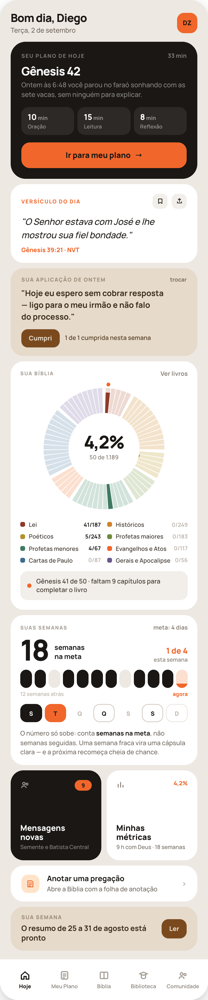

## 3. G1 — Hoje

**Tudo o que já existe em 34a fica como está** — cabeçalho, "SEU PLANO DE HOJE", "VERSÍCULO DO DIA", "SUA APLICAÇÃO DE ONTEM", os dois quadrados, "Anotar uma pregação", "SUA SEMANA" (resumo da IA), barra de abas. Mesma ordem, mesmo espaçamento (coluna com `gap:10px`, `padding:14px 20px 0`).

**Duas mudanças, e só duas:**
- **Sai** o cartão "ESTA SEMANA" (os sete círculos + minutos por passo).
- **Entram**, na posição dele (depois de "SUA APLICAÇÃO DE ONTEM", antes dos dois quadrados), nesta ordem: **SUA BÍBLIA** e **SUAS SEMANAS**.

O quadrado "Minhas métricas" **não muda** e continua abrindo a tela de métricas. Os minutos por passo que estavam em "ESTA SEMANA" continuam existindo lá.

### 3.1 Cartão SUA BÍBLIA
`#fff`, raio 24, `padding:17px 18px 18px`.
1. Linha de topo: rótulo **SUA BÍBLIA** (fixo) · à direita **Ver livros** (fixo, 700 11.5px `#8B8279`) → G9.
2. A roda, modo `livros`, **250px**, centralizada, `padding:4px 0 10px`. Centro: percentual da Bíblia lida com uma casa e vírgula ("4,2%") + "N de 1.189". Marcador no livro atual do plano.
3. Legenda: grade de 2 colunas (`repeat(2, minmax(0,1fr))`, `gap:9px 12px`), os 8 blocos na ordem canônica. Cada item: quadrado 9px raio 3 na cor do bloco · nome (600 11px `#4A423A`, **sem** nowrap/ellipsis) · "lidos/total" à direita (700 10.5px; `#1A1714` se lidos > 0, `#BDB5AC` se zero).
4. Linha de rodapé: `#F2EEE9`, raio 14, `padding:11px 13px`, ponto laranja 8px + frase (600 12px `#4A423A`): **"{Livro} {lidos} de {total} · faltam {n} capítulos para completar o livro"**. Singular: "falta 1 capítulo".

Toque em qualquer ponto do cartão (fora "Ver livros") → G2.

### 3.2 Cartão SUAS SEMANAS

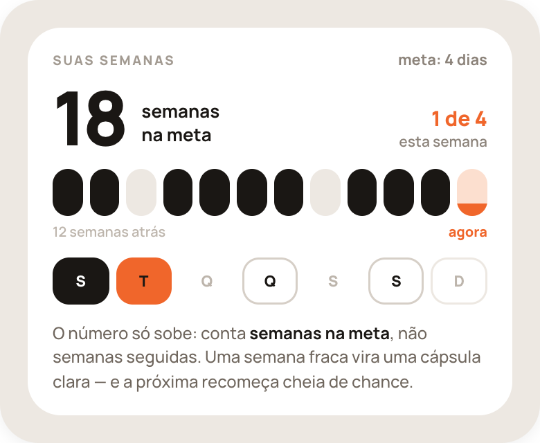

`#fff`, raio 24, `padding:17px 18px 16px`. (Em G3 o cartão aparece dentro de uma moldura areia só para a captura.)
1. Topo: **SUAS SEMANAS** (fixo) · à direita "meta: {n} dias" (700 11px `#8B8279`).
2. Linha do número (`align-items:flex-end`, `gap:12px`, margem inferior 14):
   - o total de semanas na meta: **800 54px, line-height .85, letter-spacing -3px**, `#1A1714`;
   - "semanas / na meta" em duas linhas (700 13px/1.3) — singular "semana / na meta";
   - à direita: "{feitos} de {meta}" (800 15px `#F0662B`) e, embaixo, "esta semana" (600 10.5px `#8B8279`).
3. **Doze cápsulas** — as últimas 12 semanas, a mais antiga à esquerda, a atual à direita. `display:flex; gap:5px`; cada uma `flex:1; height:34px; border-radius:99px`:
   - semana que bateu a meta: `#1A1714`;
   - semana que não bateu: `#EDE8E2`;
   - **semana atual**: fundo `#FCDFCF` com preenchimento `#F0662B` subindo **de baixo para cima**, altura = `min(feitos/meta, 1)`. Ao bater a meta ela fica inteira laranja até a semana virar; aí vira preta.
   - semanas anteriores ao cadastro: o lugar existe (para as larguras não mudarem) mas fica transparente.
4. Legenda das cápsulas: "12 semanas atrás" à esquerda (600 10px `#BDB5AC`), **"agora"** à direita (800 10px `#F0662B`). Margem inferior 14.
5. **Sete dias desta semana** — S T Q Q S S D. `display:flex; gap:5px`; cada um `flex:1; height:34px; border-radius:12px`, letra 800 11px centralizada:
   - leu: fundo `#1A1714`, letra `#fff`;
   - **hoje**: fundo `#F0662B`, letra `#1A1714` (lido ou não — hoje é sempre laranja);
   - dia do plano ainda por vir: fundo `#fff`, contorno interno 1.5px `#D6CFC7`, letra `#1A1714`;
   - dia fora do plano: transparente, letra `#BDB5AC`;
   - dia de descanso: transparente, contorno interno 1.5px `#EDE8E2`, letra `#BDB5AC`;
   - dia do plano que passou sem leitura: igual a "fora do plano" — **sem vermelho, sem X, sem alerta**.
6. Frase (500 12px/1.45 `#6E655C`, margem superior 12), **fixa**: "O número só sobe: conta **semanas na meta**, não semanas seguidas. Uma semana fraca vira uma cápsula clara — e a próxima recomeça cheia de chance."

Toque no cartão → G5.

**Definição de "semana na meta":** semana de segunda a domingo no fuso do usuário em que o número de dias com o plano cumprido foi ≥ à meta semanal **vigente naquela semana**. Mudar a meta depois não reavalia semanas passadas.

---

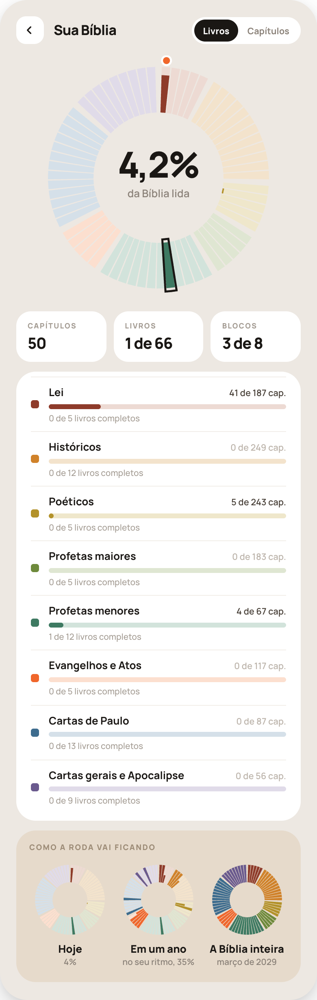

## 4. G2 — Sua Bíblia

1. Cabeçalho: voltar (34×34, raio 12, `#fff`) · **Sua Bíblia** · seletor em pílula branca com `padding:3px`: **Livros** | **Capítulos** (ativo: fundo `#1A1714`, texto `#fff`, 800 11px; inativo: 700 11px `#8B8279`). Troca só o modo da roda; a escolha é lembrada.
2. A roda em **300px**, centro "4,2%" (44px) + "da Bíblia lida". Marcador no livro atual; **contorno de destaque no último livro completado**.
3. Três cartões brancos (raio 18): **Capítulos** · **Livros** ("1 de 66") · **Blocos** ("3 de 8" = blocos em que já leu algo).
4. Cartão branco com **uma linha por bloco** (8): quadrado da cor · nome (700 13px) · "{lidos} de {total} cap." · barra de 6px no tom do bloco com preenchimento na cor (largura mínima 6px quando lidos > 0) · "{n} de {m} livros completos" (500 10.5px `#A29A91`). Divisor `#F2EEE9` entre linhas.
5. Cartão areia **COMO A RODA VAI FICANDO** (fixo): três rodas de 92px lado a lado, cada uma com título e subtítulo — **Hoje** · **Em um ano** ("no seu ritmo, {p}%") · **A Bíblia inteira** ("{mês} de {ano}"). A do meio é a projeção no ritmo dos últimos 60 dias; a última é a roda cheia com a data estimada de término. Sem ritmo para estimar (menos de 14 dias de uso ou zero leitura no período): mostre só "Hoje" e "A Bíblia inteira" sem data.

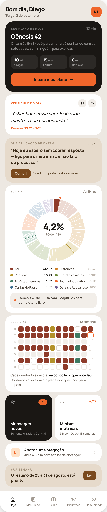

**G2b** mostra a roda no modo **Capítulos** (só o cartão SUA BÍBLIA desta captura interessa): Salmos é a maior fatia, Obadias é um fio, e o preenchimento anda no sentido do relógio.

---

## 5. Conquistas

### 5.1 O sistema

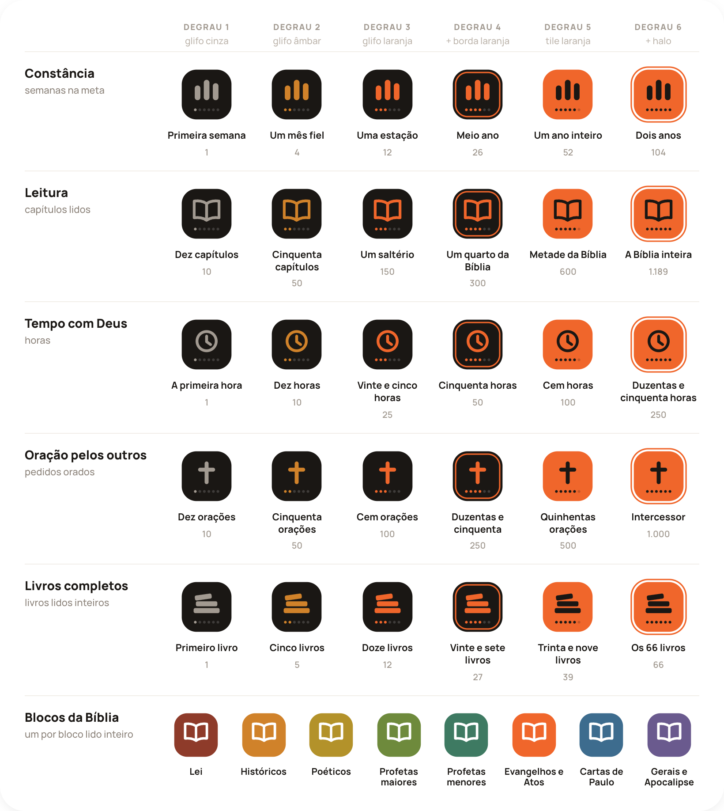

**38 conquistas** = 5 famílias × 6 degraus + 8 blocos. Limiares e regras de cálculo em `data/conquistas.json`.

| Família | Mede | 1 | 2 | 3 | 4 | 5 | 6 |
|---|---|---|---|---|---|---|---|
| Constância | semanas na meta | 1 | 4 | 12 | 26 | 52 | 104 |
| Leitura | capítulos distintos lidos | 10 | 50 | 150 | 300 | 600 | 1.189 |
| Tempo com Deus | horas somadas | 1 | 10 | 25 | 50 | 100 | 250 |
| Oração pelos outros | "Orei" em pedidos de outros | 10 | 50 | 100 | 250 | 500 | 1.000 |
| Livros completos | livros inteiros | 1 | 5 | 12 | 27 | 39 | 66 |

Nomes de cada degrau: no JSON e em G7. **Blocos:** um por bloco com todos os livros completos.

### 5.2 A medalha — um componente só

SVG, `viewBox="0 0 100 100"`. Recebe família, degrau (1–6), tamanho, e se está ganha.

- **Tile**: `rect x=6 y=6 width=88 height=88 rx=26`.
- **Glifo** da família, no centro-alto (formas exatas no `.dc.html` de referência, turnos 45 e 46): Constância = três barras arredondadas; Leitura = livro aberto em traço; Tempo = relógio em traço; Oração = cruz; Livros completos = três livros empilhados.
- **Seis pontos** embaixo: círculos r 2.4 em y=77, x = `50 + (i − 2.5) × 8` (i de 0 a 5). Os `degrau` primeiros acesos.

**O símbolo nunca muda; o que evolui é o material:**

| Degrau | Tile | Glifo e pontos acesos | Extra |
|---|---|---|---|
| 1 | `#1A1714` | `#A29A91` | — |
| 2 | `#1A1714` | `#D0822A` | — |
| 3 | `#1A1714` | `#F0662B` | — |
| 4 | `#1A1714` | `#F0662B` | borda interna: `rect 11,11 78×78 rx 21`, traço `#F0662B` 2.5 |
| 5 | `#F0662B` | `#1A1714` | — |
| 6 | `#F0662B` | `#1A1714` | halo: `rect 1.5,1.5 97×97 rx 30`, traço `#F0662B` 2.5 |

Pontos apagados: `rgba(255,255,255,.16)` sobre tile preto, `rgba(26,23,20,.22)` sobre tile laranja.
**Não ganha:** tile `#fff` com traço `#D6CFC7` 2.5 tracejado `5 4`; glifo `#E4DED7`; pontos `#D6CFC7` (até o degrau) e `#EDE8E2`.
**Sobre fundo preto** (G4, topo de G5 e G9): a não ganha usa tile `rgba(255,255,255,.05–.06)` e traço `rgba(255,255,255,.2)`; a ganha de tile preto usa `#3A352F` para não sumir no fundo.
**Medalha de bloco:** tile na cor do bloco, livro aberto branco, sem pontos. Não ganha: tracejada, com uma barrinha da cor do bloco (45% de opacidade) embaixo.

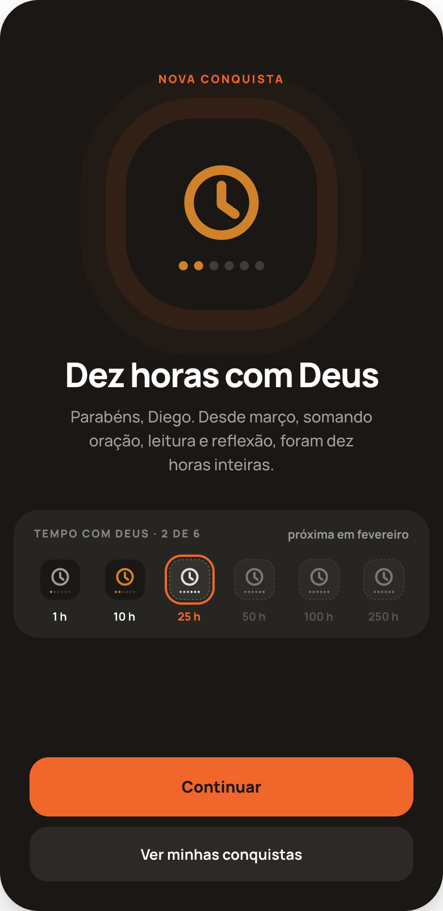

### 5.3 G4 — Nova conquista

Tela cheia `#1A1714`, conteúdo centralizado, `padding:64px 26px 26px`.
1. **NOVA CONQUISTA** (fixo; 800 10px, .16em, `#F0662B`).
2. A medalha em **168px**, com dois anéis suaves: `box-shadow: 0 0 0 18px rgba(240,102,43,.08), 0 0 0 40px rgba(240,102,43,.04)`.
3. Nome do degrau (800 30px, -1.1px, `#fff`).
4. Frase (500 14px/1.5, `rgba(255,255,255,.6)`, máx. 300px): começa com **"Parabéns, {nome}."** e diz o fato com o número e desde quando.
5. Cartão `rgba(255,255,255,.06)`, raio 22: "{FAMÍLIA} · {n} DE 6" à esquerda, "próxima em {mês}" à direita; embaixo a escada de seis medalhas de 40px com o limiar sob cada uma. **O próximo degrau leva contorno laranja de 2px** e o número em laranja; os seguintes ficam a 45% de opacidade.
6. Rodapé: **Continuar** (laranja) · **Ver minhas conquistas** (`rgba(255,255,255,.08)`, texto branco) → G5.

**"próxima em {mês}"**: (limiar − atual) ÷ ritmo médio das últimas 8 semanas. Esconda a frase se o ritmo for zero ou a estimativa passar de 36 meses. No último degrau, some.

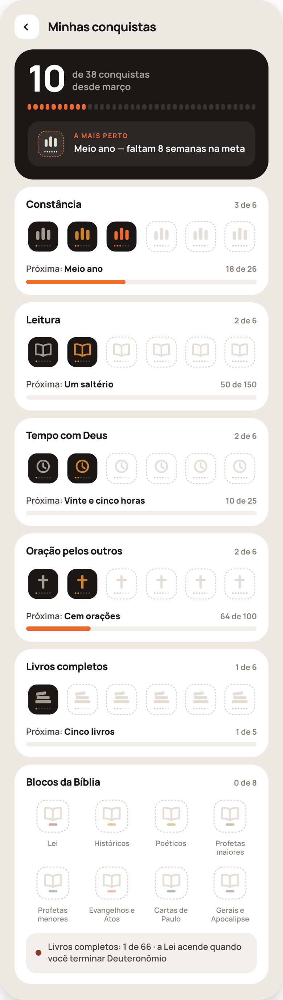

### 5.4 G5 — Minhas conquistas

1. Cabeçalho: voltar · **Minhas conquistas**.
2. Cartão preto (raio 26): total ganho em **800 50px** + "de 38 conquistas / desde {mês}"; **38 traços** (`flex:1; height:8px; radius 99; gap:3px`), os ganhos em laranja; e a linha **A MAIS PERTO** com a medalha tracejada em laranja e "{Nome} — faltam {n} {unidade}". "A mais perto" = a de maior percentual concluído entre os próximos degraus de todas as famílias.
3. **Um cartão por família**, nesta ordem: Constância, Leitura, Tempo com Deus, Oração pelos outros, Livros completos. Cada um: nome (800 14px) · "{n} de 6" · as seis medalhas em 47px, `justify-content:space-between` · "Próxima: **{nome}**" · "{atual} de {limiar}" · barra de 6px (`#F2EEE9` / `#F0662B`) com o progresso **entre o degrau atual e o próximo**. Família completa: sem linha "Próxima", sem barra.
4. Cartão **Blocos da Bíblia**: "{n} de 8", grade de 4 colunas com as medalhas de bloco em 50px e o nome embaixo, e uma linha de rodapé areia clara com o próximo bloco a acender.

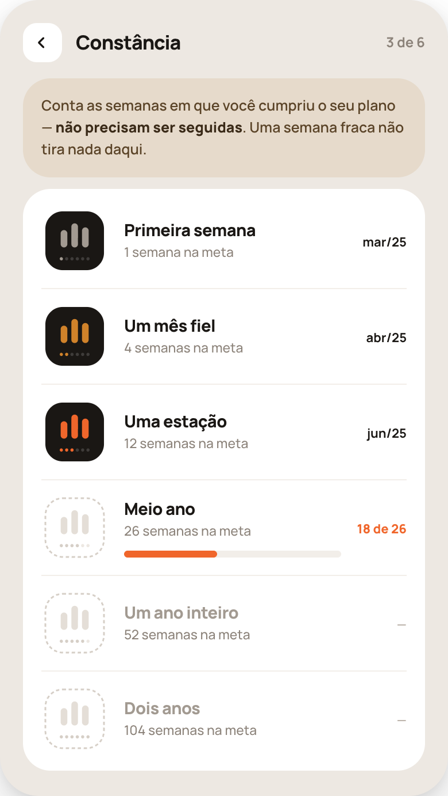

### 5.5 G6 — Uma família

1. Cabeçalho: voltar · nome da família · "{n} de 6".
2. Cartão areia com **o que a família mede**, em uma frase (o texto de cada família está em `conquistas.json`, campo `mede` — reescreva em frase corrida mantendo o sentido; a de Constância é a da captura).
3. Cartão branco com os seis degraus, um por linha: medalha 58px · nome (800 14.5px; `#A29A91` se ainda distante) · "{limiar} {unidade}" · à direita: **mês/ano em que ganhou**, ou "{atual} de {limiar}" em laranja no próximo, ou "—". **Só o próximo degrau** tem barra de progresso.

---

## 6. Selos de livro

Cada livro terminado dá um **selo**: quadrado arredondado na cor do bloco com a sigla. São 66, um por livro, e nenhum se repete.

**Três estados do selo** (raio = 30% do lado; sigla em Manrope 800, 36% do lado — 30% se a sigla tem 3 caracteres):
- **completo**: fundo na cor do bloco, sigla `#fff`;
- **em andamento**: fundo `#fff`, **borda 2px na cor do bloco**, e um preenchimento no **tom** do bloco subindo de baixo, altura = lidos/capítulos; sigla na cor do bloco;
- **não começado**: fundo `#fff`, borda 1.5px tracejada `#D6CFC7`, sigla `#D6CFC7`.

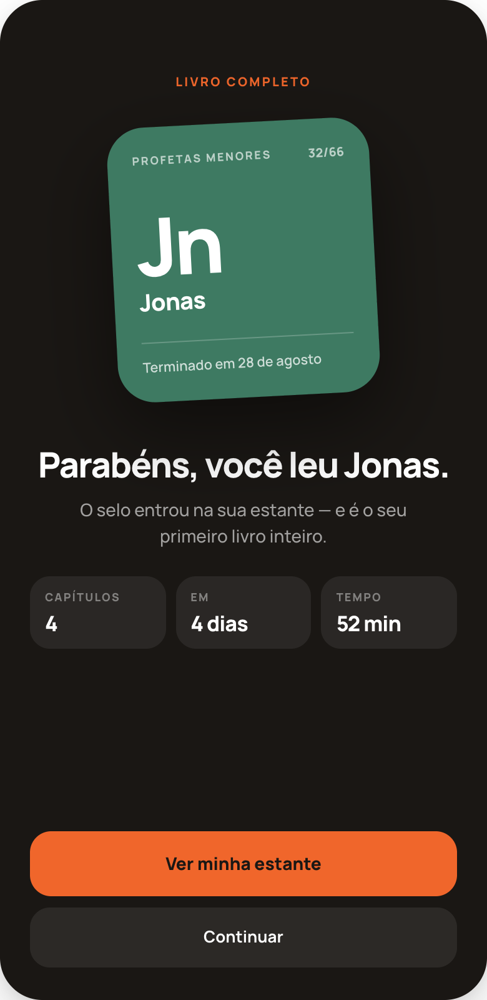

### 6.1 G8 — Livro completo

Tela cheia `#1A1714`, `padding:60px 24px 26px`.
1. **LIVRO COMPLETO** (fixo, mesmo estilo de "NOVA CONQUISTA").
2. **O selo grande**: cartão de 210px de largura, raio 30, fundo na cor do bloco, `padding:22px 20px 20px`, **girado −3°**, sombra `0 24px 60px rgba(0,0,0,.45)`. Dentro: nome do bloco em maiúsculas (800 9px, .14em) à esquerda e **"{posição}/66"** à direita, ambos `rgba(255,255,255,.65)`; a sigla em **800 64px, -3px**; o nome do livro (800 19px); um fio `rgba(255,255,255,.22)`; "Terminado em {dia} de {mês}".
3. **"Parabéns, você leu {Livro}."** (800 28px, -1px, `#fff`).
4. Uma linha (500 14px, `rgba(255,255,255,.6)`): "O selo entrou na sua estante" + o que este livro representa (primeiro livro inteiro; ou "é o seu {n}º livro"; ou "com ele você completou {bloco}").
5. Três cartões `rgba(255,255,255,.07)`: **Capítulos** · **Em** ("{n} dias", do primeiro ao último capítulo) · **Tempo** (soma das sessões de leitura do livro).
6. Rodapé: **Ver minha estante** (laranja) → G9 · **Continuar** (translúcido).

Se o mesmo capítulo também sobe um degrau de "Livros completos" ou acende um bloco, **mostra-se só G8**; as outras entram em G5 marcadas como novas (ver §7).

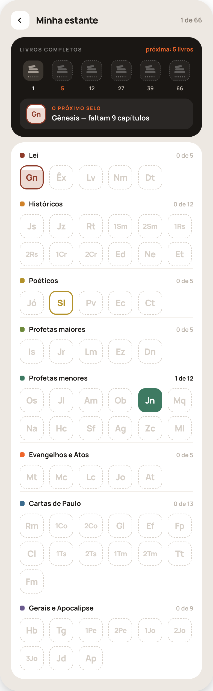

### 6.2 G9 — Minha estante

1. Cabeçalho: voltar · **Minha estante** · "{n} de 66".
2. Cartão preto: **LIVROS COMPLETOS** · "próxima: {limiar} livros" em laranja; a escada da família em seis medalhas de 42px com o limiar embaixo (o próximo em laranja); e a linha **O PRÓXIMO SELO** — o selo em andamento mais adiantado, em 36px, com "{Livro} — faltam {n} capítulos".
3. Cartão branco com **oito prateleiras** na ordem canônica. Cada uma: quadrado da cor · nome do bloco (700 12.5px) · "{n} de {m}" (`#1A1714` se n > 0, senão `#BDB5AC`) · grade de **6 colunas**, `gap:7px`, selos de 44px na ordem canônica. Divisor `#F2EEE9` entre prateleiras, **sem divisor acima da primeira**.

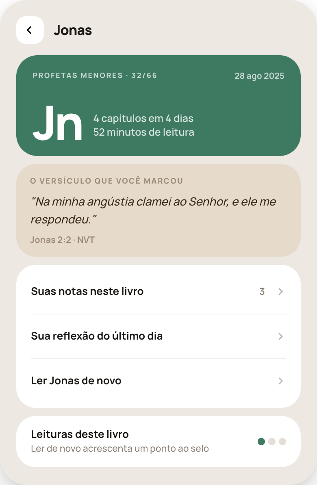

### 6.3 G10 — Um selo

1. Cabeçalho: voltar · nome do livro.
2. Cartão na cor do bloco (raio 26): "{BLOCO} · {posição}/66" e a data de término; a sigla em 800 58px e, ao lado, "{n} capítulos em {d} dias / {t} de leitura".
3. Cartão areia **O VERSÍCULO QUE VOCÊ MARCOU** — o primeiro versículo destacado pela pessoa naquele livro, em itálico, com a referência. **Sem versículo marcado, o cartão não aparece** (não escolha um por ela).
4. Lista branca: **Suas notas neste livro** (com a contagem; some se zero) · **Sua reflexão do último dia** (some se não houver) · **Ler {Livro} de novo**.
5. Cartão **Leituras deste livro**: "Ler de novo acrescenta um ponto ao selo" e três pontos de 9px — acesos na cor do bloco conforme o número de leituras completas, máximo três.

---

## 7. Quando e como o parabéns aparece

- A avaliação roda **ao concluir uma sessão** (oração, leitura ou reflexão) e ao marcar um capítulo como lido fora do plano.
- **No máximo uma tela de parabéns por sessão**, exibida **depois** da tela de conclusão que já existe, nunca no lugar dela. Prioridade: livro completo (G8) → bloco completo → degrau de família (o de maior degrau).
- As demais conquistas da mesma sessão são gravadas e aparecem em G5 com um ponto laranja de "nova" até a pessoa abrir a tela.
- Cada conquista é celebrada **uma única vez na vida da conta**. Fechar o app no meio não faz reaparecer.
- **Retroativo:** na primeira execução depois da atualização, calcule tudo o que a pessoa já tinha e grave como ganho e **já visto** — sem fila de parabéns atrasados. A data de cada um é a data real em que o limiar foi cruzado, reconstruída do histórico; se não der para reconstruir, use a data da migração e não mostre mês.

## 8. Estados e casos extremos

| Caso | Comportamento |
|---|---|
| Conta nova | Roda toda nos tons, centro "0%" / "0 de 1.189", rodapé "Comece por onde quiser — cada capítulo lido aparece aqui". Contador "0", doze lugares transparentes menos a semana atual. G5 "0 de 38". Estante toda tracejada. |
| Carregando | Esqueleto `#F2EEE9` no lugar da roda (anel) e das cápsulas. Nunca spinner de tela cheia. |
| Bíblia inteira | Roda cheia, centro "100%" / "1.189 de 1.189", sem marcador, rodapé com a data de término. |
| Releitura | Não aumenta roda, Leitura nem Livros completos. Só acrescenta ponto ao selo (até 3). |
| Capítulo desmarcado | A roda e os contadores recalculam; **conquista e selo já ganhos ficam**. |
| Meta semanal alterada | Vale a partir da semana atual. Semanas passadas não são reavaliadas. |
| Meta já batida esta semana | Cápsula atual inteira laranja; "4 de 4" (ou "5 de 4" se passou). |
| Sem plano de leitura ativo | A roda funciona igual (conta leitura livre). Sem marcador de livro atual. |
| Números | pt-BR: vírgula decimal, ponto de milhar ("4,2%", "1.189"). |
| Plurais | "1 semana na meta", "falta 1 capítulo", "1 livro completo", "1 de 6". |

## 9. Checklist por tela

- [ ] Ordem dos blocos idêntica ao PNG; nada inserido, agrupado ou reordenado.
- [ ] No Hoje, **só** saiu "ESTA SEMANA" e **só** entraram SUA BÍBLIA e SUAS SEMANAS.
- [ ] Texto fixo em português, palavra por palavra.
- [ ] Texto sobre laranja `#1A1714`.
- [ ] Roda: 66 fatias, 8 blocos, folgas 0.7° / 3.4°, começa no topo, sentido horário.
- [ ] Cores de bloco idênticas à tabela; o mesmo bloco tem a mesma cor na roda, na legenda, na estante e no selo.
- [ ] Nenhum vermelho, X ou alerta para dia ou semana perdidos.
- [ ] Nenhum ponto, nível, ranking, sequência ("streak") ou comparação.
- [ ] Medalha: mesmo glifo nos seis degraus; material conforme a tabela.
- [ ] Um parabéns por sessão, no fim, uma vez por conquista.
- [ ] Migração retroativa silenciosa.
- [ ] Nenhum número, nome ou data hardcoded.
- [ ] Nenhuma outra tela do app mudou.
