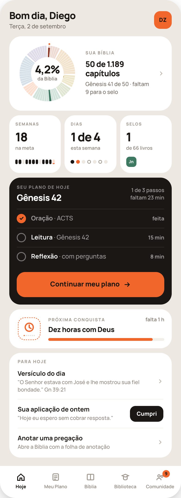

# HANDOFF — Hoje, mais limpo (H1)

## 0. Regras

1. **Quatro blocos, nesta ordem, e nada entre eles:** (1) Sua caminhada — o cartão da Bíblia e os três quadrados Semanas · Dias · Selos; (2) Seu plano de hoje; (3) Próxima conquista; (4) Para hoje.
2. **Um botão laranja na tela** — o do plano.
3. **Nenhum número aparece duas vezes.** "4,2%" só na roda; cada um dos três quadrados tem o seu número e mais nenhum.
4. **Nada aqui é calculado de novo.** Percentual, semanas na meta, cápsulas, passos de hoje, estado de cada passo, "a mais perto" e as estimativas vêm das funções que a gamificação e o Meu Plano já têm.
5. Continuam valendo as regras dos dois pacotes: nada zera, sem ranking, sem pontos, sem vermelho ou alerta para dia perdido, texto sobre laranja `#1A1714`.

## 1. Tokens

Os de `src/index.css`. Nenhuma cor nova.
`#EDE8E2` fundo · `#fff` cartão · `#1A1714` preto · `#F2EEE9` areia clara · `#F0662B` laranja · `#FCDFCF` laranja claro · `#E4DED7` / `#D6CFC7` apagados. Texto: `#1A1714` · `#4A423A` · `#6E655C` · `#8B8279` · `#A29A91` (rótulo) · `#BDB5AC` (chevron).
Sobre preto: branco; secundário `rgba(255,255,255,.6)`; rótulo `rgba(255,255,255,.5)`; divisor `rgba(255,255,255,.1)`.
**Rótulo de cartão** (igual em todos): Manrope 800 9.5px, letter-spacing .13em, maiúsculas.
**Chevron:** 14px, traço 2.2, `#BDB5AC`.

## 2. Estrutura da tela

- **Cabeçalho — não muda:** `padding:22px 20px 0`; saudação (800 21px, -0.7px) + data (500 12.5px, `#6E655C`); avatar 38×38, raio 13, laranja.
- **Corpo:** `padding:14px 20px 0`, coluna com `gap:10px`.
- **Barra de abas — não muda**, exceto o número na Comunidade (§7).

## 3. Bloco 1 — Sua caminhada

Duas fileiras, separadas pelos mesmos 10px do resto da tela: **o cartão da Bíblia** e, logo abaixo, **três quadrados**. Nenhum quadro areia, nenhuma faixa.

### 3.1 Cartão da Bíblia

Cartão `#fff`, raio 26, `padding:14px 16px`, `display:flex; align-items:center; gap:16px`. **O cartão inteiro é um alvo de toque** → Sua Bíblia.

- **A roda.** O componente `RodaDaBiblia` que já existe, modo `livros`, **132px**, com o marcador no livro atual. Como a roda é desenhada num `viewBox` de 300, o texto do centro precisa ser maior aqui para continuar legível:
  - linha 1 — o percentual ("4,2%"): **800, 54 unidades do viewBox**, letter-spacing -2, `#1A1714`, baseline y=150 → ~24px na tela;
  - linha 2 — **"da Bíblia"** (fixo): **700, 24 unidades**, `#8B8279`, baseline y=184 → ~10.5px na tela.
  Faça isso com uma prop de tamanho de texto na roda; **não crie uma segunda roda**. Sem legenda, sem "Ver livros".
- **Texto** (`flex:1; min-width:0`):
  1. rótulo **SUA BÍBLIA** (fixo; `#A29A91`);
  2. **"{lidos} de 1.189 capítulos"** — 800 17px/1.2, -0.5px, `#1A1714`, `margin:9px 0 5px`;
  3. **"{Livro} {lidos} de {total} · faltam {n} para o selo"** — 500 12px/1.4, `#6E655C`; "falta 1 para o selo". Pode quebrar em duas linhas.
     Sem livro em andamento: "Comece por onde quiser". Bíblia inteira: "Terminada em {mês} de {ano}".
- **Chevron** à direita.

### 3.2 Três quadrados — Semanas · Dias · Selos

`display:flex; gap:8px`. Cada quadrado: `flex:1; min-width:0`, `#fff`, raio 22, `padding:14px 13px 13px`. Os três têm **a mesma estrutura e a mesma altura**:

1. rótulo — 800 9px, .12em, maiúsculas, `#A29A91`, margem inferior 12;
2. número — **800 26px, line-height .9, -1.1px**, `#1A1714`, **nunca quebra** (`white-space:nowrap`), margem inferior 6;
3. legenda — 600 10.5px/1.3, `#8B8279`, margem inferior 11;
4. complemento — uma fileira de **22px de altura**, conteúdo centralizado na vertical.

| Quadrado | Rótulo (fixo) | Número | Legenda | Complemento | Toque |
|---|---|---|---|---|---|
| Semanas | **SEMANAS** | total de semanas na meta | **"na meta"** (fixo) | 12 cápsulas | Minhas métricas |
| Dias | **DIAS** | "{feitos} de {meta}" | **"esta semana"** (fixo) | 7 pontos | Minhas métricas |
| Selos | **SELOS** | livros completos | **"de 66 livros"** (fixo) | os selos mais recentes | Minha estante |

**12 cápsulas** — as últimas 12 semanas, a atual à direita: `display:flex; gap:2px`, ocupando a largura toda; cada uma `flex:1; height:10px; border-radius:99px`. Bateu a meta `#1A1714` · não bateu `#EDE8E2` · **atual**: fundo `#FCDFCF` com `#F0662B` subindo de baixo, altura = min(feitos ÷ meta, 1) · anterior ao cadastro: transparente, ocupando o lugar.

**7 pontos** — segunda a domingo: `display:flex; gap:4px`, cada um 8×8px, redondo, **sem letra**:
- dia cumprido: `#1A1714`;
- **hoje**: `#F0662B` (cumprido ou não);
- dia do plano por vir: vazio, contorno interno 1.5px `#A29A91`;
- fora do plano, descanso ou dia que passou sem leitura: `#EDE8E2` — **sem vermelho, sem X**.
Para leitor de tela o quadrado anuncia "1 de 4 dias na meta esta semana".

**Selos** — o componente `SeloDeLivro` em **22px** (raio 7, sigla 800 9px), `gap:4px`: os **três selos completos mais recentes**, o mais novo à esquerda. Com mais de três, só os três. Nenhum selo: número "0" e, no complemento, um selo **tracejado** vazio (contorno 1.5px tracejado `#D6CFC7`).

"{feitos} de {meta}" aparece **só** no quadrado Dias; o total de semanas, **só** no quadrado Semanas.

## 4. Bloco 2 — Seu plano de hoje

Cartão `#1A1714`, raio 24, `padding:16px`.

**Cabeçalho** — `display:flex; align-items:center; gap:12px; margin-bottom:13px`:
- esquerda (`flex:1`): rótulo **SEU PLANO DE HOJE** (fixo; `rgba(255,255,255,.5)`), 7px abaixo o **título** (800 19px/1.1, -0.6px, `#fff`) — a leitura de hoje ("Gênesis 42"); em dia de estudo, o nome do estudo; sem leitura nem estudo hoje, o nome do primeiro passo;
- direita, alinhado à direita, duas linhas (600 11.5px/1.35, `rgba(255,255,255,.6)`): **"{feitos} de {total} passos"** / **"faltam {x} min"**.

**Lista de passos** — fio superior `rgba(255,255,255,.1)`, `margin-bottom:13px`. **Só os passos programados para hoje, na ordem do dia** — os mesmos que o Meu Plano mostra; passo desligado ou que não cai hoje não é renderizado. Cada linha: `display:flex; align-items:center; gap:11px; padding:10px 0`, com fio inferior `rgba(255,255,255,.1)` **menos na última**:
- **círculo de 20px:**
  - **a fazer:** vazio, contorno interno de 2px `rgba(255,255,255,.4)`;
  - **feito:** cheio `#F0662B`, com um visto de 11px (traço 2.2, `#1A1714`, pontas redondas);
- **texto** (`flex:1`): nome do passo (700 13.5px; `#fff` a fazer, `rgba(255,255,255,.6)` feito) + **" · {detalhe}"** (500, `rgba(255,255,255,.6)`). Detalhe: Oração "ACTS" ou "livre" · Leitura "{Livro} {cap}" · Estudo "{nome}, dia {n}" · Reflexão "com perguntas" ou "livre";
- **direita** (700 11.5px, `rgba(255,255,255,.6)`): **"{n} min"** a fazer; **"feita"/"feito"** concordando com o passo.

**As linhas não são tocáveis** — ninguém pula passo por aqui. O círculo muda sozinho quando o passo é concluído; ao voltar para o Hoje ele enche em 200ms (sem animação com `prefers-reduced-motion`).

**Botão** — 54px, raio 18, `#F0662B`, centralizado, `gap:8px`: rótulo (800 14.5px, `#1A1714`) + seta de 16px.

### Estados do cartão

| Estado | Direita do cabeçalho | Círculos | Botão |
|---|---|---|---|
| Nada feito | "{total} passos" / "{soma} min" | todos abertos | **Começar meu plano** |
| No meio (H1) | "1 de 3 passos" / "faltam 23 min" | feitos em laranja | **Continuar meu plano** |
| Passo aberto e interrompido | igual ao meio | o passo continua **aberto** | **Continuar meu plano** |
| Tudo feito | "Plano completo" / "{soma} min" | todos em laranja | secundário: fundo `rgba(255,255,255,.08)`, texto `#fff`, sem seta — **Ver meu plano** → aba Meu Plano |
| Dia de descanso | — (some) | sem lista | título **"Hoje é descanso"**, uma linha "Volta {dia da semana}." (500 12.5px, `rgba(255,255,255,.6)`), e o botão secundário **Quero ler hoje mesmo assim** → leitura livre |

Um passo só: "1 passo", "0 de 1 passo". "falta 1 min".

## 5. Bloco 3 — Próxima conquista

Cartão `#fff`, raio 24, `padding:15px 16px`, `display:flex; align-items:center; gap:14px`. Mostra **"a mais perto"** — a mesma de "Minhas conquistas".
- **Medalha** de 54px: o componente `Medalha`, na família e no degrau da próxima, no estado **não ganha em laranja** (o de "A mais perto"): tile `#fff`, traço `#F0662B` 2.5 tracejado `5 4`, glifo `#F0662B`, pontos acesos em laranja e apagados `#E4DED7`.
- **Direita** (`flex:1`): rótulo **PRÓXIMA CONQUISTA** (fixo) com, à direita, **"falta(m) {n} {unidade}"** (700 11px, `#8B8279`) · nome (800 15px/1.2, -0.3px; `margin:8px 0 9px`) · barra de 6px, raio 99, fundo `#F2EEE9`, preenchimento `#F0662B` = progresso **entre o degrau atual e o próximo**.
- Tudo conquistado (38 de 38): o cartão **não aparece**.
- Se a próxima for um selo ou um bloco, vale a mesma estrutura com o selo/medalha correspondente.

## 6. Bloco 4 — Para hoje

Cartão `#fff`, raio 24, `padding:14px 18px 2px`. Rótulo **PARA HOJE** (fixo). Linhas com `padding:13px 0`, `gap:12px`, fio `#F2EEE9` entre elas (não depois da última): título (700 13.5px, `#1A1714`), 3px abaixo o subtítulo (500 11.5px/1.35, `#8B8279` — pode quebrar em duas linhas, nunca corta com reticências), e à direita um chevron ou um botão.

Nesta ordem; **linha sem conteúdo não aparece**:

| Linha | Subtítulo | Direita | Quando aparece |
|---|---|---|---|
| **Resumo da sua semana** | "{dia} a {dia} de {mês} está pronto" | chevron | Só com resumo **não lido**. Some depois de aberto. |
| **Versículo do dia** | o versículo entre aspas + referência abreviada ("Gn 39:21") | chevron | Sempre. |
| **Sua aplicação de ontem** | a aplicação entre aspas | botão **Cumpri** | Só se houver aplicação de ontem. |
| **Anotar uma pregação** | "Abre a Bíblia com a folha de anotação" (fixo) | chevron | Sempre. |

- **Botão Cumpri:** 34px de altura visual (área de toque 44), `padding:0 14px`, raio 12, fundo `#1A1714`, 800 12px `#fff`. Tocar marca como cumprida **sem navegar** — a mesma ação do cartão antigo. Depois de marcada, o botão vira o texto **"Cumprida"** (800 12px, `#F0662B`, sem fundo).
- **Versículo:** tocar abre o versículo inteiro com **salvar** e **compartilhar** — as duas ações que eram ícones no cartão antigo. Reaproveite a folha/tela que o app já tem; se não existir, use a folha inferior padrão com o versículo, a referência e os dois botões.
- **Aplicação:** tocar na linha (fora do botão) abre a aplicação inteira, onde fica o **"trocar"**.
- Se só "Anotar uma pregação" e "Versículo do dia" existirem, o cartão tem duas linhas — não preencha com mais nada.

## 7. Número na aba Comunidade

Substitui o quadrado "Mensagens novas". Sobre o ícone da aba Comunidade: pílula `min-width:16px; height:16px`, raio 99, fundo `#F0662B`, 800 9.5px `#1A1714`, `padding:0 3px`, posicionada 5px acima do topo do ícone e à direita dele. Mostra o total de mensagens novas; acima de 99, "99+". Zero: não aparece. **É a única mudança na barra de abas**, e vale para o app todo (a barra é uma só).

## 8. Estados e casos extremos

| Caso | Comportamento |
|---|---|
| Conta nova | Roda nos tons, "0%"; "0" semanas, só a cápsula atual visível; "0 de {meta}" nos dias; "0" selos; próxima conquista = a primeira de menor limiar. |
| Carregando | Esqueleto `#F2EEE9`: um anel no lugar da roda, barras no lugar das cápsulas e das linhas. Nunca spinner de tela cheia. O cartão do plano aparece primeiro se os dados dele chegarem antes. |
| Meta da semana batida | Cápsula atual inteira laranja; quadrado Dias "4 de 4". |
| Sem plano configurado | Cartão do plano com o título "Monte seu plano" e o botão laranja **Criar meu plano** → Ajustar. |
| Nome longo de estudo ou de conquista | Quebra em duas linhas; nada é cortado. |
| Números | pt-BR: "4,2%", "1.189". |

## 9. O que sai do código do Hoje

Depois da aprovação: o parágrafo e os três quadrados de minutos do cartão do plano; o cartão "VERSÍCULO DO DIA"; o cartão areia "SUA APLICAÇÃO DE ONTEM"; a legenda de oito blocos e o "Ver livros" **no Hoje**; a fileira grande de sete dias e o parágrafo do contador **no Hoje**; os quadrados "Mensagens novas" e "Minhas métricas"; o cartão "Anotar uma pregação"; o cartão areia "SUA SEMANA". Confirme antes que nenhuma outra tela os usa — a legenda e os sete dias **continuam existindo** em "Sua Bíblia" e no Meu Plano.

## 10. Checklist

- [ ] Quatro blocos, na ordem; nada inserido, nada reordenado.
- [ ] Roda de 132px com o mesmo componente; texto do centro legível (≥ 10.5px na tela).
- [ ] Três quadrados iguais em estrutura e altura; números não quebram.
- [ ] Doze cápsulas de 10px; a atual enche de baixo para cima.
- [ ] Sete pontos com quatro estados, sem letra; até três selos de 22px com o `SeloDeLivro`.
- [ ] Plano: só os passos de hoje; círculo aberto / laranja cheio com visto; linhas não tocáveis.
- [ ] Cinco estados do cartão do plano implementados.
- [ ] Próxima conquista = "a mais perto" de Minhas conquistas, mesma função.
- [ ] "Para hoje": linhas condicionais; "Cumpri" marca sem navegar; salvar/compartilhar e "trocar" continuam alcançáveis.
- [ ] Número na aba Comunidade; some com zero.
- [ ] Sua Bíblia pelo cartão da roda; métricas por "Semanas" e por "Dias"; estante por "Selos".
- [ ] Texto fixo palavra por palavra; texto sobre laranja `#1A1714`.
- [ ] Nenhum número, nome ou data hardcoded.
- [ ] Nenhuma outra tela mudou; nenhum cálculo duplicado.
