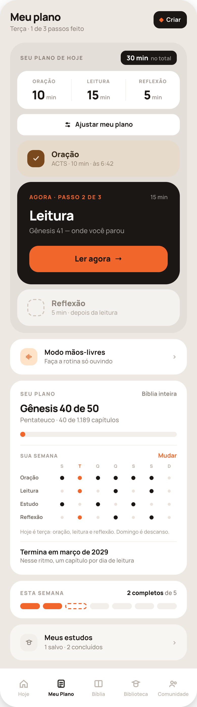
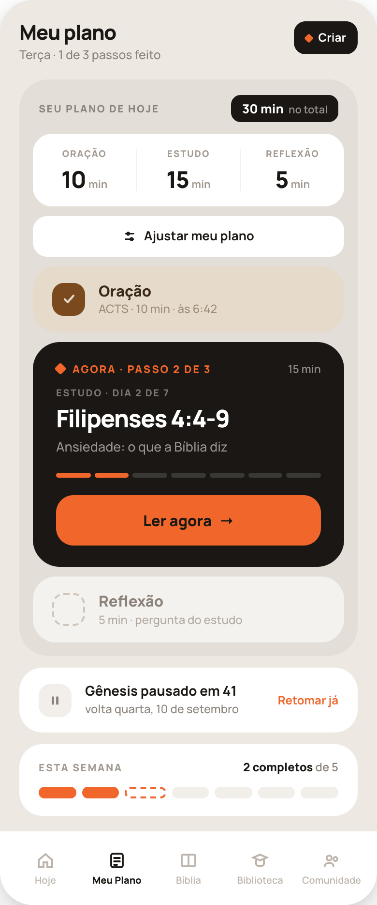
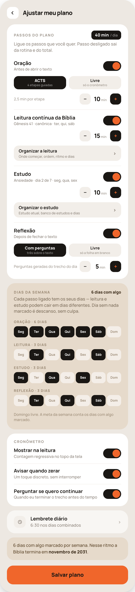
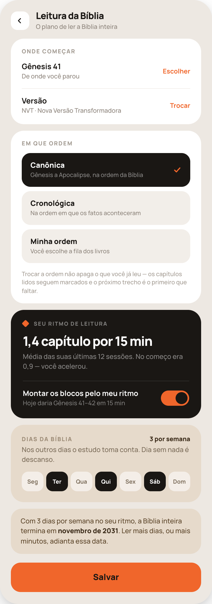
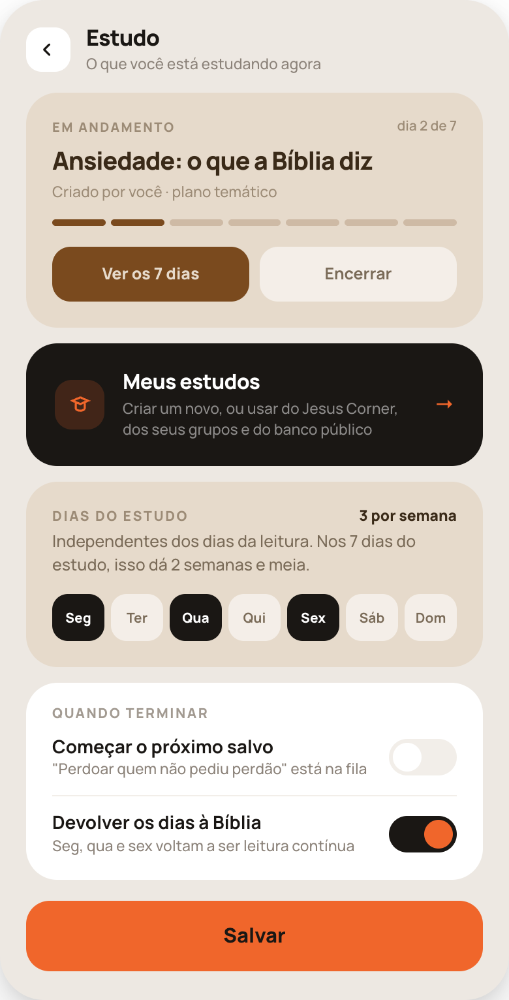
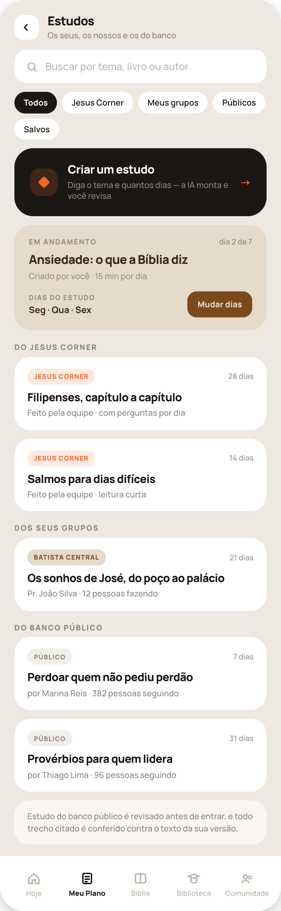
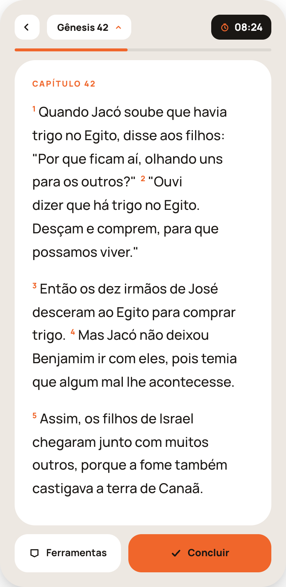
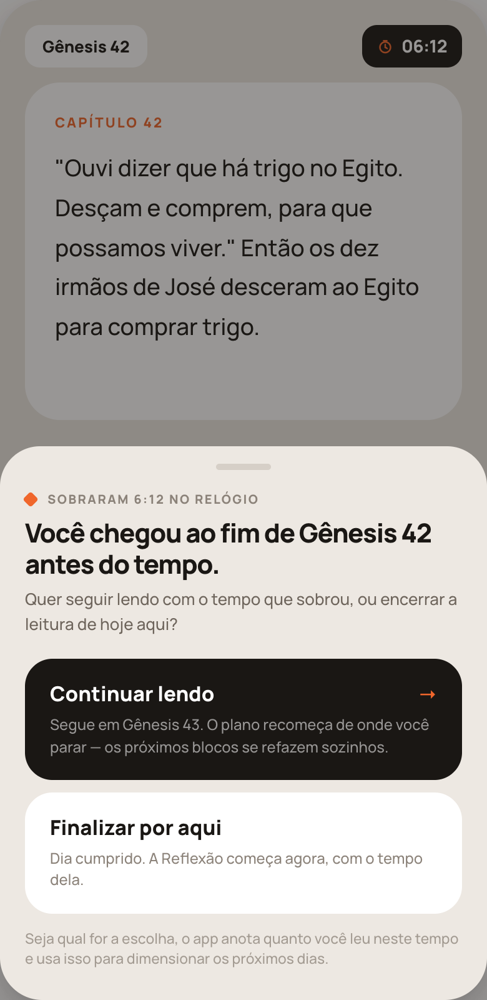
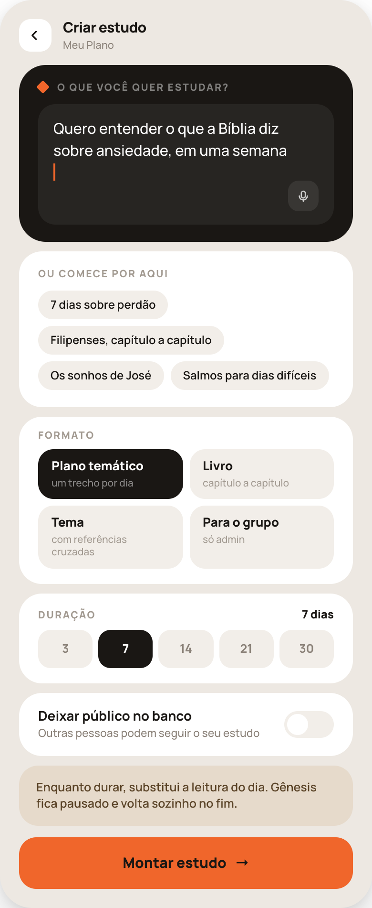
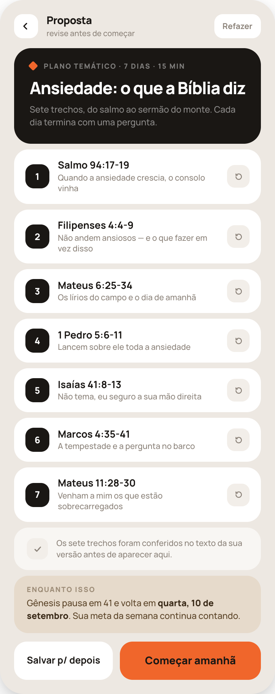

# Handoff 35 — Aba "Meu Plano" (pacote completo)

Substitui as telas antigas espalhadas pelo design: **4b** (rotina do dia), **5a** (ajustar), **22c** (estudo ativo), **22a** (criar), **22b** (proposta). Onde houver conflito, vale este documento.

## Como ler as imagens (importante)

Cada PNG desta pasta é **uma tela só, inteira, com rolagem** — não são duas telas nem dois estados.
O quadro foi capturado mais alto que um celular de propósito, para caber todo o conteúdo numa imagem.

No app:
- O **cabeçalho rola junto** com o conteúdo (não é sticky).
- A **barra de abas** (35a, 35b) é **fixa no rodapé**, sobreposta ao conteúdo; na imagem ela aparece no fim porque é onde encosta.
- Em 35c, 35d e 35e o **botão primário do rodapé é fixo** ("Salvar plano", "Montar estudo", "Salvar p/ depois + Começar amanhã"); o conteúdo rola atrás dele.
- Todos os valores (nomes, datas, minutos, referências) são **exemplo**. Cada conta tem os seus.

| Imagem | Tela | Rota |
|---|---|---|
| `35a-meu-plano.png` | Meu Plano — dia normal | aba Meu Plano |
| `35b-estudo-ativo.png` | Meu Plano — com estudo de IA ativo | aba Meu Plano (mesma rota, outro estado) |
| `35c-ajustar.png` | Ajustar meu plano | push a partir de "Ajustar" |
| `35d-criar-estudo.png` | Criar estudo — o pedido | push a partir de "Criar" |
| `35e-proposta.png` | Proposta do estudo | push depois de "Montar estudo" |
| `35f-leitura-relogio.png` | Leitura com contagem regressiva | push a partir de "Ler agora" |
| `35g-fim-antes-do-tempo.png` | Folha: acabou o trecho e sobrou tempo | overlay sobre 35f |
| `35h-estudos.png` | Estudos — criar / Jesus Corner / grupos / público | push a partir de "Meus estudos" |
| `35i-organizar-leitura.png` | Leitura da Bíblia — onde começar, ordem, ritmo, dias | push a partir de "Organizar a leitura" |
| `35j-organizar-estudo.png` | Estudo — atual, banco, dias, fim | push a partir de "Organizar o estudo" |

## Sistema visual (já usado no resto do app)

- Fundo `#EDE8E2` · tinta `#1A1714` · ação `#F0662B` · areia `#E6DACB` · realce `#FFE3C9` · cartão branco `#fff` · divisor `#F2EEE9`
- Texto secundário `#8B8279`, terciário `#A29A91`, desativado `#BDB5AC`
- Tipografia: **Manrope** — 500 corpo, 700 títulos de linha, 800 números e títulos
- Raios: 12 (botão de cabeçalho / ícone), 18 (botão grande), 20/24 (cartão), 28 (bloco escuro), 34 (tela)
- Rótulo de seção: 10,5px/800, `letter-spacing:.12em`, uppercase, `#A29A91` (ou branco 45% no bloco escuro)
- Alvo de toque mínimo 44px

### Gramática dos estados da rotina
- **areia `#E6DACB`** = passo já feito (ícone quadrado `#7A4A1E` com check)
- **bloco preto `#1A1714`** = passo de agora, com o botão laranja
- **branco 60% translúcido** = ainda não chegou (ícone com borda tracejada `#CFC6BC`)

## 35a — Meu Plano, dia normal

Ordem da rolagem, de cima para baixo:

1. **Cabeçalho** — "Meu plano" (21px/800) + subtítulo `Terça · 1 de 3 passos feito` (sem repetir os minutos — eles agora vivem no bloco). À direita, um único botão de 34px: **Criar** (preto, com losango laranja → 35d). O "Ajustar" saiu do cabeçalho — ele agora mora dentro do bloco da rotina.
2. **Bloco da rotina** — um contêiner `border-radius:30px`, fundo `rgba(0,0,0,.045)`, padding 14, gap 10, que agrupa **o resumo de tempos + os três passos**. Os três passos são um bloco só, não cartões soltos.
   - **Topo do bloco:** rótulo "Seu plano de hoje" à esquerda e o **tempo total** à direita numa **pílula preta** (`#1A1714`, raio 10, altura 28): "30 min" em 13px/800 branco + "no total" em 11px/600 branco 55%. É a soma dos passos ativos.
   - **Faixa branca de tempos** (`border-radius:20px`, padding 16px 0): uma coluna por passo com o nome em versalete (9,5px/800, `letter-spacing:.1em`, uppercase, `#A29A91`) e os minutos em destaque (**24px/800**, `letter-spacing:-1px`, `#1A1714`, com "min" em 11px/700 `#A29A91`), separadas por filete de 1px `#F2EEE9`. Os minutos são o maior número da tela depois dos títulos — é o que a pessoa negociou consigo mesma.
   - **Ajustar meu plano** — botão branco de 42px (raio 15) logo abaixo da faixa, largura total do bloco, com ícone de controles + rótulo 13px/700. Abre 35c. Fica aqui, e não no cabeçalho, porque é a ação que edita exatamente os números acima dele.
   - O bloco mostra **só os passos do dia de hoje**: numa terça (dia de Bíblia) são Oração, Leitura e Reflexão; numa segunda (dia de estudo) o Estudo entra no lugar da Leitura. Mostra só os passos ativos: se a pessoa desligou um passo em 35c, ele sai da faixa, sai do bloco e o total recalcula (2 colunas em vez de 3).
   - **Oração** — cartão areia, feito. Subtítulo: método + minutos + hora em que foi concluída.
   - **Agora · passo 2 de 3** — bloco preto. Rótulo laranja, minutos do passo à direita, título do passo (27px/800), linha de contexto ("Gênesis 41 — onde você parou") e botão laranja **Ler agora**.
   - **Reflexão** — cartão translúcido, ainda não.
3. **Modo mãos-livres** — cartão branco navegável.
4. **Seu plano** — *cartão novo, não existia em 4b*. Contém: "Bíblia inteira" à direita do rótulo; posição atual (`Gênesis 40 de 50`); linha `Pentateuco · 40 de 1.189 capítulos`; barra de progresso da Bíblia inteira (aqui 3,3%); divisor; linha **dias por semana** com os dias por extenso e ação "Mudar" (→ 35c, ancorando no bloco Ritmo da semana); divisor; linha **previsão de término** com a explicação do ritmo.
5. **Esta semana** — "1 completo de 6": o denominador é o **número de dias com algum passo marcado** na semana (o mesmo que a grade "Sua semana" mostra), nunca um número fixo. Sempre 7 pílulas, uma por dia, na ordem Seg→Dom: laranja = dia cumprido, tracejada = hoje, `#F2EEE9` = dia marcado ainda por vir, `rgba(0,0,0,.04)` = dia de descanso (sem nada marcado). A meta é o número de dias, não dias seguidos.
6. **Meus estudos** — atalho para os estudos salvos/concluídos (na Biblioteca).
7. Barra de abas fixa, "Meu Plano" ativo.

Ordem dos passos: se a pessoa desligou um passo em 35c (0 min), ele **não aparece** — a faixa de tempos, o total e o "passo N de M" recontam.

## 35b — Meu Plano com estudo ativo

Mesma tela de 35a com estas diferenças:

- Na faixa de tempos, a coluna do meio passa a se chamar **Estudo** (mesmos minutos da leitura); o total não muda.
- O bloco preto ganha **losango laranja** ao lado de "Agora · passo 2 de 3", a linha `Estudo · dia 2 de 7`, a referência do dia como título (`Filipenses 4:4-9`), o nome do estudo abaixo e **uma trilha de tracinhos** (um por dia do estudo; preenchidos = dias feitos).
- Reflexão passa a dizer "pergunta do estudo".
- Depois do bloco da rotina entra o cartão branco **"Gênesis pausado em 41"** com a data de retorno e a ação **Retomar já** (texto laranja): um toque abandona o estudo e devolve o plano principal — sem diálogo de culpa, só uma confirmação simples.
- Os cartões **"Seu plano"**, **"Modo mãos-livres"** e **"Meus estudos"** saem enquanto o estudo corre; ficam a rotina, a pausa e "Esta semana" (dia de estudo conta como dia cumprido).

## 35c — Ajustar meu plano

Esta tela responde só duas perguntas: **quais passos** e **quanto tempo**. Todo o resto foi para telas próprias (35i e 35j) — não devolva esses cartões para cá.

1. **Passos do plano** — total do dia numa pílula preta (`40 min / dia`, soma dos passos ligados). Cada passo tem **interruptor próprio**; o stepper de minutos só aparece no passo ligado. A **segunda linha de cada passo é um resumo** do que está configurado nas outras telas (ex.: "Gênesis 41 · canônica · ter, qui, sáb").
   - **Oração** — método **ACTS** (4 etapas guiadas) ou **Livre** (só o cronômetro, sem etapas nem campos do ACTS). "2,5 min por etapa" (tempo ÷ 4) só no ACTS.
   - **Leitura contínua da Bíblia** — stepper + botão **Organizar a leitura** (`#F2EEE9`, 44px, raio 14, com subtítulo "Onde começar, ordem, ritmo e dias") → **35i**.
   - **Estudo** — stepper + botão **Organizar o estudo** ("Estudo atual, banco de estudos e dias") → **35j**.
   - **Reflexão** — método **Com perguntas** (três geradas do trecho do dia) ou **Livre** (folha em branco, nada sugerido).
2. **Dias da semana** (areia) — **uma fileira de sete dias por passo ativo**, cada uma com seu contador (ex.: "Oração · 6 dias", "Leitura · 3 dias"). Oração e Reflexão aparecem aqui como qualquer outro passo: podem ter dias próprios, não são obrigadas a acompanhar leitura/estudo. Passo desligado não aparece na lista. Rodapé resume ("Domingo livre. A meta da semana conta os dias com algo marcado."). Os dias de cada passo também aparecem em 35i (Bíblia) e 35j (Estudo) — é a mesma informação, editável nos dois lugares.
3. **Cronômetro** — *Mostrar na leitura* (liga 35f), *Avisar quando zerar*, *Perguntar se quero continuar* (liga 35g).
4. **Lembrete diário**.
5. **Projeção** (areia) — resumo em uma frase: dias com algo marcado e data de término da Bíblia.
6. Rodapé fixo: **Salvar plano**.

### Regras dos passos

- Pelo menos um entre **Leitura** e **Estudo** ligado; ao desligar o último, explique em vez de bloquear em silêncio.
- Oração e Reflexão podem estar as duas desligadas.
- Ordem no dia: Oração → Leitura → Estudo → Reflexão. Passo desligado sai de 35a, da faixa de tempos, do total e do "passo N de M".
- Minutos: 5 a 60, passo de 5.

## 35i — Organizar a leitura (Leitura da Bíblia)

1. **Onde começar** — capítulo atual com ação **Escolher** (abre a lista de livros de 28) e a **Versão** do texto com **Trocar**.
2. **Em que ordem** — três opções em lista, a ativa em preto com check laranja: **Canônica**, **Cronológica** (ordem dos fatos) e **Minha ordem** (a pessoa monta a fila dos livros → tela de ordem de 28c). Trocar a ordem **não apaga o progresso**: capítulos lidos seguem marcados e o próximo trecho é o primeiro que faltar na nova ordem.
3. **Seu ritmo de leitura** (bloco preto) — `1,4 capítulo por 15 min`, média das últimas sessões e evolução, com o interruptor **"Montar os blocos pelo meu ritmo"** e a consequência escrita. Desligado: um capítulo por dia de leitura.
4. **Dias da Bíblia** (areia) — sete chips, contador "3 por semana", com a nota de que os outros dias podem ser do estudo.
5. **Projeção** (areia) — data de término com a explicação do que a adianta.
6. Rodapé fixo: **Salvar**.

## 35j — Organizar o estudo

1. **Em andamento** (areia) — estudo atual, autor, tipo, trilha de dias (um traço por dia, feitos em `#7A4A1E`) e dois botões: **Ver os 7 dias** (lista tipo 35e, editável) e **Encerrar** (para antes do fim, sem drama; progresso fica na Biblioteca).
2. **Meus estudos** (bloco preto) → **35h**.
3. **Dias do estudo** (areia) — sete chips independentes dos da Bíblia, com o contador e a tradução em calendário ("7 dias do estudo em 3 dias por semana = 2 semanas e meia").
4. **Quando terminar** — dois interruptores: *Começar o próximo salvo* (nomeando qual está na fila) e *Devolver os dias à Bíblia* (ligado por padrão).
5. Rodapé fixo: **Salvar**.

### Dias por trilha — regra geral

- Bíblia e Estudo têm **conjuntos de dias independentes**. Dia só de Bíblia: Oração + Leitura + Reflexão. Dia só de estudo: Oração + Estudo + Reflexão. Dia com os dois: leitura primeiro, estudo depois. Dia sem nada: descanso — não conta contra a meta e não gera lembrete.
- Oração e Reflexão têm **dias próprios** — por padrão acompanham todo dia com leitura ou estudo, mas a pessoa pode marcar menos (ou mais) dias para elas.
- Um dia que só tem Oração marcada é um dia válido de rotina: a rotina de 35a mostra só esse passo.
- Meta semanal = dias cumpridos ÷ dias com algo marcado.
- A **projeção de término da Bíblia** usa só os dias da Bíblia.

## 35h — Estudos (criar, Jesus Corner, grupos, banco público)

Tela cheia com barra de abas (é um push dentro da aba Meu Plano). Rolagem:

1. **Busca** — um campo só, que casa **tema, livro ou autor** ("ansiedade", "Filipenses", "Marina Reis").
2. **Chips de origem** — Todos · Jesus Corner · Meus grupos · Públicos · Salvos. Filtram a lista abaixo; combinam com a busca.
3. **Criar um estudo** (bloco preto, ação primária) → 35d.
4. **Em andamento** (areia) — o estudo ativo com progresso, autor, minutos por dia, os **dias do estudo** e o atalho **Mudar dias** (mesma seleção de 35c, só a trilha do estudo).
5. **Do Jesus Corner** — estudos da equipe, com selo laranja.
6. **Dos seus grupos** — estudos publicados pelos grupos de que a pessoa participa, com o nome do grupo no selo e quem escreveu.
7. **Do banco público** — estudos de outros usuários, com **autor** e quantas pessoas seguem.
8. **Nota de confiança** — estudo público é revisado antes de entrar e todo trecho citado é conferido contra o texto da versão do usuário.

Cada cartão abre a prévia do estudo (mesma estrutura de 35e, com "Começar" em vez de "Refazer") e ao adotar pergunta os **dias da semana** dele. Estudo de grupo entra como convite: a pessoa pode recusar.

## 35f — Leitura com o relógio

- Pílula preta no canto direito do cabeçalho com a **contagem regressiva** (`08:24`) e ícone de cronômetro em laranja; filete de 4px logo abaixo do cabeçalho com o tempo já decorrido (laranja sobre `rgba(0,0,0,.07)`).
- Só existe quando a leitura (ou o estudo) faz parte do plano **e** "Mostrar na leitura" está ligado.
- Tocar na pílula **pausa/retoma**; o texto não se move. Sair do app pausa; voltar retoma no mesmo ponto.
- Ao zerar: toque discreto (haptic + a pílula pisca uma vez e passa a contar para cima, em `#8B8279`). **Nunca** bloqueie a leitura nem feche a tela por tempo.
- O tempo é do passo — leitura e estudo têm relógios separados, um por passo.

## 35g — Chegou ao fim do trecho antes do tempo

Folha por cima da leitura, disparada quando a pessoa conclui o trecho planejado **com tempo restante** (e a preferência ligada).

- Rótulo com o tempo que sobrou, título nomeando o que ela terminou, e a pergunta.
- **Continuar lendo** (bloco preto, ação primária): o cronômetro segue correndo, abre o próximo trecho (Gênesis 43) e — este é o ponto de código — **o plano é reescrito a partir do último versículo lido**: o ponto de retomada passa a ser onde ela parar, e todas as sessões seguintes são recalculadas com o novo saldo de capítulos (a data de término em 35a/35c muda junto).
- **Finalizar por aqui** (cartão branco): fecha o passo, marca o dia como cumprido e leva à Reflexão com o tempo dela. Sem penalidade, sem placar perdido.
- Nota de rodapé: qualquer das duas escolhas alimenta o ritmo aprendido.

## Ritmo aprendido — como calcular

- Registre por sessão: `versiculos_lidos`, `palavras_lidas`, `segundos_ativos` (descontando pausas e app em background), passo (leitura/estudo), hora do dia.
- Métrica base: **palavras por minuto** (mais estável que capítulos, que variam muito de tamanho). Exiba para a pessoa em capítulos, que é o que ela entende.
- Estimativa = **mediana móvel das últimas 10–12 sessões** (mediana, não média: uma sessão interrompida não distorce). Descarte sessões com menos de 60s ativos.
- Cold start: use 200 palavras/min nas três primeiras sessões e diga que ainda está calibrando.
- Montagem do bloco: escolha o maior conjunto de capítulos consecutivos cujo tempo estimado ≤ minutos do passo + 15% de tolerância; nunca corte um capítulo ao meio (se um capítulo sozinho já estoura o tempo, ele é o bloco do dia).
- Limites: no máximo ±50% de variação de um dia para o outro, para o plano não oscilar; e sempre ≥ 1 capítulo.
- Reprojete a data de término a cada atualização da estimativa e mostre em 35a/35c.

## 35d — Criar estudo (o pedido)

1. **Bloco preto** com o campo de texto livre ("O que você quer estudar?"), cursor laranja e botão de ditado. É a IA ouvindo — por isso o bloco é escuro, como em toda entrada de IA no app.
2. **Ou comece por aqui** — quatro sugestões em pílula; tocar preenche o campo.
3. **Formato** — grade 2×2: Plano temático / Livro / Tema / Para o grupo (só admin). Vem **pré-selecionado a partir do texto**; a pessoa corrige.
4. **Duração** — 3 / 7 / 14 / 21 / 30 dias, também inferida do texto ("em uma semana" → 7).
5. **Deixar público no banco** — toggle; se ligado, o estudo entra no banco público e pode ser seguido por outras pessoas (autoria creditada).
6. **Aviso areia** — diz o custo antes de montar: substitui a leitura do dia, Gênesis pausa e volta sozinho.
7. Rodapé fixo: **Montar estudo** → 35e.

## 35e — Proposta

1. **Bloco preto** de resumo: `Plano temático · 7 dias · 15 min`, título e descrição gerados.
2. **Uma linha por dia**, todas visíveis (aqui os 7): número, referência, uma frase do que o trecho traz, e botão de **trocar aquele dia** (a IA propõe outro trecho para o mesmo dia). Não esconda dias atrás de "ver mais" — a lista é curta e a tela rola.
3. **Linha de verificação** — "os trechos foram conferidos no texto da sua versão antes de aparecer aqui". É a regra de produto ficando visível: **referência gerada que não bate com o texto da versão escolhida é descartada antes de renderizar** (nunca mostre um trecho não verificado).
4. **Enquanto isso** (areia) — o que acontece com o plano principal e a data de retorno.
5. **Refazer** no cabeçalho pede outra proposta inteira.
6. Rodapé fixo: **Salvar p/ depois** (branco) + **Começar amanhã** (laranja). O rótulo é "Começar hoje" se a leitura de hoje ainda não foi feita.

## Regras de dados / backend

- `plano`: livro+capítulo atual, ordem de leitura, minutos por passo (oração/leitura/reflexão), dias da semana comprometidos, hora do lembrete.
- **Previsão de término**: capítulos restantes ÷ capítulos por dia de leitura × dias comprometidos por semana. Recalcular no cliente a cada mudança em 35c e exibir em 35a.
- **Meta semanal** = dias cumpridos ÷ **dias com algum passo marcado** na semana (união dos dias de todos os passos ativos). É esse mesmo número que aparece na pílula de 35c, na projeção e no cartão "Esta semana" de 35a — as três leituras têm de bater. Nunca "streak" de dias seguidos.
- **Estudo ativo** pausa o plano principal: guardar `pausado_em` (capítulo) e `retorna_em` (data prevista pelo nº de dias do estudo × dias da semana). "Retomar já" limpa o estudo ativo e restaura o plano na hora.
- Estudo público: guardar autor, formato, duração, lista de dias (referência + descrição + pergunta).
- Toda referência gerada por IA passa por validação contra o texto da versão do usuário antes de ser salva/mostrada.

## Checklist de revisão

- [ ] 35a e 35b são a **mesma rota**, dois estados (com/sem estudo ativo)
- [ ] Barra de abas fixa; cabeçalho rola
- [ ] Cartão "Seu plano" presente em 35a e ausente em 35b
- [ ] Os três passos dentro de um bloco só, com o total em pílula preta e os minutos por passo em 24px
- [ ] "Ajustar meu plano" logo abaixo da faixa de tempos (não no cabeçalho) e abrindo 35c
- [ ] Passo desligado sai da faixa de tempos e do total
- [ ] Trilha de tracinhos do estudo com um traço por dia
- [ ] "Retomar já" volta ao plano principal em um toque
- [ ] Cada passo liga/desliga por interruptor; stepper só no passo ligado
- [ ] Leitura + Estudo podem estar ligados juntos (e então o plano da Bíblia não pausa)
- [ ] Ordem canônica ou cronológica, sem perder o progresso já lido
- [ ] Dias por passo (inclusive Oração e Reflexão), montando a rotina de cada dia
- [ ] Grade "Sua semana" em 35a mostrando qual passo cai em qual dia, hoje destacado
- [ ] "Esta semana" usa como meta os dias com algo marcado (mesmo número da grade e de 35c)
- [ ] 35c não voltou a acumular cartões: leitura em 35i, estudo em 35j
- [ ] Resumo na segunda linha de cada passo reflete o que está em 35i/35j
- [ ] Busca de estudos por tema, livro ou autor + filtro por origem
- [ ] Oração no modo Livre = mesmo cronômetro, sem as etapas do ACTS
- [ ] Reflexão no modo Livre = folha em branco, sem perguntas geradas
- [ ] Pelo menos um entre Leitura e Estudo sempre ligado, com motivo explicado
- [ ] Relógio da leitura pausa ao tocar e ao sair do app; ao zerar só avisa
- [ ] Folha 35g aparece ao terminar o trecho com tempo sobrando
- [ ] "Continuar lendo" reescreve o plano a partir do último versículo lido
- [ ] Blocos dimensionados pela mediana móvel do ritmo, sem cortar capítulo ao meio
- [ ] Número de dias e dias da semana sincronizados
- [ ] Projeção de término recalcula ao vivo em 35c e aparece em 35a
- [ ] Os 7 dias da proposta visíveis, cada um com troca individual
- [ ] Nenhum trecho não verificado renderizado
