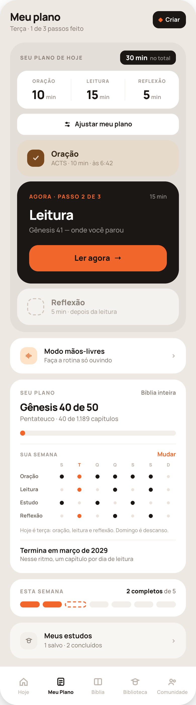
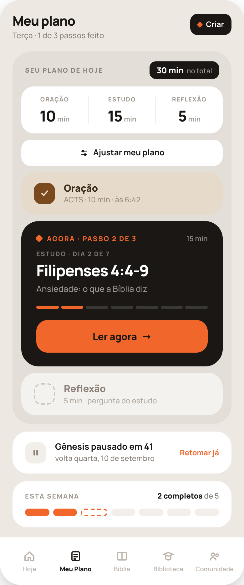
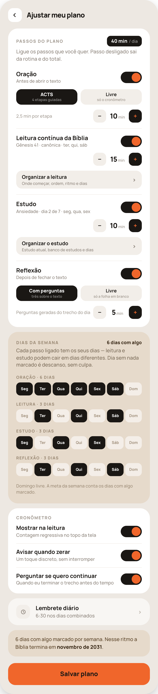
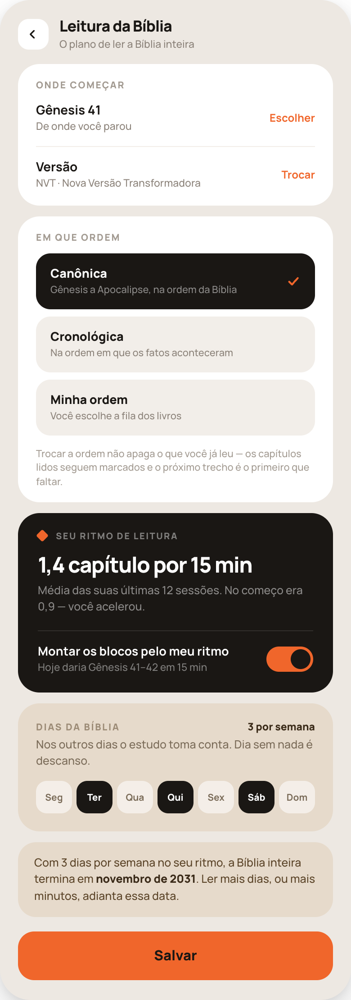
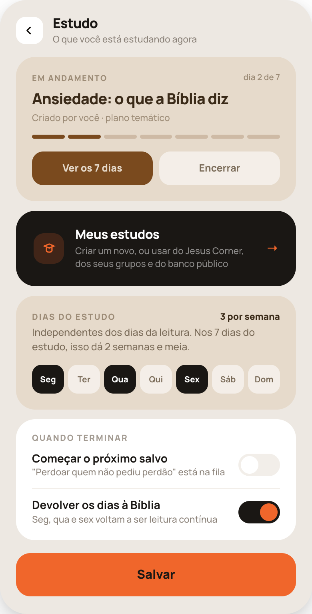
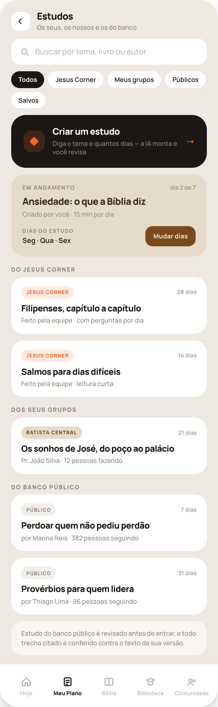
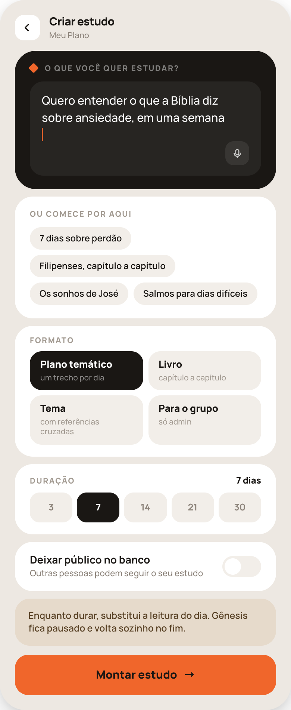
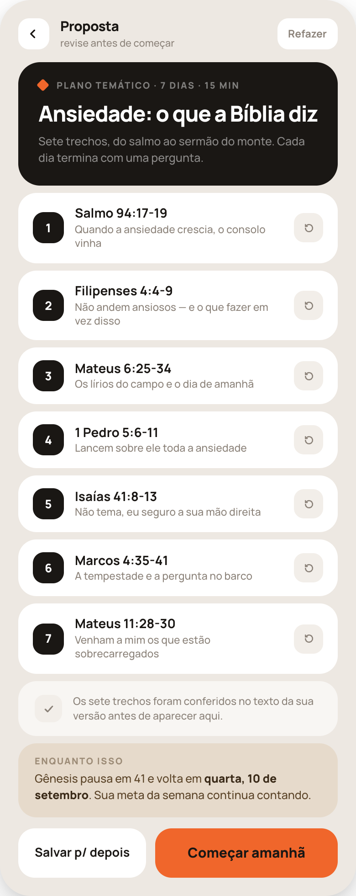
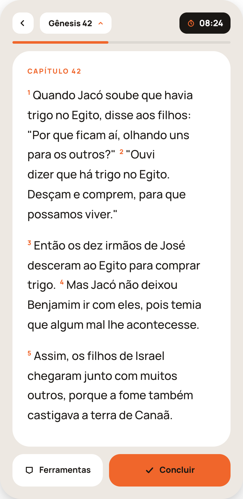
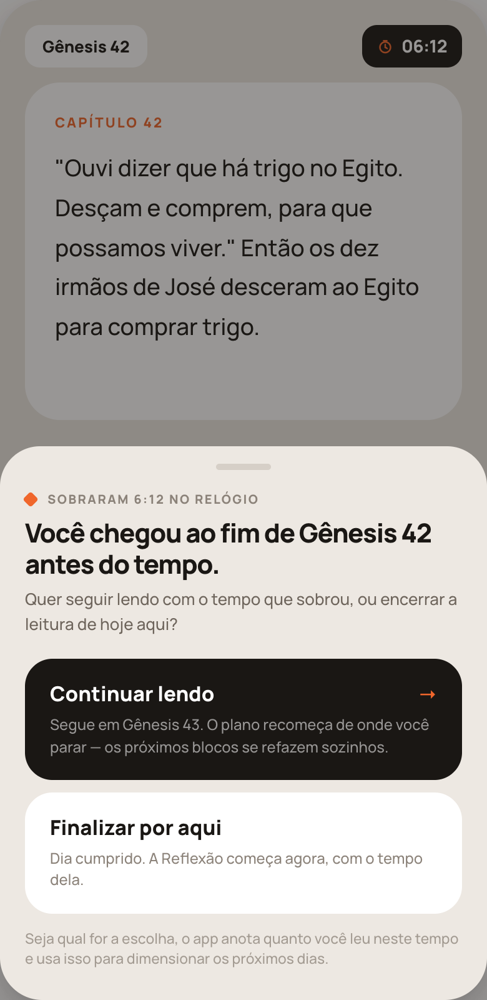

# Meu Plano — pacote de implementação (turno 35)

Dez telas da aba **Meu Plano** do Jesus Corner, prontas para implementar. Este pacote substitui as telas antigas equivalentes (4b, 5a, 22a, 22b, 22c).

```
handoff-meu-plano-35/
├── README.md                      ← você está aqui: como usar o pacote
├── PROMPT-CODE.md                 ← cole isto no Claude Code para começar
├── HANDOFF-35-meu-plano.md        ← especificação tela por tela + regras de produto
├── 35a-meu-plano.png              ← Meu Plano, dia normal
├── 35b-estudo-ativo.png           ← Meu Plano, com estudo ativo
├── 35c-ajustar.png                ← Ajustar meu plano
├── 35d-criar-estudo.png           ← Criar estudo (pedido à IA)
├── 35e-proposta.png               ← Proposta do estudo
├── 35f-leitura-relogio.png        ← Leitura com contagem regressiva
├── 35g-fim-antes-do-tempo.png     ← Folha: terminou antes do tempo
├── 35h-estudos.png                ← Estudos (criar / Jesus Corner / grupos / público)
├── 35i-organizar-leitura.png      ← Leitura da Bíblia (ordem, ritmo, dias)
└── 35j-organizar-estudo.png       ← Estudo (atual, banco, dias, fim)
```

## A regra número 1

**Os quadros são a verdade.** Cada PNG é uma tela real, inteira, em 390px de largura — não é inspiração, é o layout a ser reproduzido: mesma ordem de blocos, mesmos raios, mesmos pesos de fonte, mesmas cores, mesmos espaçamentos, mesmo texto de interface.

**Os valores não são a verdade.** Nomes, datas, capítulos, minutos, contagens, nomes de estudo e de grupo são exemplos de uma conta. Cada usuário tem os seus. O que precisa ser fiel é: o quadro, o layout, os estados e os links entre as telas.

## Telas altas = uma tela com rolagem

Vários PNGs são mais altos que um celular (35a tem 1395px de altura em 390px de largura). **Não são duas telas.** São uma tela só, capturada inteira para caber numa imagem.

- O cabeçalho **rola junto** com o conteúdo (não é sticky).
- A **barra de abas** (35a, 35b, 35h) é **fixa no rodapé**, sobreposta ao conteúdo; na imagem ela aparece no fim porque é onde encosta.
- Em 35c, 35d, 35e, 35i, 35j o **botão primário do rodapé é fixo** e o conteúdo rola atrás dele.


## As dez telas

### 35a — Meu Plano, dia normal


### 35b — Meu Plano com estudo ativo (mesma rota de 35a, outro estado)


### 35c — Ajustar meu plano


### 35i — Leitura da Bíblia (abre de "Organizar a leitura", em 35c)


### 35j — Estudo (abre de "Organizar o estudo", em 35c)


### 35h — Estudos: criar, Jesus Corner, grupos e banco público


### 35d — Criar estudo (o pedido à IA)


### 35e — Proposta do estudo (revisar antes de começar)


### 35f — Leitura com o relógio


### 35g — Terminou o trecho antes do tempo (folha sobre 35f)


## Mapa de navegação

```
Aba Meu Plano
│
├── 35a  Meu Plano (dia normal)  ─── mesma rota, dois estados ─── 35b  Meu Plano (estudo ativo)
│     ├── "Criar" (cabeçalho) ─────────────────────────────────► 35d  Criar estudo
│     ├── "Ajustar meu plano" (dentro do bloco da rotina) ─────► 35c  Ajustar meu plano
│     ├── "Ler agora" (bloco preto) ───────────────────────────► 35f  Leitura com relógio
│     ├── "Mudar" (grade Sua semana) ──────────────────────────► 35c  (rolando até Dias da semana)
│     ├── "Modo mãos-livres" ──────────────────────────────────► (fora deste pacote)
│     └── "Meus estudos" ──────────────────────────────────────► 35h  Estudos
│
├── 35b  extra: "Retomar já" (cartão Gênesis pausado) → encerra o estudo e volta para 35a
│
├── 35c  Ajustar meu plano
│     ├── "Organizar a leitura" (linha da Leitura) ────────────► 35i  Leitura da Bíblia
│     ├── "Organizar o estudo" (linha do Estudo) ──────────────► 35j  Estudo
│     ├── "Lembrete diário" ───────────────────────────────────► (fora deste pacote)
│     └── "Salvar plano" → volta para 35a com o plano novo
│
├── 35i  Leitura da Bíblia
│     ├── "Escolher" (onde começar) ───────────────────────────► lista de livros (turno 28)
│     ├── "Trocar" (versão) ───────────────────────────────────► seletor de versão
│     ├── "Minha ordem" ───────────────────────────────────────► tela de ordem dos livros (28c)
│     └── "Salvar" → volta para 35c
│
├── 35j  Estudo
│     ├── "Ver os 7 dias" ─────────────────────────────────────► lista de dias (mesma estrutura de 35e, editável)
│     ├── "Encerrar" → encerra o estudo, volta para 35c
│     ├── "Meus estudos" (bloco preto) ────────────────────────► 35h  Estudos
│     └── "Salvar" → volta para 35c
│
├── 35h  Estudos
│     ├── "Criar um estudo" (bloco preto) ─────────────────────► 35d  Criar estudo
│     ├── "Mudar dias" (estudo em andamento) ──────────────────► 35j  (bloco Dias do estudo)
│     └── cartão de estudo (qualquer origem) ──────────────────► prévia do estudo (35e com "Começar")
│
├── 35d  Criar estudo ── "Montar estudo" ────────────────────────► 35e  Proposta
│
├── 35e  Proposta
│     ├── "Refazer" (cabeçalho) → nova proposta, mesma tela
│     ├── "Salvar p/ depois" → guarda em 35h (chip "Salvos"), volta para 35c/35a
│     └── "Começar amanhã" → ativa o estudo, volta para 35a no estado 35b
│
├── 35f  Leitura com relógio
│     ├── pílula do relógio → pausa / retoma
│     ├── "Ferramentas" ───────────────────────────────────────► folha de ferramentas (5e)
│     ├── "Concluir" → se terminou o trecho com tempo sobrando ► 35g
│     └── "Concluir" → sem tempo sobrando → próximo passo (Reflexão)
│
└── 35g  Fim antes do tempo (folha sobre 35f)
      ├── "Continuar lendo" → segue em 35f no trecho seguinte + reescreve o plano
      └── "Finalizar por aqui" → fecha o passo, vai para a Reflexão
```

## Ordem sugerida de implementação

1. **35c → 35i → 35j** — o modelo de dados do plano nasce aqui (passos ligados, minutos, métodos, ordem, dias por passo, ritmo).
2. **35a / 35b** — a tela que consome esse modelo (rotina do dia, grade da semana, meta).
3. **35f → 35g** — relógio e o fluxo de terminar antes do tempo (inclui a reescrita do plano).
4. **35h → 35d → 35e** — banco de estudos e criação.

## O que revisar antes de fechar

O checklist está no fim de `HANDOFF-35-meu-plano.md`. Os três pontos que mais quebram na implementação:

1. **Meta da semana** = dias cumpridos ÷ dias com **algum** passo marcado. O mesmo número tem de aparecer na grade de 35a, na pílula de 35c e no cartão "Esta semana".
2. **Passo desligado desaparece** de tudo: da rotina, da faixa de tempos, do total, do "passo N de M" e da grade.
3. **"Continuar lendo"** (35g) não é só seguir lendo: o ponto de retomada e todas as sessões seguintes são recalculados.
