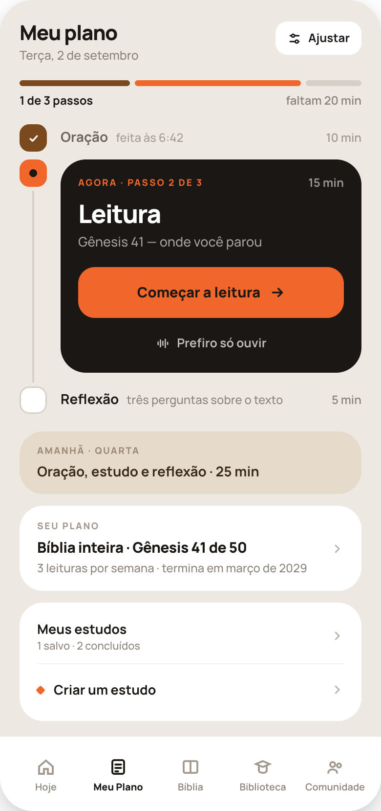
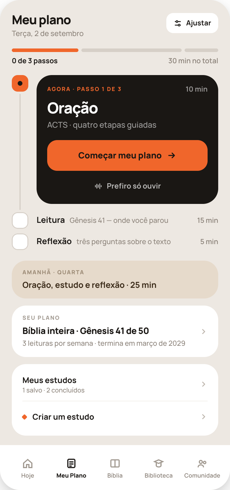
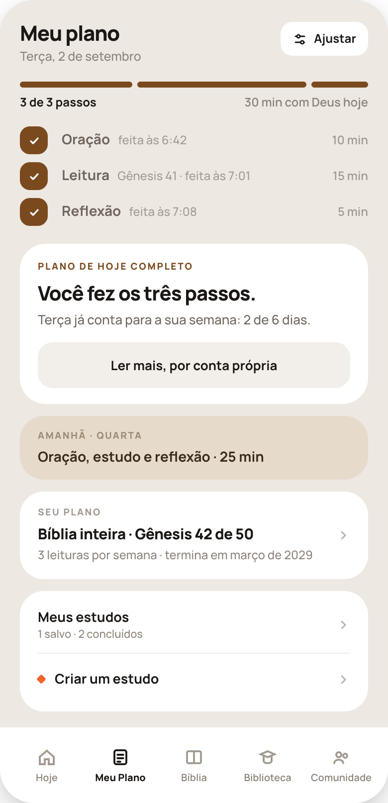
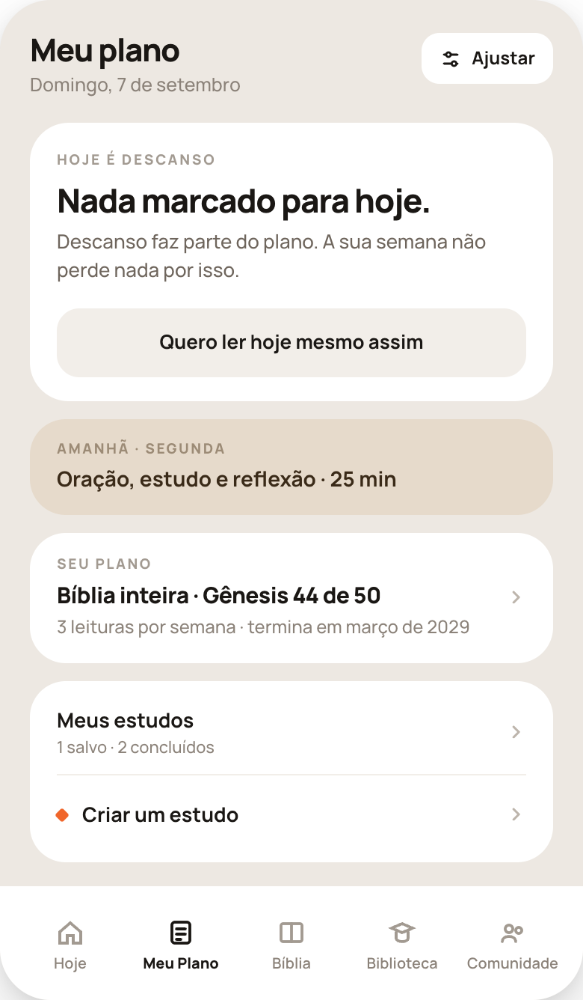
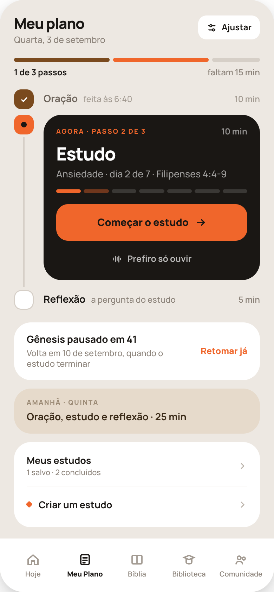
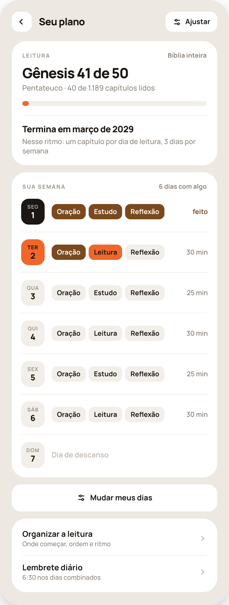
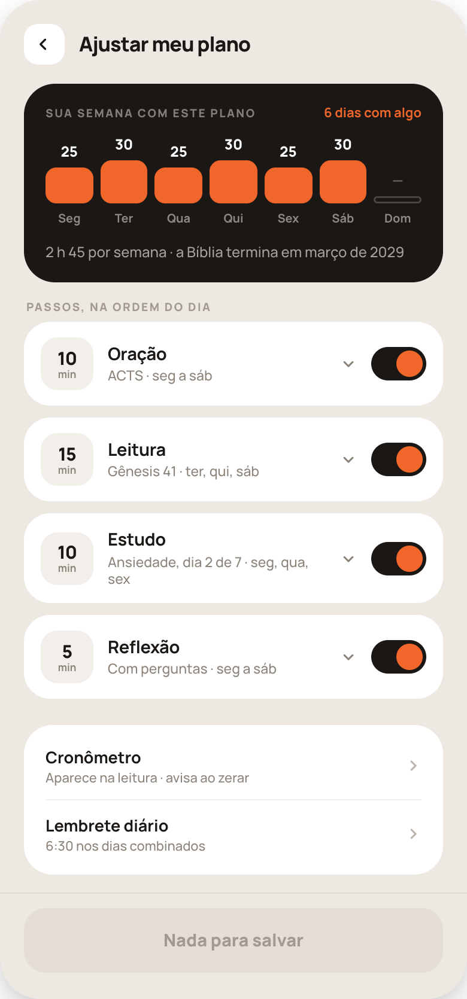
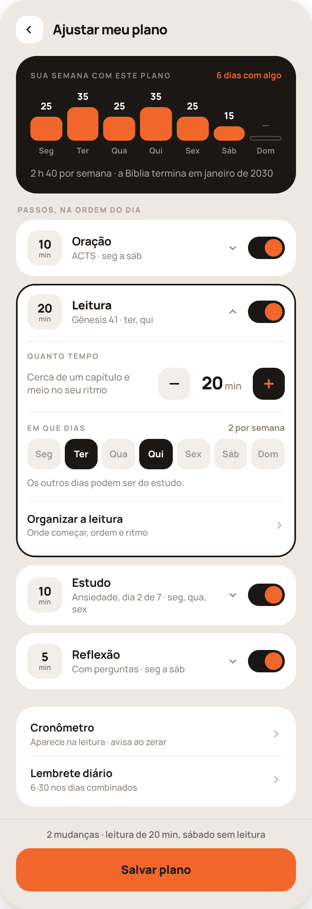
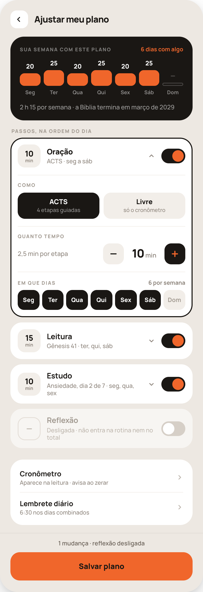
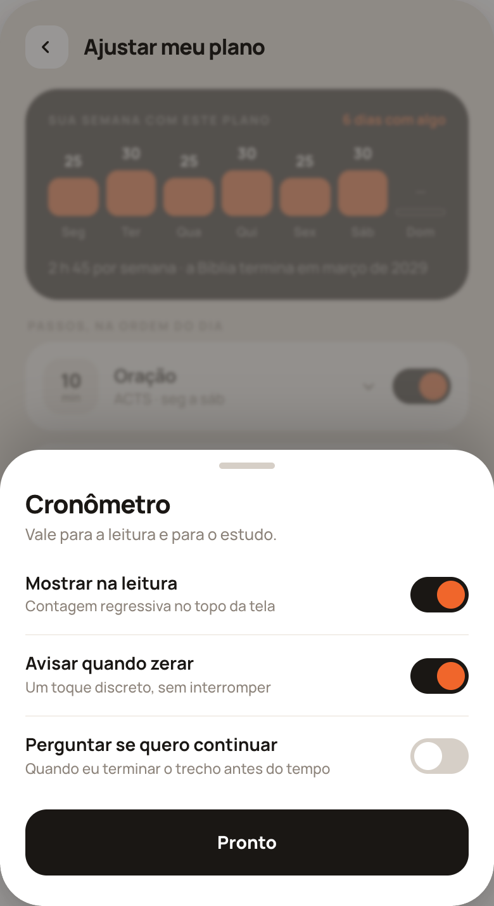

# HANDOFF — Meu Plano, mais simples (P1–P6 e A1–A4)

Substitui **35a**, **35b** e **35c**. Onde este documento não fala, vale `handoff-meu-plano-35/HANDOFF-35-meu-plano.md` — em especial as regras dos passos, dos dias por trilha, do ritmo aprendido e de dados.

## 1. Regras da tela

1. **Um botão de ação, e só um.** É o botão laranja dentro do cartão preto. Nenhuma linha de passo é tocável; ninguém pula passo por aqui.
2. **O botão vale para o dia inteiro.** Abre o passo de agora e, ao concluir, **emenda o seguinte sem voltar para o Meu Plano**. Terminado o último, vai para o fecho do dia. (Comportamento que já existe em 35a — não mude.)
3. **Só entram os passos de hoje.** Passo desligado em Ajustar, ou que não cai hoje, **não aparece**. Não há linha esmaecida, nem "—", nem "hoje não é dia de…".
4. **Ordem dos passos:** Oração → Leitura → Estudo → Reflexão, pulando o que não acontece hoje.
5. **Nada de cobrança.** Sem vermelho, sem alerta, sem "você está atrasado". Dia de descanso e dia incompleto são ditos com calma.

## 2. Tokens

Use os que já existem em `src/index.css`. Todos os valores abaixo já são usados em outras telas do app.

`#EDE8E2` fundo · `#fff` cartão · `#1A1714` preto · `#F0662B` laranja · `#7A4A1E` marrom (feito) · `#E6DACB` areia · `#F2EEE9` areia clara · `#D6CFC7` trilho e contorno.
Texto: `#1A1714` · `#3A2A18` (sobre areia) · `#6E655C` · `#8B8279` · `#A29A91` · `#9C8B76` (rótulo sobre areia) · `#BDB5AC` (chevron, inativo).
**Sobre laranja o texto é `#1A1714`, nunca branco.**
Tipografia: Manrope em tudo.

## 3. Estrutura comum de P1–P5

De cima para baixo. Largura do conteúdo: a da tela, com 20px de cada lado.

### 3.1 Cabeçalho
`padding:22px 20px 0`; duas colunas, `align-items:flex-start`, `justify-content:space-between`.
- Esquerda: **Meu plano** (fixo; 800 21px/1.1, letter-spacing -0.7px, `#1A1714`) e, 4px abaixo, a data por extenso — "{Dia da semana}, {d} de {mês}" (500 12.5px, `#8B8279`). **A contagem de passos saiu do subtítulo**; ela vive na barra.
- Direita: botão **Ajustar** — altura 34, `padding:0 12px`, raio 12, fundo `#fff`, ícone de controles 15px + rótulo (700 12px, `#1A1714`), `gap:7px`. → **A1** (§12). O ícone é o mesmo que 35a já usa em "Ajustar meu plano".

### 3.2 Corpo
`padding:18px 20px 0`; coluna com `gap:12px`. A barra de abas vem depois, com o `margin-top:16px` que ela já tem.

### 3.3 Barra de progresso do dia  *(não aparece em P4)*
- Uma linha de segmentos, `display:flex; gap:5px`, um por passo de hoje, cada um com **`flex` igual aos minutos do passo** (10 / 15 / 5). Altura 6, raio 99.
  - passo feito: `#7A4A1E` · passo de agora: `#F0662B` · passo por vir: `#D6CFC7`.
- 9px abaixo, uma linha com dois textos nas pontas:
  - esquerda (700 12px, `#1A1714`): **"{feitos} de {total} passos"** — "1 de 1 passo" no singular;
  - direita (600 12px, `#8B8279`): **"{X} min no total"** se nada foi feito · **"faltam {X} min"** se há passo feito e passo por fazer · **"{X} min com Deus hoje"** se tudo foi feito. Em "faltam", X é a soma dos passos não concluídos.

### 3.4 O caminho
Contêiner com `padding-top:6px`. Uma linha por passo de hoje. Cada linha é `display:flex; gap:14px`:
- **coluna do trilho**, 28px de largura, coluna centralizada: o **nó** (28×28, raio 10) e, abaixo dele, o **fio** — 2px de largura, `#D6CFC7`, `margin:4px 0`, `flex:1` (cresce até a altura do conteúdo ao lado). **O último passo não tem fio.**
- **coluna do conteúdo**, `flex:1; min-width:0`, com `padding-bottom:14px` (0 no último).

**Nó, por estado:**
| Estado | Nó |
|---|---|
| feito | fundo `#7A4A1E`, check branco de 13px (traço 2.6, pontas redondas) |
| agora | fundo `#F0662B`, ponto `#1A1714` de 8px no centro |
| por vir | fundo `#fff`, contorno interno 1.5px `#D6CFC7` |

**Conteúdo, por estado:**

**Passo feito** — uma linha, `align-items:baseline; gap:8px; padding-top:5px`:
nome (700 14px, `#6E655C`) · "feita às {H:MM}" (`flex:1`; 500 12px, `#A29A91`) · "{N} min" (600 12px, `#A29A91`).
Leitura e Estudo feitos mostram o trecho antes da hora: "Gênesis 41 · feita às 7:01". Concordância: Oração/Leitura/Reflexão "feita", Estudo "feito".

**Passo por vir** — a mesma linha em outra tinta:
nome (700 14px, `#1A1714`) · uma descrição curta em minúsculas (500 12px, `#8B8279`) · "{N} min" (600 12px, `#8B8279`).
Descrições: Oração "ACTS · quatro etapas guiadas" ou "livre"; Leitura "{Livro} {cap} — onde você parou"; Estudo "{nome} · dia {n} de {m}"; Reflexão "três perguntas sobre o texto", "folha em branco" (modo livre) ou "a pergunta do estudo" (dia de estudo).

**Passo de agora** — o cartão preto. É o único elemento grande da tela.
- Cartão: raio 26, fundo `#1A1714`, `padding:18px 18px 16px`.
- Linha de topo (`space-between`, margem inferior 12): **"AGORA · PASSO {n} DE {total}"** (800 9.5px, letter-spacing .14em, maiúsculas, `#F0662B`) · "{N} min" (700 12px, `rgba(255,255,255,.55)`).
- Nome do passo: 800 26px/1.05, letter-spacing -1px, `#fff`, margem inferior 6.
- Descrição: 500 13.5px/1.4, `rgba(255,255,255,.6)`, margem inferior 16 (12 quando vem a trilha do estudo logo abaixo). Leitura: "Gênesis 41 — onde você parou". Oração: "ACTS · quatro etapas guiadas". Estudo: "{nome} · dia {n} de {m} · {referência}". Reflexão: "Três perguntas sobre o texto".
- **Só no Estudo — a trilha de dias:** `display:flex; gap:4px`, um traço por dia do estudo, altura 5, raio 99, margem inferior 16. Dia feito `#F0662B` · dia de hoje `rgba(240,102,43,.4)` · dia por vir `rgba(255,255,255,.14)`.
- **O botão:** altura 52, raio 17, fundo `#F0662B`, conteúdo centralizado com `gap:9px`: rótulo (800 14.5px, `#1A1714`) + seta para a direita de 16px (`#1A1714`, traço 2.2).
- **O link:** linha de 40px de altura, `margin:6px 0 -6px`, centralizada, `gap:8px`: ícone de onda sonora 14px + **"Prefiro só ouvir"** (fixo; 700 12.5px), ambos `rgba(255,255,255,.7)`. A área de toque é a linha inteira.

**Rótulo do botão:**
| Situação | Rótulo |
|---|---|
| Nenhum passo feito hoje | **Começar meu plano** |
| Há passo feito; o de agora ainda não foi aberto | **Começar a oração** / **Começar a leitura** / **Começar o estudo** / **Começar a reflexão** |
| O passo de agora foi aberto e interrompido | **Continuar a oração** / **a leitura** / **o estudo** / **a reflexão** |

### 3.5 Cartão "Amanhã"
Raio 24, fundo `#E6DACB`, `padding:15px 18px`. **Não é tocável.**
- Rótulo: **"AMANHÃ · {DIA DA SEMANA}"** (800 9.5px, .13em, maiúsculas, `#9C8B76`), margem inferior 7.
- Texto (700 14px/1.25, `#3A2A18`): os passos por extenso + o total — "Oração, leitura e reflexão · 30 min". Dois passos: "Oração e leitura". Um: "Oração".
- Se amanhã é descanso, o cartão mostra o **próximo dia com algo marcado**, e o rótulo vira **"PRÓXIMO DIA · {DIA DA SEMANA}"**.
- Quando é o primeiro cartão depois do caminho, leva `margin-top:6px`; quando vem depois de outro cartão, não.

### 3.6 Linha "Seu plano"  *(não aparece em P5)*
Cartão raio 24, `#fff`, `padding:16px 18px`, `display:flex; align-items:center; gap:12px`. Tocável inteiro → **P6**.
- Rótulo **SEU PLANO** (800 9.5px, .13em, `#A29A91`), margem inferior 8.
- Título (800 15px/1.2, -0.3px): **"{nome do plano} · {Livro} {capítulo da próxima leitura} de {capítulos do livro}"** — "Bíblia inteira · Gênesis 41 de 50". Margem inferior 4.
- Linha (500 12px, `#8B8279`): **"{n} leituras por semana · termina em {mês} de {ano}"**. n = dias com Leitura marcada. Singular "1 leitura por semana".
- Chevron 14px `#BDB5AC` à direita.

### 3.7 Cartão "Meus estudos"
Cartão raio 24, `#fff`, `padding:6px 18px`, duas linhas:
- **Meus estudos** (700 13.5px) + "{n} salvo(s) · {m} concluído(s)" (500 11px, `#8B8279`) + chevron. Altura 56, divisor `#F2EEE9` embaixo.
- Losango laranja de 7px (quadrado girado 45°, raio 1.5) + **Criar um estudo** (fixo; 700 13.5px) + chevron. Altura 52. → 35d. É o mesmo losango do antigo botão "Criar".

### 3.8 Barra de abas
Sem mudança. "Meu Plano" ativo.

---

## 4. P1 — no meio do dia

Barra: marrom · laranja · cinza. Esquerda "1 de 3 passos", direita "faltam 20 min".
Caminho: Oração (feita) → **Leitura (cartão preto)** → Reflexão (por vir).
Depois: Amanhã · Seu plano · Meus estudos.

## 5. P2 — antes de começar

Barra: laranja · cinza · cinza. "0 de 3 passos" · "30 min no total".
Caminho: **Oração (cartão preto, "Agora · passo 1 de 3")** → Leitura → Reflexão. Botão: **Começar meu plano**.

## 6. P3 — dia completo

Barra: toda marrom. "3 de 3 passos" · "30 min com Deus hoje".
Caminho: três linhas feitas, cada uma com a sua hora. **Não há cartão preto nem botão laranja.**
Logo abaixo do caminho (`margin-top:6px`), cartão branco, raio 26, `padding:18px 18px 16px`:
- **PLANO DE HOJE COMPLETO** (fixo; 800 9.5px, .14em, `#7A4A1E`), margem inferior 10;
- **"Você fez os {três} passos."** (800 20px/1.15, -0.6px) — o número por extenso até dez; "Você fez o passo de hoje." se era um só;
- "{Dia} já conta para a sua semana: {feitos} de {meta} dias." (500 13px/1.45, `#6E655C`), margem inferior 14. A meta é o número de **dias com algo marcado** na semana — a regra que já existe (meta semanal = dias cumpridos ÷ dias com algo marcado). Use a função que o app já tem para isso; não recalcule de outro jeito;
- botão secundário, altura 46, raio 15, fundo `#F2EEE9`: **Ler mais, por conta própria** (fixo; 700 13px) → leitura livre.
Depois: Amanhã · Seu plano (já apontando para o próximo capítulo) · Meus estudos.

## 7. P4 — dia de descanso

Dia sem nenhum passo marcado. **Sem barra e sem caminho.** O corpo começa por um cartão branco, raio 26, `padding:20px 18px 16px`:
- **HOJE É DESCANSO** (fixo; 800 9.5px, .14em, `#A29A91`), margem inferior 10;
- **"Nada marcado para hoje."** (fixo; 800 22px/1.12, -0.7px), margem inferior 6;
- **"Descanso faz parte do plano. A sua semana não perde nada por isso."** (fixo; 500 13px/1.45, `#6E655C`), margem inferior 16;
- botão secundário (46, raio 15, `#F2EEE9`): **Quero ler hoje mesmo assim** (fixo) → leitura livre.
Depois: Amanhã · Seu plano · Meus estudos.

## 8. P5 — dia de estudo

Quando há um estudo ativo e hoje é dia dele.
- O **Estudo ocupa o lugar da Leitura** no caminho, com os minutos dele. No cartão preto: nome "Estudo", descrição "{nome} · dia {n} de {m} · {referência}", **a trilha de dias**, botão **Começar o estudo**.
- A Reflexão passa a dizer **"a pergunta do estudo"**.
- Depois do caminho (`margin-top:6px`), cartão branco, raio 24, `padding:15px 18px`, `display:flex; align-items:center; gap:12px`: **"{Livro} pausado em {capítulo}"** (700 14px) + **"Volta em {d} de {mês}, quando o estudo terminar"** (500 12px, `#8B8279`) e, à direita, **Retomar já** (fixo; 800 12.5px, `#F0662B`). Um toque pede **uma confirmação simples**, abandona o estudo e devolve a leitura contínua — sem diálogo de culpa (regra de 35b, mantida).
- **A linha "Seu plano" não aparece** enquanto o estudo corre: o cartão de pausa a substitui.
- Amanhã e Meus estudos continuam.
- Se o plano tem **leitura e estudo no mesmo dia** (trilhas independentes, ver "Dias por trilha" no handoff 35), os dois entram no caminho — Oração → Leitura → Estudo → Reflexão — e não há cartão de pausa.

## 9. P6 — Seu plano (tela nova)

Push a partir da linha "Seu plano". **Sem barra de abas.**

1. **Cabeçalho** — `padding:20px 20px 0`, `align-items:center; gap:12px`: voltar (34×34, raio 12, `#fff`, seta 16px) · **Seu plano** (fixo; 800 17px, -0.5px) · botão **Ajustar** igual ao de 3.1 → 35c.
2. **Corpo** — `padding:16px 20px 22px`, coluna com `gap:12px`.
3. **Cartão da leitura** — raio 24, `#fff`, `padding:18px 18px 16px`:
   - topo: **LEITURA** (rótulo) · nome do plano à direita (700 11px, `#8B8279`);
   - **"{Livro} {capítulo da próxima leitura} de {capítulos}"** (800 24px/1.05, -0.9px), margem inferior 6;
   - "{Seção} · {lidos} de 1.189 capítulos lidos" (500 12.5px, `#8B8279`), margem inferior 14;
   - barra de 8px, raio 99, trilho `#F2EEE9`, preenchimento `#F0662B` com largura = lidos/1189 e **mínimo de 8px** quando lidos > 0; margem inferior 16;
   - divisor `#F2EEE9`, 14px de respiro;
   - **"Termina em {mês} de {ano}"** (800 15px, -0.3px) e "Nesse ritmo: {ritmo}, {n} dias por semana" (500 12px, `#8B8279`). A projeção é a que já existe (ritmo aprendido; usa só os dias de leitura).
4. **Cartão "Sua semana"** — raio 24, `#fff`, `padding:18px 16px 4px`:
   - topo: **SUA SEMANA** · "{n} dias com algo" (700 11px, `#8B8279`) — o mesmo número do cartão preto de A1;
   - **sete linhas, de segunda a domingo**, `padding:12px 0`, divisor `#F2EEE9` entre elas (não acima da primeira). Cada linha, `align-items:center; gap:12px`:
     - **o dia**: bloco 40×44, raio 13, com a abreviação (800 9px, .06em, maiúsculas) sobre o número do dia do mês (800 14px), `gap:3px`. **Hoje:** fundo `#F0662B`, textos `#1A1714`. **Dia já cumprido:** fundo `#1A1714`, abreviação `rgba(255,255,255,.6)`, número `#fff`. **Demais:** fundo `#F2EEE9`, abreviação `#A29A91`, número `#1A1714`;
     - **os passos do dia**, `flex:1; flex-wrap:wrap; gap:5px`, um chip por passo na ordem de execução. Chip: altura 26, raio 9, `padding:0 9px`, 700 11.5px. **Feito:** `#7A4A1E` com texto `#fff`. **O de agora (só hoje):** `#F0662B` com texto `#1A1714`. **Por fazer:** `#F2EEE9` com texto `#1A1714`;
     - **à direita:** "feito" (700 11.5px, `#7A4A1E`) se o dia foi cumprido; senão o total "{N} min" (600 11.5px, `#8B8279`);
     - **dia sem nada:** no lugar dos chips, "Dia de descanso" (600 12.5px, `#BDB5AC`), e nada à direita.
   - Dia passado **não cumprido**: chips feitos em marrom, os demais em `#F2EEE9`, e à direita o total de minutos — **sem vermelho, sem "perdido"**.
5. **Mudar meus dias** — botão branco, altura 46, raio 15, ícone de controles + rótulo (700 13px) → **A1 já com o passo Leitura aberto** e rolada até "EM QUE DIAS" (§12.4). Se a Leitura estiver desligada, abre o primeiro passo ligado.
6. **Lista** — cartão raio 24, `padding:6px 18px`, linhas de 56px: **Organizar a leitura** / "Onde começar, ordem e ritmo" → 35i · **Lembrete diário** / "{H:MM} nos dias combinados" → a tela de lembrete que 35c já abre. Divisor `#F2EEE9` entre elas.

Com estudo ativo, P6 continua acessível por "Ajustar"? **Não** — P6 só abre pela linha "Seu plano", que some em P5. Não crie outro caminho.

---

## 10. Estados e casos extremos

| Caso | Comportamento |
|---|---|
| Carregando | Esqueleto `#F2EEE9`: uma barra, uma linha, um bloco da altura do cartão preto, uma linha. Nunca spinner de tela cheia. |
| Um passo só no dia | Barra com um segmento; caminho com um nó, sem fio; "passo 1 de 1"; "1 de 1 passo". |
| Quatro passos (leitura + estudo) | Quatro segmentos, quatro nós. O cartão preto é sempre e só o passo de agora. |
| Passo aberto e interrompido | Continua sendo o "agora"; botão "Continuar …"; se o relógio já correu, os minutos do topo do cartão mostram o que **falta** ("9 min"). |
| Passo desligado em Ajustar | Não aparece, não entra no total nem na contagem. |
| Todos os passos desligados para hoje | É dia de descanso (P4). |
| Virou o dia com o app aberto | A tela recalcula ao voltar para o primeiro plano. |
| Sem plano de leitura criado | Fora do escopo — o onboarding garante um plano. Se acontecer, mostre P4 com o botão levando a Ajustar, e me avise. |
| Nome de estudo ou referência longa | Quebra em duas linhas dentro do cartão preto; nunca corta com reticências. |
| Hora | Formato 24 h sem zero à esquerda na hora: "6:42", "19:05". |
| Plurais | "1 passo", "1 min", "1 leitura por semana", "1 salvo · 1 concluído". |

## 11. O que apagar

Depois que P1–P6 e A1–A4 estiverem aprovadas: de 35c, o cartão único "PASSOS DO PLANO" com a pílula "40 min / dia", o bloco areia "DIAS DA SEMANA" com as quatro fileiras, o cartão "CRONÔMETRO" na rolagem e o cartão areia de projeção no fim. De 35a/35b: o bloco "SEU PLANO DE HOJE" com a lista branca, o bloco preto "Continuar meu plano", o cartão "Modo mãos-livres" **desta tela**, o cartão "Seu plano" com a grade de bolinhas, o cartão "Esta semana" **desta tela**, o botão "Criar" do cabeçalho, e a linha de passo desligado. Antes de apagar qualquer componente, confirme que nenhuma outra tela o usa. **O modo mãos-livres em si, a leitura livre, Ajustar, Organizar e Estudos não são tocados.**

---

## 12. Ajustar meu plano (A1–A4) — substitui 35c

A tela continua respondendo às mesmas perguntas de 35c — **quais passos, quanto tempo, em que dias** — e **nenhuma função saiu**. Muda a organização: o resultado em cima, os passos embaixo, **um aberto de cada vez**, e os dias de cada passo **dentro do próprio passo**.

As regras de 35c continuam valendo, sem exceção: pelo menos um entre Leitura e Estudo ligado (ao tentar desligar o último, explique numa linha dentro do passo em vez de bloquear em silêncio); Oração e Reflexão podem estar as duas desligadas; minutos de 5 a 60, de 5 em 5; Bíblia e Estudo com dias independentes; Oração e Reflexão com dias próprios; os dias de Leitura e de Estudo também editáveis em 35i e 35j (é o mesmo dado).

### 12.1 Rascunho e salvar
- Tudo o que a pessoa mexe nesta tela (interruptores, modo, minutos, dias, e a folha do cronômetro) fica num **rascunho em memória**. **Nada é gravado antes de "Salvar plano".**
- O cartão preto, os resumos das linhas e o rodapé são calculados **a partir do rascunho**, a cada toque.
- Voltar com mudanças não salvas pede uma confirmação simples: "Sair sem salvar?" · **Salvar** / **Descartar**.
- "Organizar a leitura" (35i), "Organizar o estudo" (35j) e "Lembrete diário" são telas próprias, com o seu próprio salvar, como hoje. Se houver rascunho ao tocar nelas, ele **viaja junto e volta intacto**.

### 12.2 A1 — tudo fechado

Push, **sem barra de abas**. De cima para baixo:

1. **Cabeçalho** — `padding:20px 20px 0`, `align-items:center; gap:12px`: voltar (34×34, raio 12, `#fff`) · **Ajustar meu plano** (fixo; 800 17px, -0.5px).
2. **Corpo** — `padding:16px 20px 0`, coluna com `gap:10px`.
3. **Cartão preto "Sua semana com este plano"** — raio 26, fundo `#1A1714`, `padding:18px 18px 16px`. **Não é tocável.**
   - Topo (`space-between`, margem inferior 16): **SUA SEMANA COM ESTE PLANO** (fixo; 800 9.5px, .13em, `rgba(255,255,255,.45)`) · **"{n} dias com algo"** (700 11px, `#F0662B`).
   - **Sete colunas**, segunda a domingo: `display:flex; gap:6px; align-items:flex-end`. Cada coluna (`flex:1`, centralizada, `gap:7px`): o total de minutos do dia (800 12px, `#fff`) · a barra · a abreviação do dia (700 10px, `rgba(255,255,255,.5)`).
     - **Barra:** largura total da coluna, raio 9, `#F0662B`, **altura = minutos ÷ 40 × 48px** (25 min → 30px; 30 → 36px; 35 → 42px), limitada a 72px.
     - **Dia sem nada:** no lugar do número, "—" (`rgba(255,255,255,.3)`); no lugar da barra, um traço de 6px de altura, raio 99, só com contorno interno 1.5px `rgba(255,255,255,.2)`.
     - Minutos do dia = soma dos passos **ligados** que caem naquele dia.
   - Rodapé (500 12px/1.4, `rgba(255,255,255,.6)`, margem superior 16): **"{total} por semana · a Bíblia termina em {mês} de {ano}"**. Total no formato "2 h 45", "45 min", "3 h". Com a Leitura desligada, a segunda metade some.
4. **Rótulo** — **PASSOS, NA ORDEM DO DIA** (fixo; 800 9.5px, .13em, `#A29A91`), `margin:6px 2px -2px`.
5. **Quatro linhas de passo, sempre nesta ordem:** Oração · Leitura · Estudo · Reflexão. Cada uma é um cartão `#fff`, raio 22, `padding:13px 14px`, com `display:flex; align-items:center; gap:12px`:
   - **bloco dos minutos:** 44×44, raio 14, fundo `#F2EEE9`; o número (800 15px, -0.4px, `#1A1714`) sobre "min" (700 8.5px, `#8B8279`), `gap:2px`;
   - **nome** (700 14.5px, -0.2px) e, 3px abaixo, o **resumo** (500 11.5px/1.25, `#8B8279`) — pode quebrar em duas linhas, nunca corta;
   - **seta** de 14px para baixo (`#8B8279`) — para cima quando aberto;
   - **interruptor:** 46×28, raio 99; ligado = trilho `#1A1714`, botão de 22px `#F0662B` à direita; desligado = trilho `#D6CFC7`, botão `#fff` à esquerda.
   - **Tocar na linha (fora do interruptor) abre o passo. Tocar no interruptor liga/desliga sem abrir.**
   - **Resumos:** Oração "{ACTS|Livre} · {dias}" · Leitura "{Livro} {cap} · {dias}" · Estudo "{nome}, dia {n} de {m} · {dias}" (sem estudo ativo: "Nenhum estudo em andamento") · Reflexão "{Com perguntas|Livre} · {dias}".
   - **Como escrever os dias:** abreviações minúsculas separadas por vírgula ("ter, qui, sáb"); três ou mais dias seguidos viram intervalo ("seg a sáb"); os sete, "todos os dias".
6. Um respiro de 2px e o cartão **Cronômetro / Lembrete diário** — raio 24, `#fff`, `padding:6px 18px`, duas linhas de 56px com divisor `#F2EEE9`: **Cronômetro** / resumo do que está ligado ("Aparece na leitura · avisa ao zerar"; tudo desligado: "Desligado") → **A4** · **Lembrete diário** / "{H:MM} nos dias combinados" → a tela de lembrete que já existe.
7. **Rodapé fixo** — colado ao fundo da tela, fora da rolagem: fundo `#EDE8E2`, fio superior `rgba(0,0,0,.06)`, `padding:12px 20px 22px` (mais a área segura).
   - **Sem mudanças:** botão de 54px, raio 18, fundo `#E4DED7`, rótulo **Nada para salvar** (fixo; 800 14.5px, `#A29A91`), desabilitado.
   - **Com mudanças:** uma linha acima (600 11.5px, `#6E655C`, centralizada, margem inferior 9) — **"{n} mudança(s) · {o que mudou}"** — e o botão `#F0662B` com **Salvar plano** (fixo; 800 14.5px, `#1A1714`). A descrição lista até duas mudanças em minúsculas ("leitura de 20 min, sábado sem leitura"); com três ou mais, só a contagem ("4 mudanças").

### 12.3 A2 — um passo aberto

O cartão do passo aberto ganha **contorno interno de 2px `#1A1714`**, raio 24, `padding:13px 14px 14px`, e o nome sobe para peso 800. **Só um passo fica aberto por vez** — abrir outro fecha o anterior. Ao abrir, a tela rola para o topo do cartão ficar visível.

Dentro, abaixo da linha de cabeçalho, as **seções** do passo. Cada seção começa com um divisor `#F2EEE9` e tem `padding-top:14px; margin-top:14px`; o rótulo (800 9.5px, .13em, `#A29A91`, margem inferior 9) pode ter um valor à direita (700 11px, `#8B8279`).

| Passo | Seções, nesta ordem |
|---|---|
| Oração | COMO · QUANTO TEMPO · EM QUE DIAS |
| Leitura | QUANTO TEMPO · EM QUE DIAS · atalho "Organizar a leitura" |
| Estudo | QUANTO TEMPO · EM QUE DIAS · atalho "Organizar o estudo" |
| Reflexão | COMO · QUANTO TEMPO · EM QUE DIAS |

**COMO** — dois blocos lado a lado (`gap:8px`, `flex:1` cada), raio 14, `padding:10px 8px`, centralizados: título (800 13px) e subtítulo (500 10.5px). Ativo: fundo `#1A1714`, título `#fff`, subtítulo `rgba(255,255,255,.55)`. Inativo: fundo `#F2EEE9`, título `#1A1714`, subtítulo `#8B8279`.
- Oração: **ACTS** / "4 etapas guiadas" · **Livre** / "só o cronômetro".
- Reflexão: **Com perguntas** / "três sobre o texto" · **Livre** / "só a folha em branco".

**QUANTO TEMPO** — uma linha: à esquerda um texto de apoio (`flex:1`; 500 12px/1.35, `#8B8279`), à direita o seletor.
- Seletor: botão **−** (40×40, raio 13, `#F2EEE9`, traço `#1A1714`) · valor (800 22px, -0.8px) + " min" (600 12px, `#8B8279`), largura mínima 54 · botão **+** (40×40, raio 13, `#1A1714`, sinal `#F0662B`). `gap:12px`. De 5 a 60, de 5 em 5; no limite o botão fica a 40% de opacidade e não responde.
- Texto de apoio: Oração ACTS "{tempo÷4} min por etapa" (some no modo Livre) · Leitura "Cerca de {n} capítulo(s) no seu ritmo" (do ritmo aprendido; sem ritmo ainda, some) · Estudo: nada · Reflexão com perguntas "Perguntas geradas do trecho do dia".

**EM QUE DIAS** — valor à direita do rótulo: "{n} por semana". Sete botões, segunda a domingo: `display:flex; gap:5px`, cada um `flex:1; height:38px; border-radius:12px`, com a abreviação (Seg, Ter, Qua, Qui, Sex, Sáb, Dom). Marcado: fundo `#1A1714`, texto `#fff`, 800 11.5px. Desmarcado: fundo `#F2EEE9`, texto `#A29A91`, 700 11.5px. **A altura visual é 38px; a área de toque tem que chegar a 44px.**
- Só na Leitura, uma linha abaixo (500 11.5px, `#8B8279`, margem superior 9): **"Os outros dias podem ser do estudo."** (fixo).
- Desmarcar o último dia de um passo equivale a desligá-lo: o interruptor desliga e o passo fecha.

**Atalho** (Leitura e Estudo) — divisor, `padding-top:4px`, linha de 52px: título (700 13.5px) + subtítulo (500 11px, `#8B8279`) + chevron. **Organizar a leitura** / "Onde começar, ordem e ritmo" → 35i · **Organizar o estudo** / "Estudo atual e banco de estudos" → 35j.

Na captura A2, a leitura subiu de 15 para 20 min e saiu do sábado: o bloco dos minutos, o resumo ("ter, qui"), o cartão preto (35 nas terças e quintas, 15 no sábado) e o rodapé já mostram o rascunho.

### 12.4 A3 — passo desligado, e a entrada por "Mudar meus dias"

- **Passo desligado** continua na lista, na posição dele: cartão `rgba(255,255,255,.55)`; bloco dos minutos sem fundo, com contorno interno 1.5px `#E4DED7` e "—" em `#BDB5AC`; nome em `#A29A91`; resumo em `#BDB5AC` dizendo **"Desligada · não entra na rotina nem no total"** ("Desligado" para o Estudo); **sem seta**; interruptor desligado. Tocar na linha não abre — só o interruptor religa, e ao religar o passo volta com os minutos e os dias que tinha.
- **Vindo de "Mudar meus dias"** (P6): a tela abre com a **Leitura já aberta** e rolada até "EM QUE DIAS". Leitura desligada: abre o primeiro passo ligado.
- **Vindo de "Ajustar"** (cabeçalho de P1–P6): abre com tudo fechado (A1).

### 12.5 A4 — Cronômetro

Folha inferior sobre a tela escurecida (véu `rgba(26,23,20,.45)`; o que está atrás fica desfocado). Folha: `#fff`, raio 32 no topo, `padding:10px 20px 24px`, sombra `0 -18px 40px rgba(0,0,0,.18)`.
- Alça 44×5, raio 99, `#D6CFC7`, centralizada, margem inferior 16.
- **Cronômetro** (fixo; 800 20px, -0.6px) e **"Vale para a leitura e para o estudo."** (fixo; 500 12.5px, `#8B8279`).
- Três linhas, `padding:14px 0`, divisor `#F2EEE9` entre elas, cada uma com título (700 14px), descrição (500 11.5px, `#8B8279`) e interruptor — os mesmos três de 35c, com os mesmos textos e os mesmos efeitos: **Mostrar na leitura** / "Contagem regressiva no topo da tela" · **Avisar quando zerar** / "Um toque discreto, sem interromper" · **Perguntar se quero continuar** / "Quando eu terminar o trecho antes do tempo".
- Botão **Pronto** (fixo): 52px, raio 17, fundo `#1A1714`, texto `#fff`, margem superior 10. Fecha a folha. Tocar no véu ou arrastar para baixo também fecha.
- As mudanças entram no **rascunho** de A1 e contam no rodapé ("1 mudança · cronômetro"); só são gravadas em "Salvar plano".

### 12.6 Casos extremos do Ajustar

| Caso | Comportamento |
|---|---|
| Tentar desligar o último entre Leitura e Estudo | O interruptor não desliga; o passo abre e mostra, abaixo do cabeçalho, uma linha areia: "Seu plano precisa de leitura ou de estudo. Ligue o outro antes de desligar este." |
| Estudo ligado sem estudo ativo | Resumo "Nenhum estudo em andamento"; aberto, mostra só o atalho "Organizar o estudo". Não entra nos minutos do cartão preto. |
| Nenhum dia com nada | Cartão preto com sete traços, "0 dias com algo", rodapé "Nenhum dia marcado". Salvar continua permitido. |
| Mudança desfeita à mão | Se o rascunho voltar a ser igual ao salvo, o rodapé volta a "Nada para salvar". |
| Salvando | O botão mostra "Salvando…" e trava; ao concluir, volta para a tela de onde veio. Erro: fica na tela, com o rascunho, e uma linha "Não deu para salvar. Tente de novo." acima do botão. |
| Dia com 60 min ou mais | A barra para em 72px; o número continua mostrando o total real. |

## 13. Checklist

- [ ] P1–P5 são **uma rota, um componente**, cinco estados.
- [ ] Um único botão laranja na tela; nenhum em P3 e P4.
- [ ] Nenhuma linha de passo é tocável.
- [ ] O botão emenda os passos sem voltar ao Meu Plano (comportamento antigo preservado).
- [ ] Só os passos de hoje aparecem; nenhum passo esmaecido.
- [ ] Segmentos da barra proporcionais aos minutos.
- [ ] Fio do trilho acompanha a altura do cartão preto; último passo sem fio.
- [ ] Rótulo do botão conforme a tabela de 3.4.
- [ ] "Amanhã" mostra o próximo dia com algo marcado.
- [ ] Em P5 a linha "Seu plano" some e entra o cartão de pausa.
- [ ] P6 sem barra de abas; a semana por extenso, sem bolinhas.
- [ ] Texto fixo em português, palavra por palavra; texto sobre laranja `#1A1714`.
- [ ] Nenhum vermelho, alerta ou texto de cobrança.
- [ ] 35i, 35j, 35h, 35d–35g, a tela de lembrete, Hoje e a barra de abas **sem nenhuma mudança**.
- [ ] Ajustar: um passo aberto por vez; dias dentro do passo; cartão preto recalcula a cada toque; nada é gravado antes de "Salvar plano".
- [ ] Nenhum número, nome, data ou hora hardcoded.
