# Fazendo os passos — especificação (turnos 36 e 37)

Complementa `handoff-meu-plano-35/HANDOFF-35-meu-plano.md`. Ali está o plano (quais passos, quanto tempo, quais dias); aqui está a execução.

Sistema visual idêntico ao pacote 35: fundo `#EDE8E2` · tinta `#1A1714` · ação `#F0662B` · areia `#E6DACB` · realce `#FFE3C9` · cartão `#fff` · divisor `#F2EEE9` · secundário `#6E655C`/`#8B8279` · terciário `#A29A91`. Manrope 500/700/800. Raios 12 / 16-18 / 20-26 / 28-30 / 34.

Contraste: rótulos informativos nunca abaixo de `#6E655C` sobre branco e `#6B5A45` sobre areia; nada de texto informativo abaixo de 10px.

---

## 36a — A oração como passo de agora

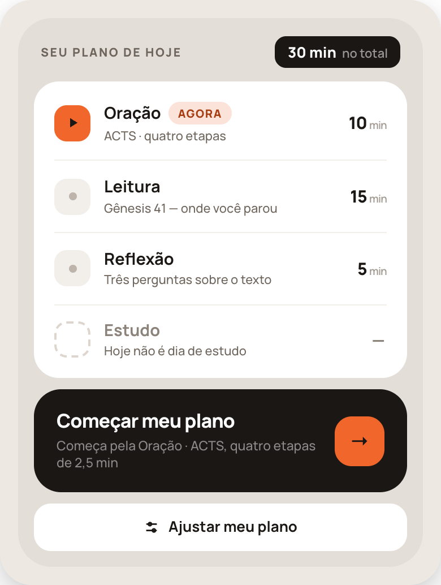

Não é tela nova: é **35a no começo do dia**, quando nada foi feito.

- O bloco "Seu plano de hoje" **lista todos os passos do dia na ordem**, com estado e minutos; o primeiro aparece como "agora". Passos que não acontecem hoje ficam no fim da lista, esmaecidos.
- **Um botão só para o dia:** "Começar meu plano" (ou "Continuar meu plano" se algo já foi feito), com a linha abaixo dizendo por onde começa e em que formato ("Começa pela Oração · ACTS, quatro etapas de 2,5 min").
- Esse botão abre a Oração (36b ou 36c conforme o método de 35c) e, **ao concluir cada passo, emenda o próximo automaticamente** — a pessoa não volta ao Meu Plano entre passos. Depois do último, vai para o fecho do dia (37c).
- Encadeamento completo de um dia com os três passos: 36b/36c → 36f → 35f → 37e → 37a/37b → 37c.

---

## 36b — Oração ACTS

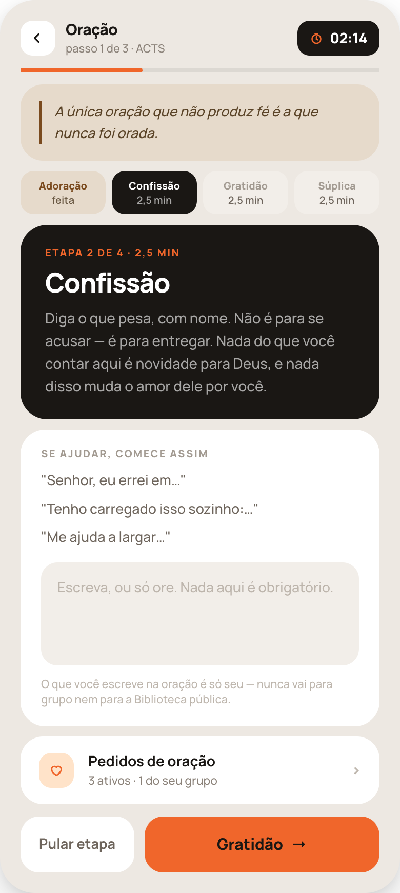

Cabeçalho: voltar · "Oração / passo 1 de 3 · ACTS" · **pílula preta com o relógio da etapa**. Abaixo, filete de 4px com o progresso da **oração inteira**.

Ordem dos blocos:

1. **Frase fixa** (areia, com filete `#7A4A1E` à esquerda, itálico): *"A única oração que não produz fé é a que nunca foi orada."* Texto do app, igual todos os dias — não é gerada por IA, não muda.
2. **Quatro chips de etapa** — Adoração · Confissão · Gratidão · Súplica. Ativa em preto, concluída em areia com "feita", futuras em `#F2EEE9` com o tempo de cada uma.
3. **Bloco escuro da etapa atual** — "Etapa N de 4 · 2,5 min", nome da etapa em 26px/800 e **a explicação em duas frases**. Textos:
   - **Adoração** — "Comece dizendo quem Deus é, não o que você precisa. Louvar antes de pedir muda o tamanho do pedido."
   - **Confissão** — "Diga o que pesa, com nome. Não é para se acusar — é para entregar. Nada do que você contar aqui é novidade para Deus, e nada disso muda o amor dele por você."
   - **Gratidão** — "Agradeça o que já veio, o pequeno junto com o grande. Lembrar do que Deus fez é o que sustenta a fé no que ainda não veio."
   - **Súplica** — "Agora peça, com nome e detalhe. Por você e pelos outros — e não tenha medo de repetir o mesmo pedido."
4. **"Se ajudar, comece assim"** — três frases de partida da etapa, em cartão branco, seguidas de um campo de texto opcional com placeholder "Escreva, ou só ore. Nada aqui é obrigatório." Nota de privacidade abaixo.
5. **Pedidos de oração** — linha navegável (ícone de coração em `#FFE3C9`) com a contagem → 36d. Na etapa **Súplica** esta linha vira a própria lista de pedidos, dentro da etapa.
6. **Rodapé fixo** — "Pular etapa" (branco, texto `#6E655C`) + botão laranja que **nomeia a próxima etapa** ("Gratidão →"), nunca "Próximo". Na última etapa o botão é "Terminei de orar".

### Cronômetro do ACTS

- Tempo total do passo ÷ 4 = tempo de cada etapa (10 min → 2,5 min). Exiba o resultado arredondado em segundos.
- O relógio do cabeçalho conta **a etapa**; o filete conta **a oração**.
- Etapa que zera **não avança sozinha**: o relógio passa a contar para cima em `#8B8279` e a pessoa avança quando quiser.
- "Pular etapa" devolve o tempo restante dela para as etapas seguintes (divide o que sobrou entre as que faltam).
- Tocar na pílula pausa e retoma; sair do app pausa.

---

## 36c — Oração livre

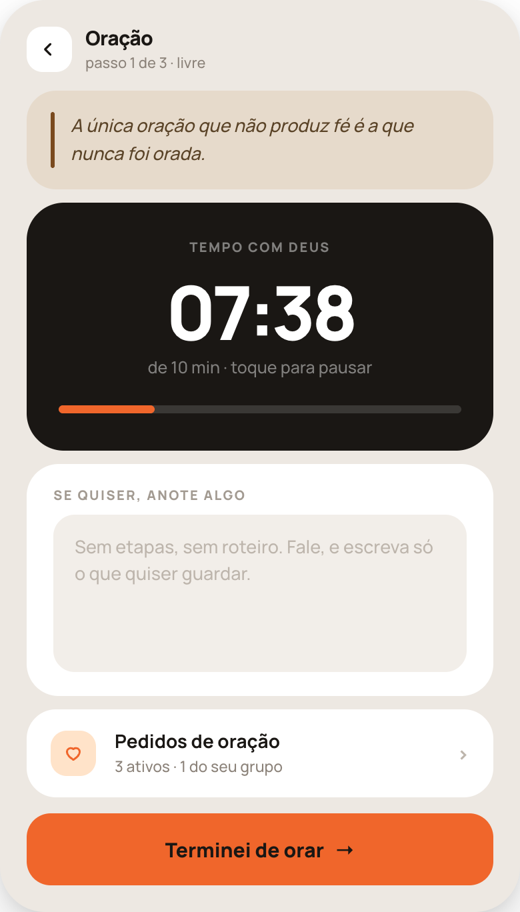

Mesma casca, sem etapas:

1. A mesma frase fixa no topo.
2. **Bloco escuro central** com o relógio em 56px/800, "de 10 min · toque para pausar" e a barra de progresso.
3. Cartão branco com campo opcional: "Sem etapas, sem roteiro. Fale, e escreva só o que quiser guardar."
4. A mesma linha de pedidos → 36d.
5. Rodapé fixo: **"Terminei de orar"** → 36f.

Zerar o tempo não fecha a tela nem interrompe: avisa e conta para cima.

---

## 36d — Pedidos de oração

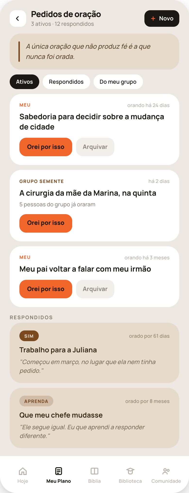

Cabeçalho: voltar · "Pedidos de oração / N ativos · N respondidos" · botão preto **Novo**. Depois a frase fixa e três chips: **Ativos · Respondidos · Do meu grupo**.

**Cartão de pedido ativo (meu):** selo "Meu" em laranja, à direita **"orando há 24 dias"** (é o dado que faz persistir), o texto do pedido em 15,5px/700, e as ações **"Orei por isso"** (laranja) + **"Arquivar"** (cinza) → 36e.

**Cartão de pedido do grupo:** selo com o nome do grupo em `#7A4A1E`, tempo desde a publicação, linha "5 pessoas do grupo já oraram" e **só** "Orei por isso" — quem arquiva é o autor.

**Seção Respondidos:** cartões areia com o **selo da resposta** (Sim em `#7A4A1E` sólido; as outras em `rgba(122,74,30,.2)`), o tempo total que foi orado e, em itálico, a frase que a pessoa escreveu ao arquivar. É a memória do que Deus fez — não esconda atrás de um filtro por padrão.

Barra de abas fixa no rodapé (esta tela é um push dentro de Meu Plano).

### Dados do pedido

`texto`, `origem` (meu | grupo), `grupo_id?`, `criado_em`, `dias_orados` (contagem de dias distintos com "Orei por isso"), `orado_em[]`, `status` (ativo | respondido), `resposta?` (sim | nao | espere | aprenda | se_mova), `nota_resposta?`, `respondido_em?`.

- "Orei por isso" marca **o dia**, não o clique: dois toques no mesmo dia contam um.
- Pedido do grupo aparece na lista de todos os membros; a contagem de quem orou é agregada.
- Nenhum pedido é apagado pela interface. Arquivar move para Respondidos.

---

## 36e — Como Deus respondeu

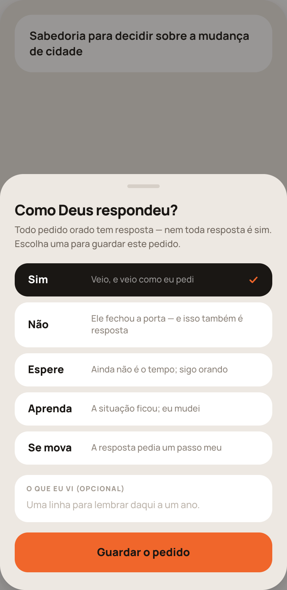

Folha sobre 36d, com o texto do pedido visível acima.

- Título: **"Como Deus respondeu?"** e a linha "Todo pedido orado tem resposta — nem toda resposta é sim."
- **Cinco opções**, cada uma com o rótulo em 14,5px/800 numa coluna fixa de 74px e a explicação de uma linha ao lado; a selecionada fica preta com check laranja:
  - **Sim** — "Veio, e veio como eu pedi"
  - **Não** — "Ele fechou a porta — e isso também é resposta"
  - **Espere** — "Ainda não é o tempo; sigo orando"
  - **Aprenda** — "A situação ficou; eu mudei"
  - **Se mova** — "A resposta pedia um passo meu"
- Campo opcional **"O que eu vi"** com placeholder "Uma linha para lembrar daqui a um ano."
- Botão **"Guardar o pedido"**.

Regras: **Espere** devolve o pedido para Ativos e **não zera o contador de dias**. As outras quatro arquivam com selo. A frase opcional aparece no cartão de Respondidos em 36d.

---

## 36f — A bênção

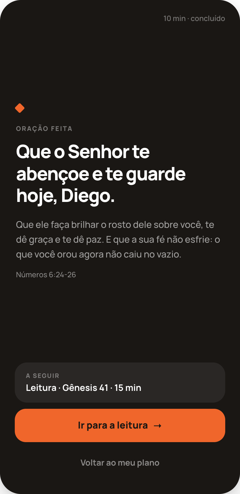

Única tela do app com **fundo escuro inteiro** (`#1A1714`), altura de celular, sem rolagem.

- Canto superior direito: "10 min · concluído".
- Losango laranja, rótulo "Oração feita", e a bênção em 30px/800 com o **nome da pessoa**: "Que o Senhor te abençoe e te guarde hoje, Diego."
- Corpo em 15px/500 a 60% de branco: "Que ele faça brilhar o rosto dele sobre você, te dê graça e te dê paz. E que a sua fé não esfrie: o que você orou agora não caiu no vazio."
- Referência: "Números 6:24-26" (branco a 50%).
- Cartão translúcido **"A seguir"** com o próximo passo do dia, botão laranja **"Ir para a leitura"** e link "Voltar ao meu plano".

Se a oração era o último passo do dia, o botão vira **"Terminar o dia"** e leva a 37c. Texto do app, não gerado por IA — muda apenas o nome e o próximo passo.

---

## 37e — Concluir a leitura

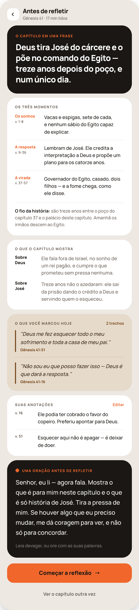

Abre no toque em **"Concluir"** da leitura (35f) — ou depois de "Finalizar por aqui" em 35g. **Não consome tempo de passo:** relógio parado; o da Reflexão começa só no botão.

Cabeçalho: ícone areia com check · "Leitura feita / Gênesis 41 · 17 min · passo 2 de 3".

Ordem dos blocos:

1. **O capítulo em uma frase** (bloco escuro, 23px/800) — a tese do capítulo.
2. **Os três momentos** (cartão branco) — três linhas com o rótulo do momento em laranja + faixa de versículos abaixo, e a descrição ao lado. Fecha com divisor e a linha **"O fio da história:"** — de onde vem, para onde vai (é o que faz a Bíblia parecer uma coisa só; não corte esta linha).
3. **O que o capítulo mostra** — duas linhas: "Sobre Deus" e "Sobre \<personagem\>".
4. **O que você marcou hoje** (areia) — **todas** as marcações do capítulo, cada uma com filete à esquerda, o texto em itálico e a referência; contador à direita ("2 trechos"). Se não marcou nada, o bloco não aparece.
5. **Suas anotações** (branco) — as notas que ela escreveu durante a leitura, com o versículo à esquerda e ação **Editar**. Se não anotou nada, o bloco não aparece.
6. **Uma oração antes de refletir** (bloco escuro) — 3 a 4 frases, em 17px/1.65 para ser lida devagar, escritas **a partir do capítulo** (não genéricas), com a linha "Leia devagar, ou ore com as suas palavras."

Rodapé: **"Começar a reflexão"** (laranja) + "Ver o capítulo outra vez".

### O que precisa ser gerado

- **Resumo**: uma frase-tese, três momentos com faixas de versículos, duas linhas de "o que mostra" e a linha do fio da história (capítulo anterior → próximo).
- **Oração**: curta, na segunda pessoa, citando o tema do capítulo.
- Toda referência gerada passa pela **checagem contra o texto da versão do usuário** antes de aparecer (mesma regra do pacote 35).
- O resumo e a oração do dia são **estáveis**: se a pessoa voltar à tela no mesmo dia, são os mesmos textos.
- Em dia de estudo, o resumo é do trecho do estudo e a oração cita o tema do estudo.

---

## 37a — Reflexão com perguntas

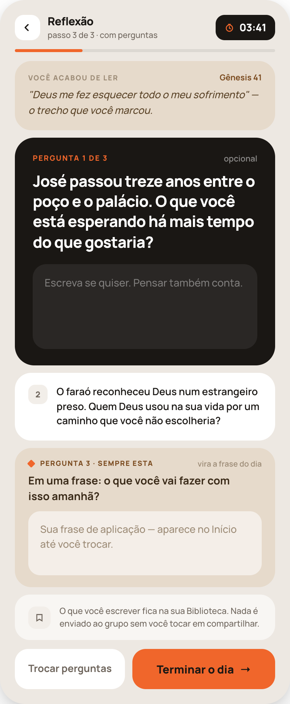

Cabeçalho: voltar · "Reflexão / passo 3 de 3 · com perguntas" · relógio. Filete de progresso abaixo.

1. **"Você acabou de ler"** (areia) — a referência à direita e, em itálico, o trecho que ela marcou.
2. **Pergunta aberta** (bloco escuro) — "Pergunta 1 de 3" em laranja, **"opcional"** à direita, a pergunta em 21px/800 e um campo com placeholder "Escreva se quiser. Pensar também conta."
3. **Perguntas 2** — cartão branco com o número num quadrado e o texto; tocar abre no lugar da atual.
4. **Pergunta 3 — sempre esta** (areia, com losango laranja): rótulo "Pergunta 3 · sempre esta", à direita "vira a frase do dia", a pergunta **"Em uma frase: o que você vai fazer com isso amanhã?"** e o campo com "Sua frase de aplicação — aparece no Início até você trocar."
5. **Nota de privacidade** — o que ela escreve fica na Biblioteca dela; nada vai ao grupo sem tocar em compartilhar.
6. Rodapé fixo: **"Trocar perguntas"** + **"Terminar o dia"**.

### Regras

- As **perguntas 1 e 2 são geradas do capítulo lido** e citam o texto. **A pergunta 3 é fixa** e sempre a última.
- **"Trocar perguntas" troca só as duas primeiras** — a terceira nunca muda.
- A resposta da pergunta 3 é a **frase de aplicação**: alimenta o cartão de aplicação do Início (35a) e o destaque de 37c/37d. Vale até ser substituída no dia seguinte.
- **"Terminar o dia" nunca fica desabilitado**, com campos vazios ou cheios.

---

## 37b — Reflexão livre

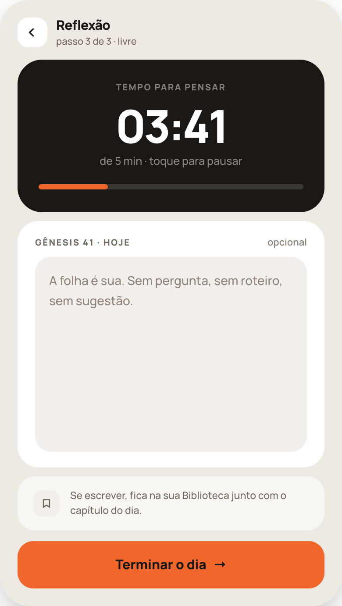

Para quem escolheu "Livre" em 35c:

1. **Bloco escuro** com o relógio em 52px/800, "de 5 min · toque para pausar" e a barra.
2. **Cartão branco** com o cabeçalho "Gênesis 41 · hoje" + "opcional" e uma folha grande (min-height ~190px) com "A folha é sua. Sem pergunta, sem roteiro, sem sugestão."
3. Nota de privacidade.
4. Rodapé fixo: **"Terminar o dia"**.

Sem perguntas, sem trecho marcado em destaque, sem sugestão de assunto — a tela não pauta a pessoa. Se a frase de aplicação for necessária para o Início, ela vem da última que a pessoa escreveu; não peça aqui.

---

## 37c — Dia concluído

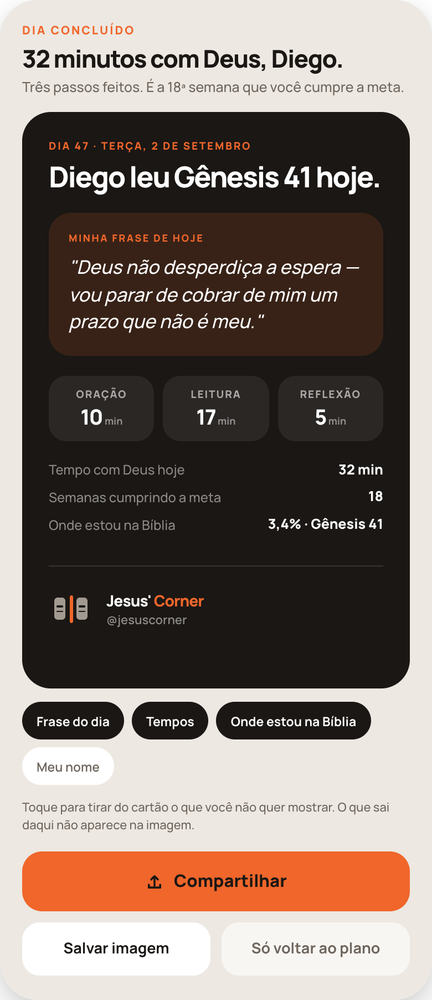

1. **Cabeçalho** — "Dia concluído" em laranja, "32 minutos com Deus, Diego." em 22px/800 e a linha de contexto (passos feitos + semanas cumprindo a meta).
2. **A imagem, em escala** — o cartão de 37d renderizado dentro da tela (mesmo conteúdo, tamanhos reduzidos). Não é um painel que depois vira imagem: é a própria imagem.
3. **Chips do que entra na imagem** — "Frase do dia", "Tempos", "Onde estou na Bíblia", "Meu nome". Ligado = preto; desligado = branco com texto `#6E655C`. Desligar remove o bloco da imagem em tempo real.
4. **Rodapé** — **Compartilhar** (laranja, com ícone de share), **Salvar imagem** e **Só voltar ao plano**. Compartilhar nunca é automático.

---

## 37d — A imagem exportada

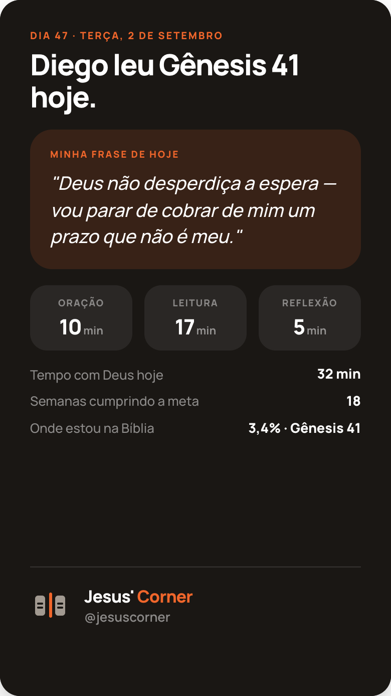

Arquivo **1080×1920** (9:16), fundo `#1A1714`. O quadro do design está em 390×693 — mesma proporção, mesma composição.

Ordem, pensada para leitura em três segundos:

1. Rótulo laranja: "Dia 47 · terça, 2 de setembro".
2. Título: "\<Nome\> leu \<referência\> hoje."
3. **A frase de aplicação** em bloco `rgba(240,102,43,.14)`, itálico — é o coração da imagem.
4. **Três blocos de tempo** — Oração / Leitura / Reflexão, com os minutos **reais** de cada passo.
5. **Três linhas de números** — "Tempo com Deus hoje", "Semanas cumprindo a meta", "Onde estou na Bíblia" (mostrando **a porcentagem lida** e o capítulo, ex. "3,4% · Gênesis 41").
6. **Assinatura no rodapé** — símbolo da marca + "Jesus' Corner" (Corner em laranja) + **@jesuscorner**, acima de uma faixa vazia.

Regras da exportação:

- Nada de informação nos **12% de cima** nem nos **9% de baixo** (≈230px e ≈170px em 1920): é onde a interface do story e a foto de perfil de quem repostar cobrem.
- Blocos desligados nos chips de 37c **não são renderizados** (a composição fecha o espaço, não deixa buraco).
- Se o nome estiver desligado, o título vira "Li Gênesis 41 hoje."
- Exportar em PNG, 2x, sem elementos de interface do app (nada de barra de abas, botões ou cabeçalho).

---

## Regras que valem para todos os passos

1. **Escrever nunca é obrigatório.** Botão de avançar sempre ativo; campo vazio não gera erro nem aviso; não existe "você não escreveu nada".
2. **O relógio nunca bloqueia.** Zerar avisa (haptic + a pílula pisca uma vez) e passa a contar para cima em `#8B8279`. Tocar pausa; sair do app pausa; voltar retoma.
3. **Privacidade.** Oração, anotações e reflexões ficam na conta da pessoa. Nada é publicado em grupo ou banco público sem um toque explícito em compartilhar.
4. **Textos do app x textos gerados.** A frase da oração, as explicações do ACTS, as cinco respostas de 36e, a bênção de 36f e a pergunta 3 de 37a são **texto fixo do app**. Resumo, oração de 37e e perguntas 1-2 de 37a são gerados e conferidos contra o texto bíblico.
5. **Registro do dia** (usado em 37c/37d e nas métricas): minutos reais por passo, referência lida, marcações, anotações, respostas da reflexão, frase de aplicação, e se o dia foi cumprido.

## Checklist de revisão

- [ ] "Começar meu plano" abre o passo da vez e emenda os seguintes sem voltar ao Meu Plano
- [ ] O método certo (ACTS ou livre) conforme 35c
- [ ] Cronômetro do ACTS divide o tempo em 4 e conta a etapa; o filete conta a oração
- [ ] Etapa que zera não avança sozinha; "Pular etapa" redistribui o tempo restante
- [ ] Cada etapa do ACTS traz a explicação de duas frases e três frases de partida
- [ ] Frase fixa no topo de 36b, 36c e 36d, idêntica
- [ ] Pedido mostra "orando há N dias"; "Orei por isso" conta por dia, não por clique
- [ ] Pedido de grupo não tem "Arquivar"
- [ ] As cinco respostas de 36e com as explicações; "Espere" volta para Ativos sem zerar o contador
- [ ] Respondidos visíveis com selo e a frase escrita
- [ ] 36f com o nome da pessoa e o próximo passo correto (ou "Terminar o dia")
- [ ] 37e abre no "Concluir" da leitura e não consome tempo de passo
- [ ] 37e mostra **todas** as marcações e as anotações, e esconde os blocos vazios
- [ ] Linha "O fio da história" presente em 37e
- [ ] 37a: perguntas 1-2 do capítulo, pergunta 3 fixa; "Trocar perguntas" não mexe na 3ª
- [ ] Frase de aplicação alimenta o Início e o resumo do dia
- [ ] "Terminar o dia" sempre habilitado, nos dois modos de reflexão
- [ ] 37c: chips desligam blocos da imagem em tempo real
- [ ] 37d: 1080×1920, assinatura no rodapé, margens de segurança respeitadas, porcentagem lida presente
