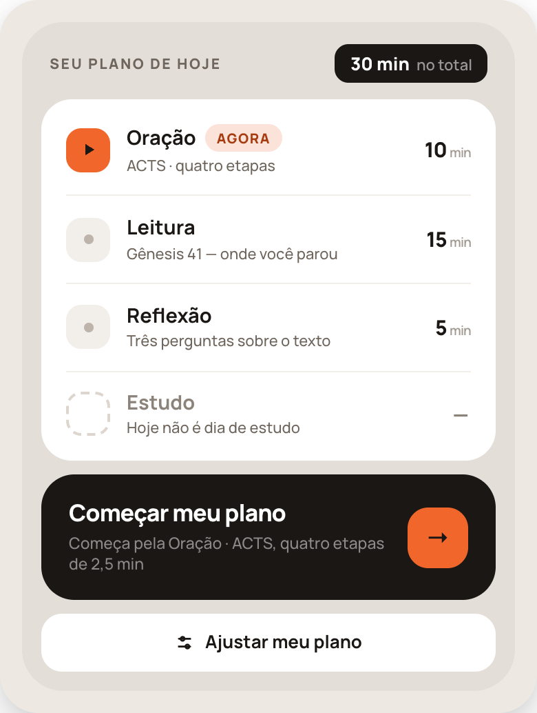
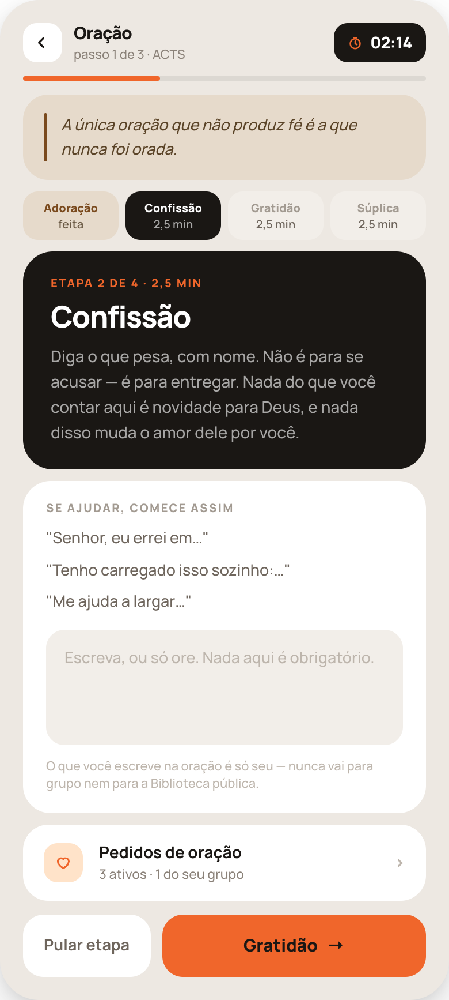
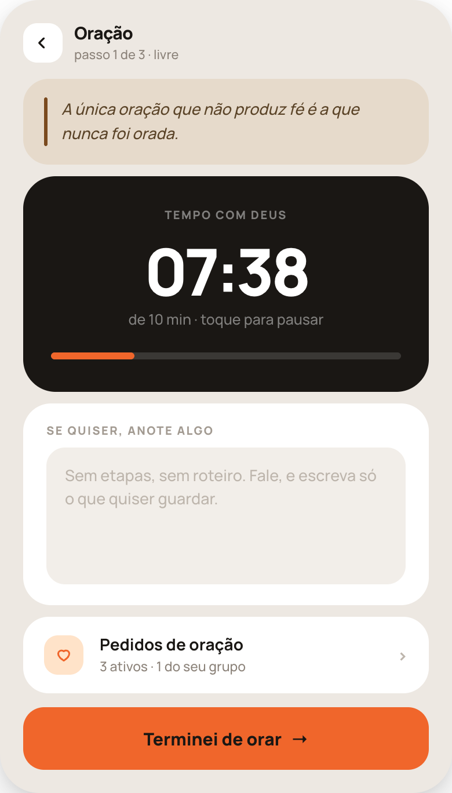
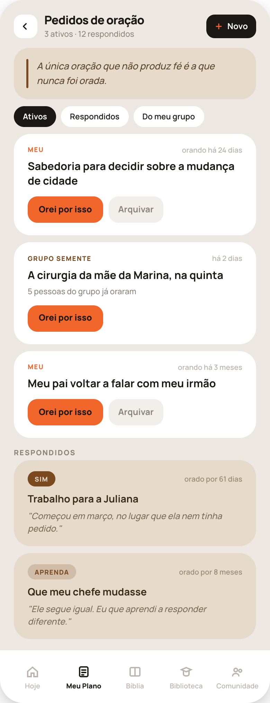
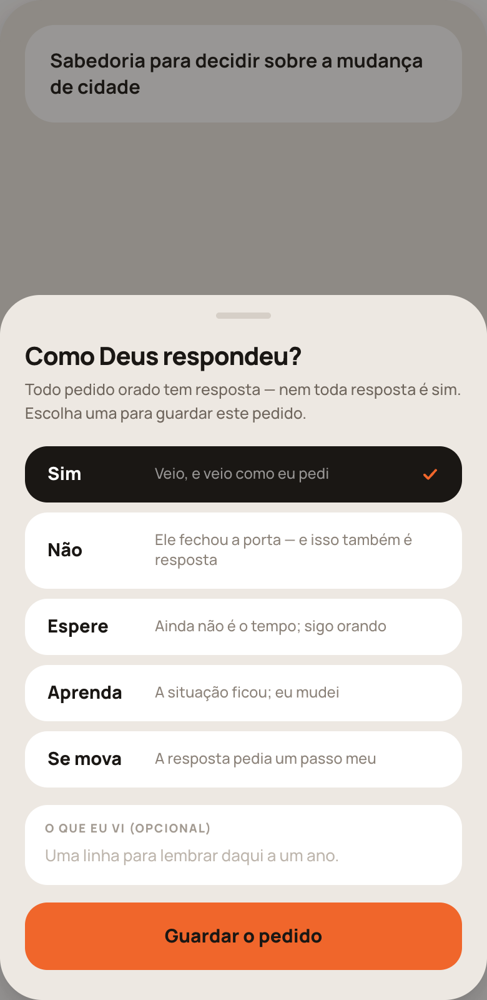
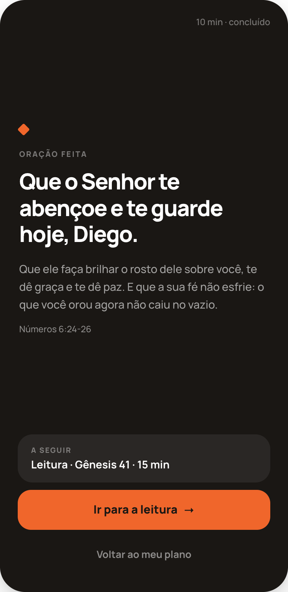
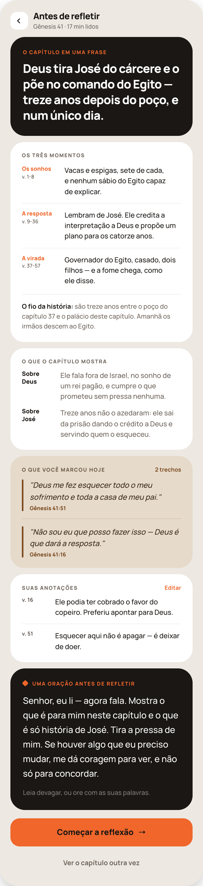
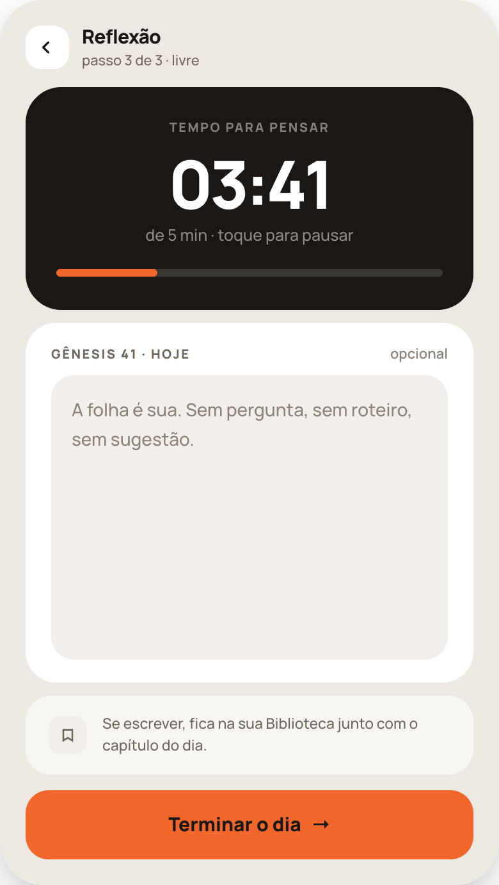
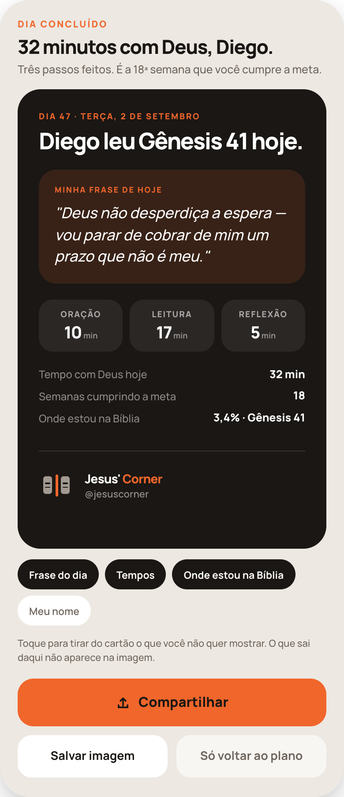
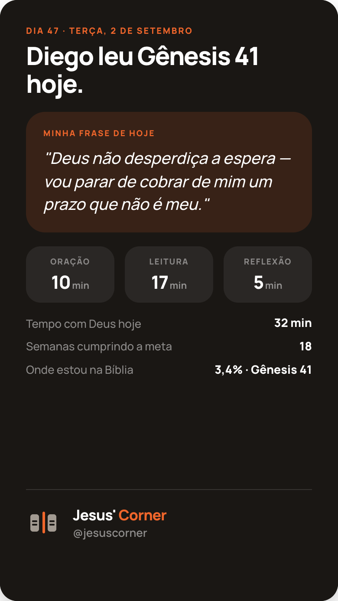

# Fazendo os passos — pacote de implementação (turnos 36 e 37)

As telas de **executar a rotina do dia**: orar, fechar a leitura, refletir e terminar o dia. Complementa o pacote `handoff-meu-plano-35/` (que define o plano); aqui é a hora de fazer.

```
handoff-passos-36-37/
├── README.md                          ← você está aqui
├── PROMPT-CODE.md                     ← cole isto no Claude Code
├── HANDOFF-36-37-passos.md            ← especificação tela por tela + regras
├── 36a-inicio-oracao.png              ← detalhe: a oração como passo de agora
├── 36b-oracao-acts.png                ← oração ACTS (4 etapas)
├── 36c-oracao-livre.png               ← oração livre (só cronômetro)
├── 36d-pedidos.png                    ← pedidos de oração
├── 36e-arquivar-pedido.png            ← como Deus respondeu (5 respostas)
├── 36f-bencao.png                     ← fim da oração: a bênção
├── 37e-concluir-leitura.png           ← concluir a leitura: resumo, marcações, anotações, oração
├── 37a-reflexao-perguntas.png         ← reflexão com perguntas
├── 37b-reflexao-livre.png             ← reflexão livre
├── 37c-dia-concluido.png              ← fecho do dia + resumo compartilhável
└── 37d-imagem-compartilhavel.png      ← a imagem exportada 9:16
```

## A regra número 1

**Os quadros são a verdade.** Cada PNG é uma tela real em 390px de largura: mesma ordem de blocos, mesmos raios, mesmas cores, mesmos pesos e tamanhos de fonte, mesmo texto de interface. Não é referência de estilo — é o layout a construir.

**Os valores não são a verdade.** "Diego", "Gênesis 41", "02:14", "orando há 24 dias", "18 semanas", "32 min", os nomes dos pedidos e as frases escritas são exemplos de uma conta. Cada usuário terá os seus. O que precisa ser fiel é o quadro, o layout, os estados e os links entre as telas.

**Falta código.** Boa parte do que está desenhado aqui não existe ainda no app: cronômetro por etapa, geração do resumo do capítulo, geração das perguntas, ciclo de vida dos pedidos de oração, exportação da imagem 9:16. O HANDOFF descreve o comportamento esperado de cada um — escreva o que falta, não simule.

## Telas altas = uma tela com rolagem

Vários PNGs são mais altos que um celular (37e tem 1702px em 390 de largura). **Não são duas telas.** O cabeçalho rola junto com o conteúdo; o botão primário do rodapé é fixo; a barra de abas, quando aparece (36d), é fixa no rodapé.

Exceções: **36f** é uma tela de altura de celular (fundo escuro inteiro, sem rolagem) e **37d** não é tela — é a **imagem exportada** em proporção 9:16 (o arquivo real sai em 1080×1920).

## As telas, em ordem de fluxo

### 36a — A oração como passo de agora (detalhe de 35a)


### 36b — Oração ACTS: quatro etapas, cronômetro dividido


### 36c — Oração livre: um cronômetro e a folha em branco


### 36d — Pedidos de oração


### 36e — Arquivar um pedido: como Deus respondeu


### 36f — Fim da oração: a bênção


### 37e — Concluir a leitura: resumo, marcações, anotações e oração (é o quadro mais alto do pacote)


### 37a — Reflexão com perguntas (a 3ª é sempre a frase de aplicação)


### 37b — Reflexão livre


### 37c — Dia concluído: o resumo pronto para compartilhar


### 37d — A imagem exportada (1080×1920)


## Mapa de navegação

```
35a  Meu Plano — bloco "Seu plano de hoje" lista os passos do dia em ordem
│    (passos que não acontecem hoje ficam no fim, esmaecidos)
│
├── botão único "Começar meu plano" / "Continuar meu plano"
│     abre o passo da vez e emenda os seguintes sem voltar ao Meu Plano:
│     Oração ─────────────────────────────► 36b (método ACTS)  ou  36c (método livre)
│     ├── 36b: "Pular etapa" → próxima etapa · botão nomeia a próxima etapa
│     ├── 36b/36c: "Pedidos de oração" ─────► 36d
│     └── fim das etapas / "Terminei de orar" ─► 36f  bênção
│                                                 ├── "Ir para a leitura" → 35f
│                                                 └── "Voltar ao meu plano" → 35a
│
├── 36d  Pedidos de oração
│     ├── "Novo" → criar pedido (folha simples: texto + é do grupo?)
│     ├── "Orei por isso" → marca o dia (fica na tela)
│     ├── "Arquivar" ───────────────────────► 36e
│     └── chips Ativos / Respondidos / Do meu grupo
│
├── 36e  Como Deus respondeu (folha sobre 36d)
│     ├── Sim / Não / Aprenda / Se mova → arquiva com selo → volta para 36d
│     └── Espere → devolve para Ativos, contador de dias segue
│
├── passo Leitura → 35f (leitura com relógio)
│     └── "Concluir"  ───────────────────────► 37e
│           ├── "Ver o capítulo outra vez" → volta a 35f
│           └── "Começar a reflexão" ────────► 37a (com perguntas) ou 37b (livre)
│
└── 37a / 37b  Reflexão
      ├── 37a: pergunta 1 e 2 vêm do capítulo · "Trocar perguntas" troca só essas duas
      ├── 37a: pergunta 3 é SEMPRE a frase de aplicação → alimenta o Início e 37c/37d
      └── "Terminar o dia" ──────────────────► 37c
            ├── chips ligam/desligam o que entra na imagem
            ├── "Compartilhar" / "Salvar imagem" → exporta 37d (1080×1920)
            └── "Só voltar ao plano" → 35a
```

## Ordem sugerida de implementação

1. **36b / 36c / 36f** — a oração completa, com o cronômetro por etapa e a bênção no fim.
2. **36d / 36e** — pedidos de oração e o ciclo de resposta (é a parte com mais dados novos).
3. **37e** — o fecho da leitura: exige o resumo gerado e a leitura das marcações/anotações.
4. **37a / 37b** — reflexão, com a pergunta 3 fixa alimentando a frase de aplicação.
5. **37c / 37d** — fecho do dia e a exportação da imagem.

## Novidades desta versão do pacote

- **37e** é uma tela só: o resumo do capítulo (com a linha "O fio da história"), **todas** as marcações do dia, **as anotações** que a pessoa escreveu (com "Editar") e a oração de transição, nessa ordem.
- **37a**: a **pergunta 3 é fixa** — a frase de aplicação — e "Trocar perguntas" só troca as duas primeiras.
- **37c/37d**: "Onde estou na Bíblia" mostra a **porcentagem lida** ("3,4% · Gênesis 41").
- Entrada da rotina: em 35a/36a o botão é **um só** ("Começar / Continuar meu plano"), que emenda os passos na ordem — nenhum passo tem botão próprio.

## Os três pontos que mais quebram

1. **Escrever nunca é obrigatório**, em nenhum passo. Botão de avançar sempre ativo, campo vazio não é erro, nenhuma mensagem de "você não escreveu nada".
2. **O relógio nunca bloqueia.** Ao zerar, avisa e passa a contar para cima. 37e não consome tempo de passo nenhum.
3. **Nada do que a pessoa escreve na oração ou na reflexão vai para grupo ou banco público** sem ela tocar em compartilhar.
