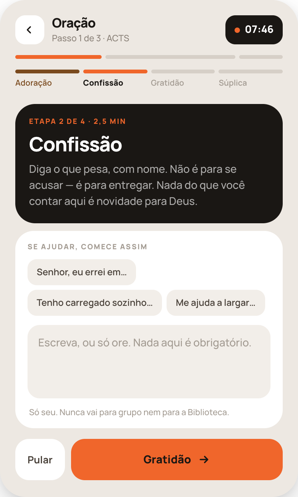
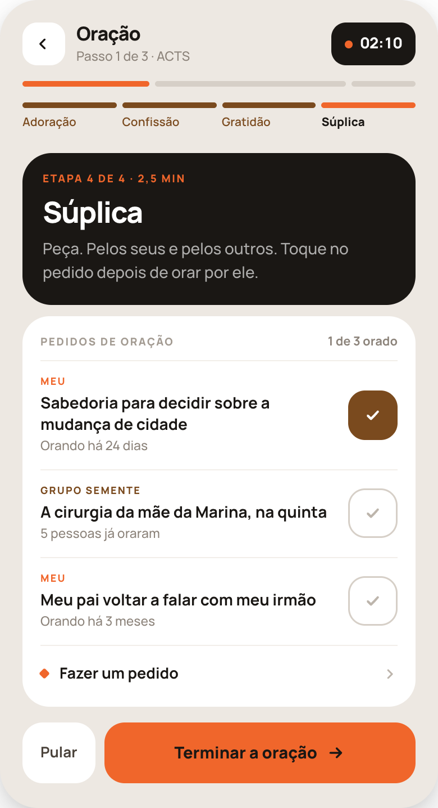
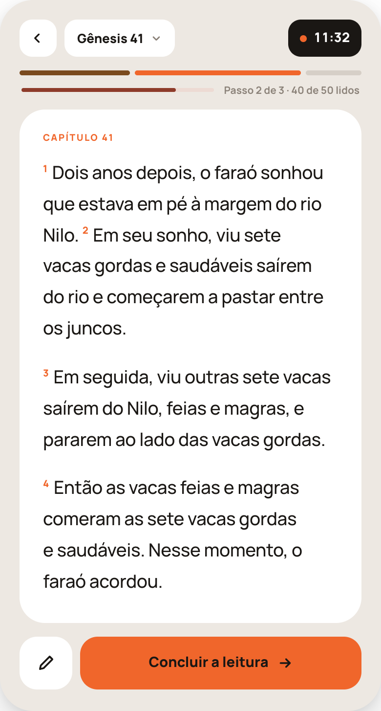
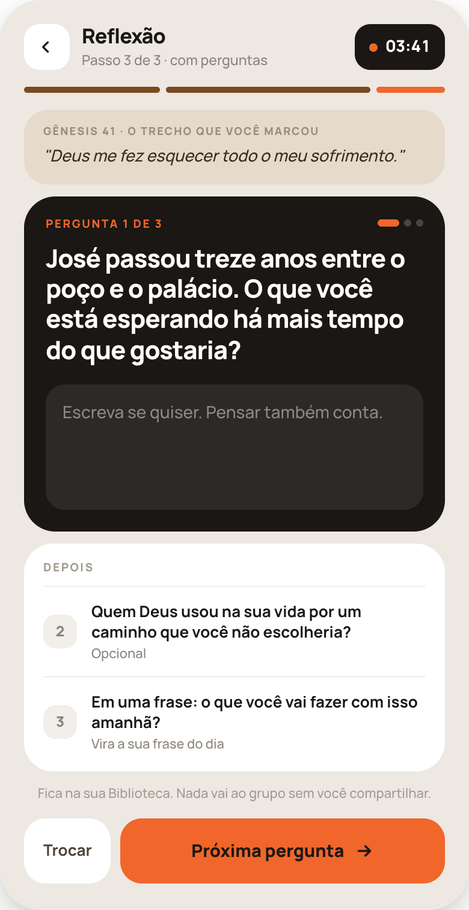
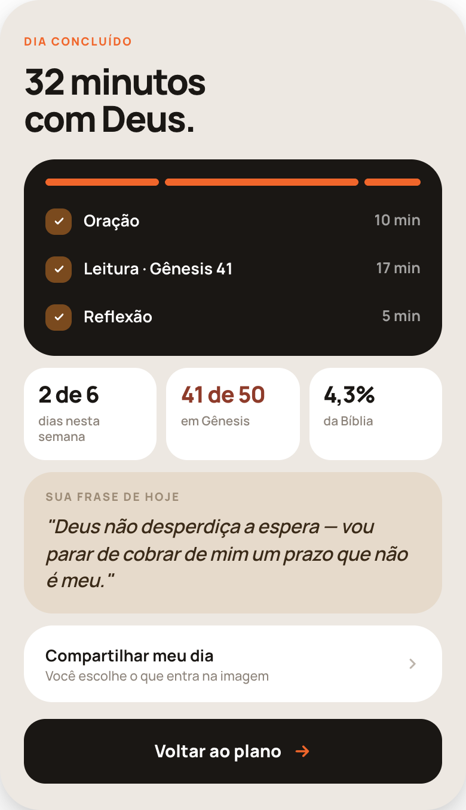
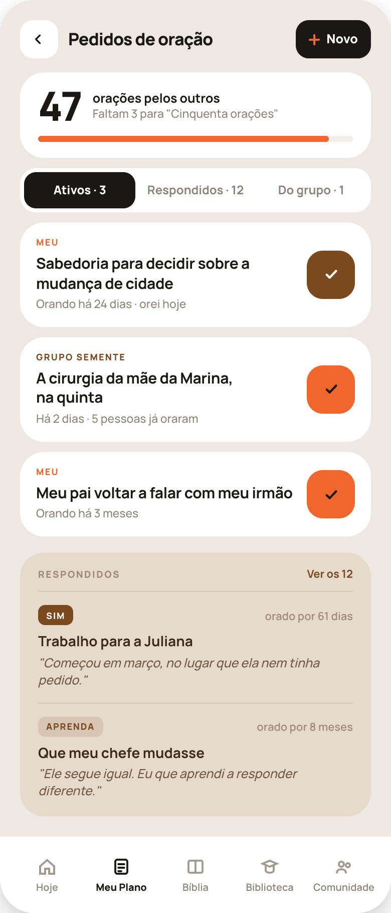
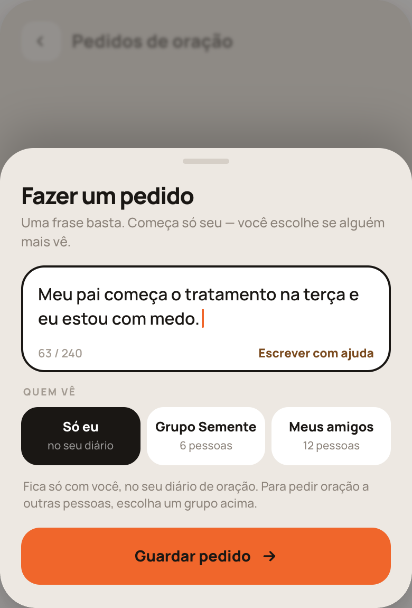
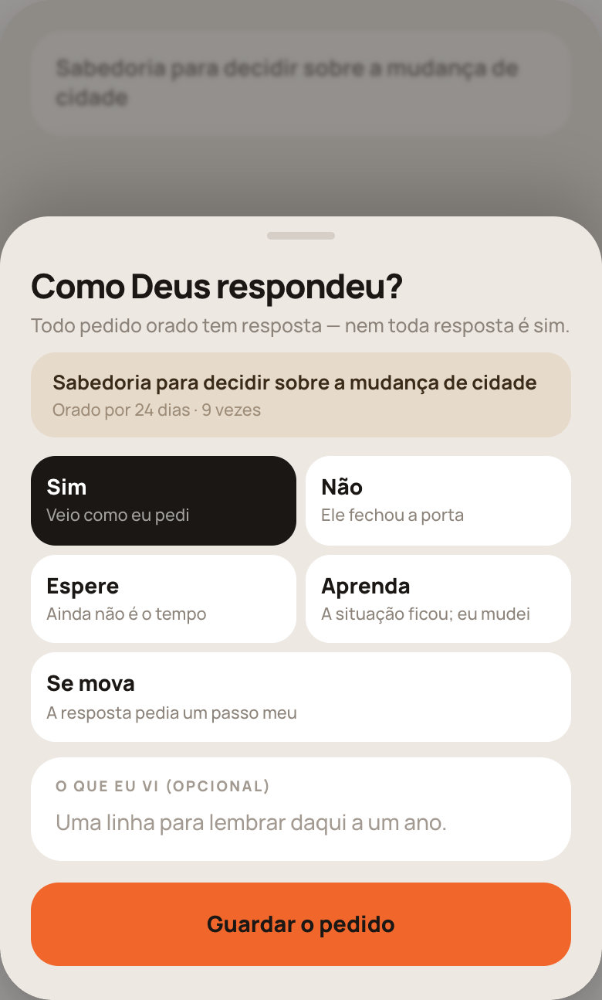

# HANDOFF — Passos do plano (S1–S5) e Pedidos de oração (O1–O3)

**Fonte de verdade para valores:** `referencia/Passos e Pedidos 53-54.dc.html`. Este documento descreve estrutura, estados e comportamento, e repete as medidas principais. Se o documento e o arquivo discordarem, pare e pergunte.

## 0. Regras

1. **Nada de dado ou de privacidade muda.** O que a pessoa escreve na oração é só dela; a reflexão fica na Biblioteca dela; nada vai ao grupo sem toque explícito; ninguém comenta pedido, só ora; quem pediu vê só o **número** de pessoas que oraram, nunca os nomes.
2. **O botão laranja é o único caminho para a frente** em cada passo. À esquerda dele fica, no máximo, uma ação secundária branca.
3. **O relógio informa, não cobra.** Ao zerar, segue o comportamento que já existe (aviso discreto; nada trava).
4. **Sem cobrança e sem festa:** nenhum vermelho, alerta, confete, emoji ou "Incrível!".
5. Texto sobre laranja é `#1A1714`, nunca branco.

## 1. Peças comuns aos passos

Tokens de `src/index.css`. Manrope em tudo. Fundo `#EDE8E2`; cartões `#fff`; preto `#1A1714`; laranja `#F0662B`; marrom "feito" `#7A4A1E`; areia `#E6DACB`; areia clara `#F2EEE9`; trilho `#D6CFC7`. Rótulo: 800 9.5px, .13em, maiúsculas.

**Cabeçalho do passo** — `padding:20px 20px 0`, `gap:10px`: voltar (38×38, raio 13, `#fff`) · nome do passo (800 17px, -0.5px) com "Passo {n} de {total} · {modo}" embaixo (500 11.5px, `#8B8279`) · **relógio**: pílula de 38px, raio 13, `#1A1714`, `padding:0 12px`, ponto laranja de 7px + tempo restante "MM:SS" (800 13.5px, `#fff`, algarismos tabulares). Voltar no meio do passo segue a confirmação que já existe.

**Barra do dia** — logo abaixo, `padding:14px 20px 0`, `gap:5px`: um segmento por passo de hoje, **`flex` = minutos do passo**, altura 5, raio 99. Feito `#7A4A1E` · agora `#F0662B` · por vir `#D6CFC7`. É o mesmo componente/cálculo da barra do Meu Plano — reaproveite.

**Cartão preto "agora"** — raio 26, `#1A1714`, `padding:18px 18px 19px`: rótulo laranja · título (800 26px, -1px, `#fff`, 12px abaixo) · texto (500 14px/1.5, `rgba(255,255,255,.65)`, 8px abaixo).

**Rodapé** — `padding:14px 20px 22px`, `gap:8px`, fixo no fundo: ação secundária (54px de altura, raio 18, `#fff`, 700 13px `#4A423A`, `padding:0 16px`) + **botão principal** (`flex:1`, 54px, raio 18, `#F0662B`, 800 14.5px `#1A1714` + seta).

---

## 2. S1 — Oração · uma etapa do ACTS

Vale para Adoração, Confissão e Gratidão (a Súplica é S2). Corpo: `padding:14px 20px 0`, coluna com `gap:10px`.

1. Cabeçalho "Oração" / "Passo 1 de 3 · ACTS" + relógio (tempo restante **da oração inteira**) + barra do dia.
2. **Trilha das etapas** — `display:flex; gap:5px`, quatro colunas iguais: um traço de 5px (raio 99) e, 7px abaixo, o nome (10.5px). Feita: traço `#7A4A1E`, nome 600 `#7A4A1E`. Atual: traço `#F0662B`, nome **800** `#1A1714`. Por vir: traço `#D6CFC7`, nome 600 `#A29A91`. Nomes fixos: **Adoração · Confissão · Gratidão · Súplica**. Não é tocável.
3. **Cartão preto** — rótulo **"ETAPA {n} DE 4 · {min} MIN"**, o nome da etapa, e a orientação da etapa (os textos de 36b, sem mudança).
4. **Cartão de escrita** — `#fff`, raio 24, `padding:16px 16px 14px`:
   - rótulo **SE AJUDAR, COMECE ASSIM** (fixo);
   - as frases de começo da etapa como **pastilhas** (`flex-wrap`, `gap:6px`, margem 11px/12px): 34px de altura, raio 12, `#F2EEE9`, 600 12px `#4A423A`. **Tocar numa pastilha escreve a frase no campo** (sem as reticências, com o cursor no fim) — se o campo já tem texto, acrescenta numa linha nova. As frases são as de 36b;
   - o campo: altura mínima 96, raio 16, `#F2EEE9`, `padding:13px 14px`, texto 500 14px/1.45; texto de apoio **"Escreva, ou só ore. Nada aqui é obrigatório."** (fixo, `#A29A91`);
   - linha **"Só seu. Nunca vai para grupo nem para a Biblioteca."** (fixo; 500 11px, `#A29A91`).
5. **Rodapé**: **Pular** (fixo) · botão com **o nome da próxima etapa** ("Gratidão →").
- **A citação fixa não aparece mais aqui** (continua em 36a). **O cartão "Pedidos de oração" não aparece nestas etapas.**
- O que foi escrito é salvo ao pausar, como hoje. Ao trocar de etapa, a tela volta ao topo.

## 3. S2 — Oração · Súplica

A mesma tela, na 4ª etapa. No lugar do cartão de escrita entra **a lista de pedidos**.

1. Cartão preto: "ETAPA 4 DE 4 · {min} MIN" · **Súplica** · **"Peça. Pelos seus e pelos outros. Toque no pedido depois de orar por ele."** (fixo).
2. **Cartão "PEDIDOS DE ORAÇÃO"** — `#fff`, raio 24, `padding:16px 16px 4px`:
   - topo: rótulo (fixo) · **"{n} de {total} orado(s)"** (700 11px, `#8B8279`);
   - uma linha por pedido **ativo** — os meus e os dos meus grupos, na ordem de O1 —, `padding:13px 0`, fio `#F2EEE9` acima, `gap:12px`:
     - origem em maiúsculas (800 9px, .12em): **MEU** em `#F0662B`; o nome do grupo em `#7A4A1E`;
     - o pedido (700 14px/1.3), inteiro, sem cortar;
     - apoio (500 11.5px, `#8B8279`): "Orando há {tempo}" nos meus; "{n} pessoas já oraram" nos do grupo;
     - **o check**: 44×44, raio 15. Não orado: `#fff`, contorno interno 1.5px `#D6CFC7`, check `#BDB5AC`. Orado: fundo `#7A4A1E`, check `#fff`. Tocar marca; tocar de novo desmarca (só dentro desta sessão);
   - última linha (50px): losango laranja de 7px + **Fazer um pedido** (fixo; 700 13.5px) + chevron → O2. Ao guardar, volta para cá com o pedido novo na lista.
3. **Rodapé**: **Pular** · **Terminar a oração**.
- **Marcar aqui é o mesmo "orei" de O1**: vale uma vez por pedido por dia; em pedido de outra pessoa soma na contagem dela e na minha família "Oração pelos outros"; em pedido meu só registra a data.
- Mais de 5 pedidos: mostram-se 5 e uma linha "Ver os {n} pedidos", que expande a lista no lugar.
- Nenhum pedido ativo: o cartão mostra só **"Nenhum pedido por enquanto."** e a linha "Fazer um pedido".
- Na **oração livre** (36c) nada disto se aplica.

---

## 4. S3 — Leitura com relógio

**É a tela de leitura da aba Bíblia (B3 de `handoff-biblia-52/`) com três diferenças** — reaproveite o componente, não copie:

1. No cabeçalho, no lugar da pílula da versão e dos três pontos, fica **o relógio** (tempo restante da leitura). A pílula "{Livro} {capítulo} ⌄" continua.
2. Abaixo do cabeçalho entra **a barra do dia**; e o fio de progresso do livro (4px, na cor do bloco) fica a 10px dela, com o texto **"Passo {n} de {total} · {lidos} de {capítulos} lidos"** (700 10.5px, `#8B8279`).
3. No rodapé, o botão principal é laranja e diz **Concluir a leitura** (fixo) → 37e. O botão quadrado do lápis (54px, `#fff`) abre as ferramentas.

A tipografia do texto bíblico, a seleção de versículo e o comportamento do relógio (35f/35g) **não mudam**. O cartão "capítulo marcado" (B4) **não aparece aqui**.

---

## 5. S4 — Reflexão com perguntas

**Uma pergunta por vez.** As três perguntas e as regras de 37a continuam (as duas primeiras geradas do trecho e opcionais; a terceira é sempre a mesma e vira a frase do dia).

1. Cabeçalho "Reflexão" / "Passo 3 de 3 · com perguntas" + relógio + barra do dia.
2. **Cartão areia do trecho** — `#E6DACB`, raio 20, `padding:13px 16px`: rótulo "{LIVRO} {CAP} · O TRECHO QUE VOCÊ MARCOU" (800 9px, `#9C8B76`) e o trecho em itálico (500 13.5px, `#3A2A18`). Sem trecho marcado: rótulo "{LIVRO} {CAP} · VOCÊ ACABOU DE LER" e o primeiro versículo do capítulo. Em dia de estudo: o trecho do estudo.
3. **Cartão preto da pergunta atual** — raio 26, `padding:18px`:
   - topo: **"PERGUNTA {n} DE 3"** (laranja) · à direita três marcadores de 6px de altura (o atual com 18px de largura, laranja; os outros 6px, `rgba(255,255,255,.2)`);
   - a pergunta (800 21px/1.2, -0.6px, `#fff`);
   - o campo dentro do cartão: altura mínima 104, raio 16, `rgba(255,255,255,.08)`, texto `#fff`, apoio **"Escreva se quiser. Pensar também conta."** (fixo; `rgba(255,255,255,.45)`).
   - **Na pergunta 3**, o rótulo é **"PERGUNTA 3 DE 3 · SUA FRASE DO DIA"** e o apoio do campo é **"Sua frase de aplicação — aparece no Início até você trocar."** (texto de 37a).
4. **Cartão "DEPOIS"** — `#fff`, raio 24, `padding:15px 16px 3px`: as perguntas que ainda faltam, uma por linha (fio acima, `padding:12px 0`): número num quadrado de 28px (raio 10, `#F2EEE9`, 800 12px `#8B8279`) · a pergunta (700 13px/1.3) · "Opcional" ou "Vira a sua frase do dia" (500 11px, `#8B8279`). Não são tocáveis. Na última pergunta, o cartão vira **"JÁ RESPONDIDAS"**, com as anteriores e o começo do que foi escrito (ou "Sem resposta"); tocar numa volta a ela.
5. Linha **"Fica na sua Biblioteca. Nada vai ao grupo sem você compartilhar."** (fixo; 500 11px, `#A29A91`, centralizada).
6. **Rodapé**: **Trocar** (troca só a pergunta atual; não aparece na pergunta 3) · **Próxima pergunta** — na 3ª, **Terminar o dia** (ou "Terminar a reflexão", se não for o último passo de hoje).
- Avançar com o campo vazio é permitido em todas, inclusive na 3ª (aí a frase do dia anterior permanece).
- O texto é salvo ao pausar e ao avançar.

---

## 6. S5 — Dia concluído

Sem cabeçalho, sem relógio. Corpo `padding:18px 20px 0`, `gap:10px`.

1. Topo (`padding:30px 20px 0`): **DIA CONCLUÍDO** (fixo; laranja) e, 12px abaixo, **"{N} minutos / com Deus."** em duas linhas (800 30px/1.05, -1.2px). N = tempo real somado dos passos.
2. **Cartão preto** — raio 26, `padding:16px 18px 12px`: a barra do dia toda laranja, com **`flex` = minutos reais** de cada passo, 6px de altura; e uma linha de 40px por passo feito: quadrado de 22px (raio 8, `#7A4A1E`) com check branco · nome (700 13.5px, `#fff`) — a Leitura como "Leitura · {Livro} {cap}", o Estudo como "Estudo · {nome}, dia {n}" · "{N} min" (700 12.5px, `rgba(255,255,255,.6)`).
3. **Três números** — `gap:8px`, cada um num cartão `#fff` raio 18, `padding:13px 12px 12px`, valor (800 19px, -0.6px) + legenda (600 10.5px, `#8B8279`):
   - **"{feitos} de {meta}"** / "dias nesta semana" — a mesma contagem do contador de semanas;
   - **"{lidos} de {capítulos}"** / "em {Livro}" — valor **na cor do bloco** do livro. Em dia sem leitura: "dia {n} de {m}" / "no estudo";
   - **"{p}%"** / "da Bíblia".
4. **Cartão areia "SUA FRASE DE HOJE"** — `#E6DACB`, raio 24, `padding:16px 18px 17px`: a frase da pergunta 3, entre aspas, em itálico (600 16px/1.4, `#3A2A18`). **Sem frase escrita hoje, o cartão não aparece.**
5. **Linha "Compartilhar meu dia"** — cartão `#fff` raio 24, linha de 56px: título (700 13.5px) + **"Você escolhe o que entra na imagem"** (fixo) + chevron → **37d**, sem mudança (é lá que ficam os controles "Frase do dia / Tempos / Onde estou / Meu nome", "Compartilhar" e "Salvar imagem").
6. **Rodapé**: um botão só, **preto** (`#1A1714`, texto `#fff`, seta laranja): **Voltar ao plano** (fixo).
- Se o dia rendeu livro completo ou conquista, a tela de parabéns correspondente aparece **depois** de "Voltar ao plano", pela regra do pacote de gamificação.

---

## 7. O1 — Pedidos de oração · lista

Com barra de abas (a aba ativa é a de onde a pessoa veio, como hoje).

1. **Cabeçalho**: voltar · **Pedidos de oração** (800 17px) · botão **Novo** (38px, raio 13, `#1A1714`, "+" laranja e texto `#fff` 800 12.5px) → O2.
2. **Cartão "orações pelos outros"** — `#fff`, raio 24, `padding:16px 18px`: o total de vezes que a pessoa orou por pedidos de outros (800 40px, -2px) · **"orações pelos outros"** (fixo; 700 12.5px) e **"Faltam {n} para "{próximo degrau}""** (500 11.5px, `#8B8279`) · barra de 6px (`#F2EEE9` / `#F0662B`) com o progresso entre o degrau atual e o próximo. Dados da família "Oração pelos outros" (`conquistas.json`). → Minhas conquistas, família Oração. Último degrau alcançado: a segunda linha vira o nome do degrau e a barra some.
3. **Abas** — segmentado `#fff`, raio 16, `padding:4px`, três opções de 36px (raio 12), com a contagem: **Ativos · {n}** | **Respondidos · {n}** | **Do grupo · {n}**. Ativa: `#1A1714`, 800 12px `#fff`.
4. **Um cartão por pedido ativo** — `#fff`, raio 24, `padding:15px 16px`, `gap:13px`:
   - origem (como em S2) · o pedido (700 15px/1.3, inteiro) · apoio (500 11.5px, `#8B8279`): meus — "Orando há {tempo}", mais " · orei hoje" quando for o caso; do grupo — "Há {tempo} · {n} pessoas já oraram";
   - **o botão "orei"**: 48×48, raio 16, com check. **Ainda não orei hoje: `#F0662B`, check `#1A1714`. Já orei hoje: `#7A4A1E`, check `#fff`** (não desmarca). `aria-label="Orei por este pedido"`.
   - **Tocar no cartão de um pedido meu** (fora do botão) → O3. Pedido de outra pessoa não abre nada.
5. **Bloco "RESPONDIDOS"** (só na aba Ativos, se houver) — `#E6DACB`, raio 24, `padding:15px 18px 3px`, 6px de respiro acima: rótulo · **"Ver os {n}"** (700 11px, `#7A4A1E`) → aba Respondidos. Os **dois mais recentes**, cada um com fio acima: selo da resposta (20px de altura, raio 7, 800 9px maiúsculas — **SIM** em `#7A4A1E` com texto `#fff`; as outras em `rgba(122,74,30,.14)` com texto `#7A4A1E`) · "orado por {tempo}" à direita · o pedido (700 14px, `#3A2A18`) · a linha "O que eu vi", em itálico, se houver.
- Aba **Respondidos**: todos, no mesmo formato, do mais recente ao mais antigo. Aba **Do grupo**: só os pedidos de outras pessoas.
- Sem pedidos ativos: um cartão branco com **"Nenhum pedido por enquanto."** e o botão "Fazer um pedido".

## 8. O2 — Fazer um pedido

Folha inferior (fundo `#EDE8E2`, raio 32 no topo, alça de 44×5) sobre a tela escurecida.

1. **Fazer um pedido** (fixo; 800 22px, -0.8px) e **"Uma frase basta. Começa só seu — você escolhe se alguém mais vê."** (fixo; 500 12.5px, `#8B8279`).
2. **O campo** — `#fff`, raio 22, contorno interno 2px `#1A1714`, texto 600 16px/1.45; embaixo "{n} / 240" (`#A29A91`) e **Escrever com ajuda** (fixo; 800 11.5px, `#7A4A1E`) — como em pd2.
3. **QUEM VÊ** (fixo) — três blocos lado a lado (`gap:6px`, `flex:1`), raio 16, `padding:12px 8px`, centralizados, título 800 12.5px + apoio 500 10.5px. **Ordem e padrão: "Só eu" primeiro e já selecionado**; depois os grupos da pessoa e "Meus amigos". Selecionado: `#1A1714` com texto `#fff`. Apoios: "no seu diário" · "{n} pessoas". Com mais de dois grupos, a fileira rola na horizontal.
4. **Com "Só eu" (estado da captura):** a linha **"Fica só com você, no seu diário de oração. Para pedir oração a outras pessoas, escolha um grupo acima."** (fixo; 500 11.5px, `#8B8279`) e o botão **Guardar pedido**.
5. **Com um grupo ou "Meus amigos" selecionado** (sem captura — monte e me mostre): entre "Quem vê" e a linha de texto aparece o cartão **Publicar sem meu nome** / "Aparece como "Anônimo" para o grupo", com interruptor (`#fff`, raio 20, `padding:13px 16px`; **desligado por padrão**); a linha de texto vira **"Você recebe só o número de pessoas que oraram, nunca os nomes. Pode encerrar o pedido quando quiser."**; e o botão vira **Publicar pedido**.
6. Botão laranja de 54px, raio 18, com seta. Desabilitado com o campo vazio.
- **O padrão é sempre "Só eu"**, toda vez que a folha abre — a última escolha não é lembrada.

## 9. O3 — Como Deus respondeu?

Folha inferior, aberta ao tocar num pedido meu.

1. **Como Deus respondeu?** (fixo) e **"Todo pedido orado tem resposta — nem toda resposta é sim."** (fixo).
2. **O pedido** — cartão areia (raio 16, `padding:11px 14px`): o texto (700 13px, `#3A2A18`) e **"Orado por {tempo} · {n} vezes"** (500 11px, `#9C8B76`).
3. **As cinco respostas** — grade de 2 colunas, `gap:6px`; a quinta ocupa a linha inteira. Cada uma: raio 16, `padding:12px 10px`, título 800 14px + apoio 500 11px. Selecionada: `#1A1714`, título `#fff`. Textos fixos:
   **Sim** / "Veio como eu pedi" · **Não** / "Ele fechou a porta" · **Espere** / "Ainda não é o tempo" · **Aprenda** / "A situação ficou; eu mudei" · **Se mova** / "A resposta pedia um passo meu".
   Nenhuma vem selecionada.
4. **O QUE EU VI (OPCIONAL)** (fixo) — campo de uma linha, apoio **"Uma linha para lembrar daqui a um ano."** (fixo).
5. Botão laranja **Guardar o pedido** (fixo), desabilitado sem resposta escolhida. Com **Espere**, o pedido **continua ativo** e o botão diz **"Seguir orando"** — regra de pd4.
- Para apagar um pedido sem responder, mantenha o caminho que pd4 já tem.

## 10. O que apagar

Aprovadas as telas: de 36b, a citação, as quatro pastilhas de etapa e o cartão "Pedidos de oração"; a tela 36d/pd3 como tela separada; de 35f, a barra de tempo e o botão largo "Ferramentas"; de 37a, as três perguntas simultâneas e o cartão de aviso; de 37c, o cartão de compartilhar embutido e os botões "Compartilhar / Salvar imagem / Só voltar ao plano" (que continuam em 37d); de pd1, a citação e os botões "Orei por isso" / "Arquivar"; de pd2, a lista de rádio; de pd4, a lista de cinco linhas. Confirme antes que nenhuma outra tela usa cada componente.

## 11. Checklist

- [ ] Barra do dia em S1–S4, igual à do Meu Plano, proporcional aos minutos.
- [ ] Um botão laranja por tela; S5 termina num botão preto.
- [ ] S1: sem citação, sem cartão de pedidos; pastilhas escrevem no campo.
- [ ] S2: pedidos dentro da Súplica; o check é o mesmo "orei" de O1 (uma vez por pedido por dia).
- [ ] S3: é o componente de leitura da Bíblia; tipografia do texto intacta.
- [ ] S4: uma pergunta por vez; a 3ª é a frase do dia; "Trocar" some na 3ª.
- [ ] S5: números reais; compartilhar leva a 37d; parabéns só depois.
- [ ] O1: um botão por pedido; laranja = ainda não orei hoje, marrom = orei.
- [ ] O2: **"Só eu" é o padrão, sempre**; o segundo estado aparece ao escolher um grupo.
- [ ] O3: cinco respostas em grade; "Espere" mantém o pedido ativo.
- [ ] Nomes de quem orou nunca aparecem; ninguém comenta.
- [ ] Texto fixo palavra por palavra; texto sobre laranja `#1A1714`.
- [ ] 36a, 36c, 36f, 37b, 37d, 37e, 35g **sem nenhuma mudança**.
- [ ] Nada hardcoded.
